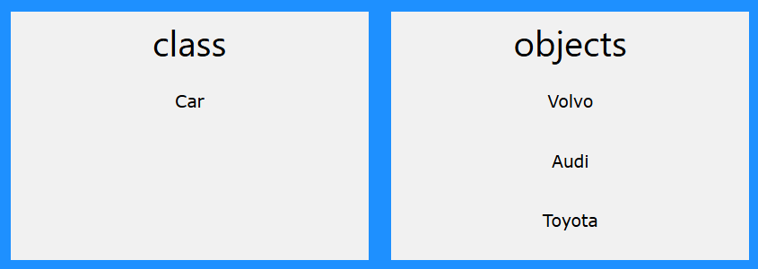
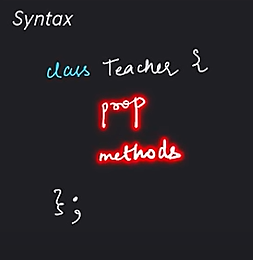
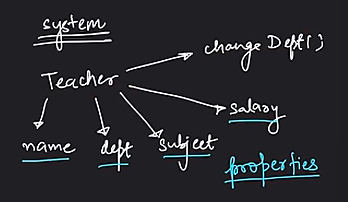
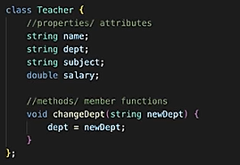
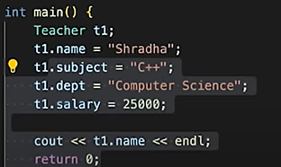

# 3.1.1 Classes & Objects

OOP stands for Object-Oriented Programming.

**Object Oriented vs Procedural Programming:**

Procedural programming is about writing procedures or functions that perform operations on the data, while object-oriented programming is about creating objects that contain both data and functions.

Object-oriented programming has several advantages over procedural programming:

  - OOP is faster and easier to execute

  - OOP provides a clear structure for the programs

  - OOP helps to keep the C++ code DRY "Don't Repeat Yourself", and makes the code easier to maintain, modify and debug

  - OOP makes it possible to create full reusable applications with less code and shorter development time

  - Code reusability increase through OOPs and avoid duplicate variables. Class allows blueprinting, and then various objects can created using class.

"Don't Repeat Yourself" (DRY) principle is about reducing the repetition of code. You should extract out the codes that are common for the application, and place them at a single place and reuse them instead of repeating it.

*What is object-oriented programming (OOPs)?*

*Object-Oriented Programming (OOP) is a programming paradigm that organizes code into objects, which are instances of classes. It focuses on encapsulating data and behavior together, promoting modularity and reusability.*

**Classes & Objects: **

Objects are entities in the real world. Class is like a blueprint of these entities. A class is a template for objects, and an object is an instance of a class.

A class is a user-defined data type that we can use in our program, and it works as an object constructor, or a "blueprint" for creating objects.

When the individual objects are created, they inherit all the variables (attributes) and functions (methods) from the class.

Attributes and methods are basically variables and functions that belongs to the class. These are often referred to as "class members".

Example of class:

**class Teacher {  // Class name can be kept as entity name.  **

**Properties (name, dept, salary)- Attributes**

**Functions (change_dept()) - Methods**

**};**

**Create a Class**

Define Class:

When variables are declared within a class, they are called **attributes**.

To create a class, use the class keyword.

At last, end the class definition with a semicolon ;

Create Objects:

To create an object from a class, specify the class name, followed by the object name.

To access the class attributes, use the dot syntax (.) on the object.

Multiple Objects:

You can create multiple objects of one class

class_name Obj1;

class_name Obj2;

Read about "access specifiers/modifiers" next. By default, all class members are private.

**Class Methods: **

Methods are functions that belongs to the class. We can access methods just like you access attributes; by creating an object of the class and using the dot syntax (.)

There are two ways to define functions that belongs to a class:

  1. Inside class definition

**class MyClass {        // The class**

**  public:              // Access specifier**

**    void myMethod() {  // Method/function defined inside the class**

**      cout << "Hello World!";**

**    }**

**};**

**int main() {**

**  MyClass myObj;     // Create an object of MyClass**

**  myObj.myMethod();  // Call the method**

**  return 0;**

**}**

  1. Outside class definition

To define a function outside the class definition, you have to declare it inside the class and then define it outside of the class. This is done by specifiying the name of the class, followed the** scope resolution :: operator**, followed by the name of the function:

**class MyClass {        // The class**

**  public:              // Access specifier**

**    void myMethod();   // Method/function declaration**

**};**

**// Method/function definition outside the class**

**void MyClass::myMethod() {**

**  cout << "Hello World!";**

**}**

**int main() {**

**  MyClass myObj;     // Create an object of MyClass**

**  myObj.myMethod();  // Call the method**

**  return 0;**

**}**
