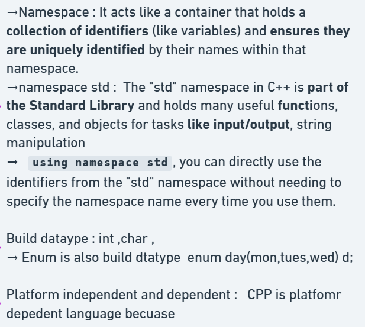

# 3.1.3 Namespaces

A namespace is a declarative region that provides a scope to the identifiers (the names of types, functions, variables, etc) inside it. Namespaces are used to organize code into logical groups and to prevent name collisions that can occur especially when your code base includes multiple libraries.

https://www.w3schools.com/cpp/cpp_enum.asp

All identifiers at namespace scope are visible to one another without qualification. Identifiers outside the namespace can access the members by using the fully qualified name for each identifier, for example std::vector<std::string> vec;, or else by a using Declaration for a single identifier (using std::string), or a using Directive for all the identifiers in the namespace (using namespace std;). Code in header files should always use the fully qualified namespace name.
