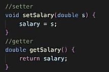
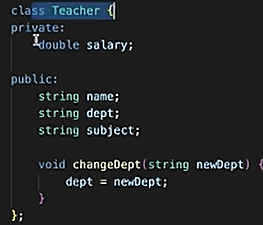

# 3.1.4 Access Specifiers/Modifiers

Access Specifiers/Modifiers:

  1. **private (default) -  data & methods accessible inside class **

members cannot be accessed (or viewed) from outside the class

By default, all members of a class are private if you don't specify an access specifier:

class MyClass {

int x;   // Private attribute

int y;   // Private attribute

};

It is possible to access private members of a class using a **public method** inside the same class. To access private attributes, we can make **getter and setter functions**.

It is considered good practice to declare your class attributes as private (as often as you can). This will reduce the possibility of yourself (or others) to mess up the code. **(encapsulation)**

  1. **public - data & methods accessible to everyone **

The public keyword is an access specifier. Access specifiers define how the members (attributes and methods) of a class can be accessed.

The public keyword specifies that members (attributes and methods) of the class are accessible from outside the class.

  1. **protected - data & methods accessible inside class & to its derived class **

members cannot be accessed from outside the class, however, they can be accessed in inherited classes. (See inheritance for more.)

Protected concept during inheritance.
