# 3.1.5 Constructor

CONSTRUCTORS

Special method invoked automatically at time of object creation. Used for Initialisation of data members of new objects. It constructs the values i.e. provides data for the object which is why it is known as a constructor.

Properties of constructor:

• Same name as class  and it is always (?) public.

Constructor is always defined as public, and never private. Because an automatic call from main() is done to constructor and main() can't access private members of any class.

*Constructors are mostly declared in the public section of the class though they can be declared in the private section of the class. If we declare a constructor as private we are not able to create an object of a class. We can use this private constructor in the Singleton Design Pattern.*

• Constructor doesn't have a **return type** and hence do not return any values.

• Only called once (automatically), at object creation

• Memory allocation happens when constructor is called

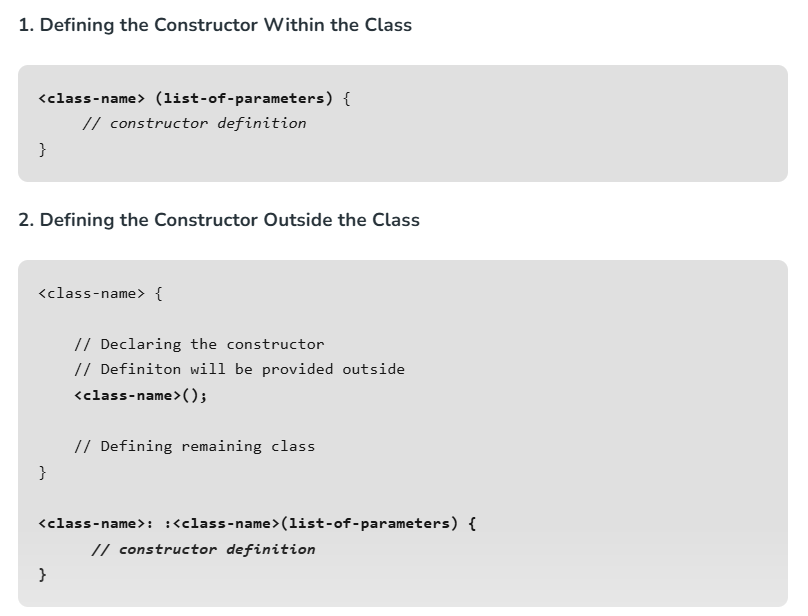

  - Just like functions, constructors can also be defined outside the class. First, declare the constructor inside the class, and then define it outside of the class by specifying the name of the class, followed by the **scope resolution :: operator**, followed by the name of the constructor (which is the same as the class):

// Constructor definition outside the class

Teacher :: Teacher(string n, string d, string s, double sal){

name = n;

dept = d;

subject = s;

salary = sal;

}

  - If we do not specifically define a constructor, then C++ does it by itself. To create a constructor, use the same name as the class, followed by parentheses ():

**class MyClass {     // The class**

**  public:           // Access specifier**

**    int x;**

**    MyClass() {     // Constructor**

**      cout << "Hi, I am constructor!";**

**      x = 9; **

**    }**

**};**

**int main() {**

**  MyClass myObj;    // Create an object of MyClass (this will call the constructor)**

**  return 0;**

**}**

Class forming doesn't require any space. Object creation, constructor call, then memory allocation happen.

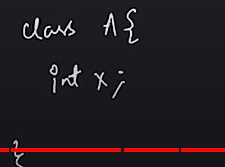

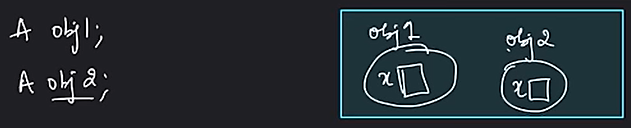

The reason for this minimum size of 1 byte is to ensure that each instance of a class has a unique address in memory.

TYPES OF CONSTRUCTORS

There are 4 types of constructors in C++:

  1. Non-parameterised Constructor/Default Constructor:

  - No parameters. They are used to create an object with default values.

  - A default constructor is a constructor that doesn’t take any argument. It has no parameters. It is also called a zero-argument constructor.

  - The compiler automatically creates an implicit default constructor if the programmer does not define one.

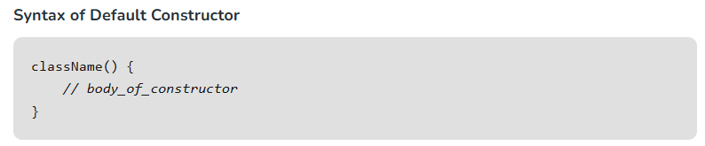

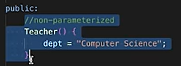

No, the C++ compiler doesn’t create a default constructor when we initialize our own, the compiler by default creates a default constructor for every class; But, if we define our own constructor, the compiler doesn’t create the default constructor, but it calls the constructor implicitly.

This is so because the default constructor does not take any argument and if two default constructors are created, it is difficult for the compiler which default constructor should be called.

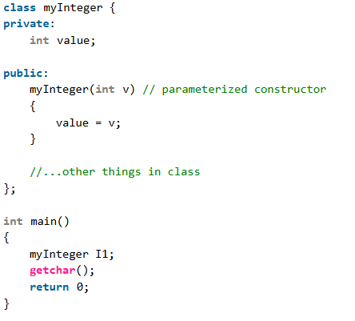

fails with the error “no matching function for call to `myInteger::myInteger()’

Here we did not instantiate the object with the suitable call of constructor so C++ couldnt find the constructor without any arguments.

  1. Parametrized constructor:

  - Constructors can also take parameters (just like regular functions), which can be useful for setting initial values for attributes.

  - Takes parameters. Used to create an object with specific initial values.

  - The teacher class has name, dept, subject, salary attributes and constructor with diff parameters. Inside the constructor we set the attributes equal to the constructor parameters.

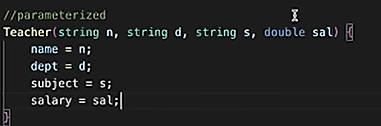

  - When we call the constructor (by creating an object of the class), we pass parameters to the constructor, which will set the value of the corresponding attributes to the same:

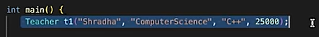

**CONSTRUCTOR OVERLOADING**

Same class can have multiple constructors given that the parameters of both the constructors are different. This is called Constructor Overloading. Eg. of polymorphism.

**THIS POINTER **

NOTE: this pointer

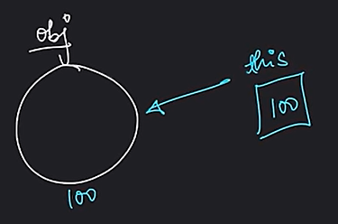

\*this = obj

obj.prop = \*(this).prop

this->prop  == \*(this).prop

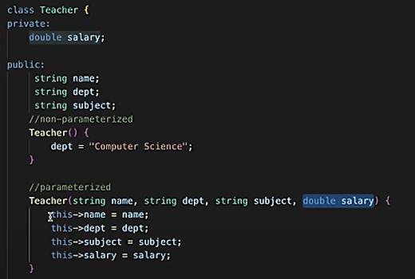

  1. Copy Constructor :

A copy constructor is a member function that initializes an object using another object of the same class. Used to create a copy of an object.

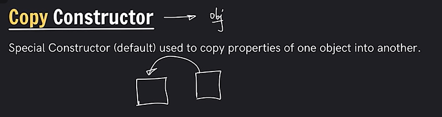

SYNTAX:

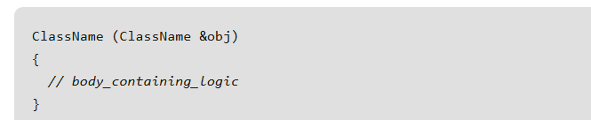

Teacher t2(const Teacher &) ;

Teacher t2(t1);

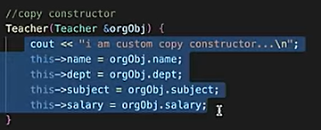

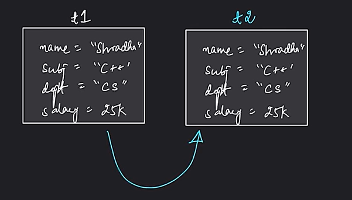

  1. Move constructor:

Takes an rvalue reference to another object. Transfers resources from a temporary object.

**SEE: SHALLOW, DEEP COPY**

What is a constructor chaining?

Constructor chaining is the process of calling one constructor from another within the same class or between a superclass and a subclass. It allows for code reuse and efficient initialization.

Q 5. What is a constructor?

A constructor is a special method that is automatically called when an object is created. It initializes the object’s attributes and prepares the object for use. Constructors often have the same name as the class.

Q 6. What is method overloading?

Method overloading is the ability to define multiple methods in a class with the same name but different parameter lists. The methods are differentiated based on the number or types of parameters they accept.

**What Are the Functions That Are Generated by the Compiler by Default, If We Do Not Provide Them Explicitly?**

*The functions that are generated by the compiler by default if we do not provide them explicitly are:*

  1. *Default Constructor*

  1. *Copy Constructor*

  1. *Move Constructors*

  1. *Assignment Operator*

  1. *Destructor*

**Can We Make the Constructors Private?**

*Yes, in C++, constructors can be made private. This means that no external code can directly create an object of that class. SINGLETON*

**Can We Have More Than One Constructor in a Class?**

*Yes, we can have more than one constructor in a class. It is called* [Constructor Overloading](<https://www.geeksforgeeks.org/constructor-overloading-c/>)*.*
