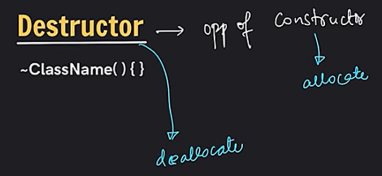
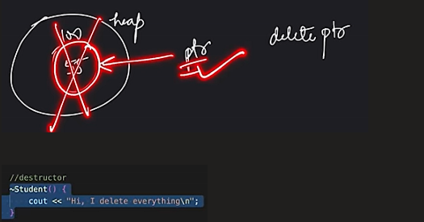
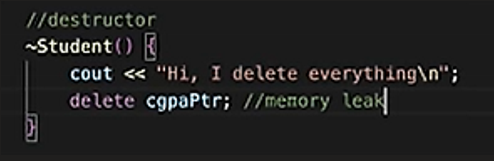

# 3.1.6 Destructor

DESTRUCTOR

Automatically made by compiler if we do not make.

It deallocates only statically allocated memory.

Dynamically allocated memory "new" needs to be removed dynamically "delete"

Destructor automatically invoked when object goes out of scope.

for dynamic memory:

What is the role of a destructor in C++?

In C++ , a destructor is a special method with the same name as the class, preceded by a tilde (~). It is called when an object is about to be destroyed, allowing for cleanup tasks such as releasing resources or memory.
