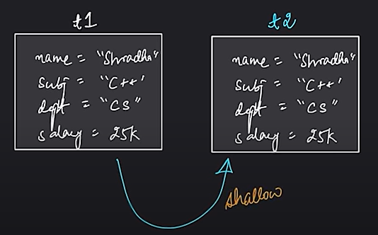
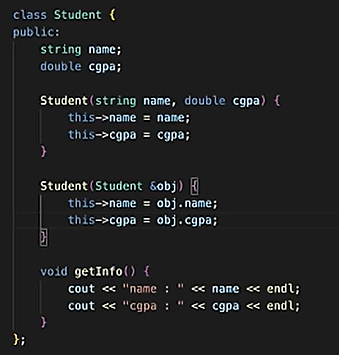
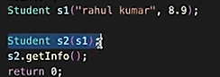
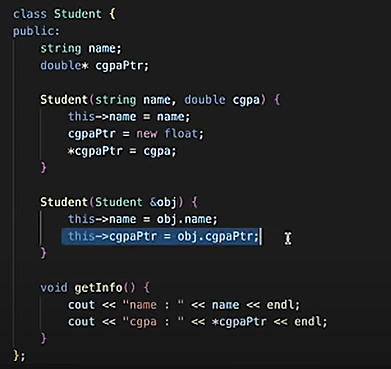
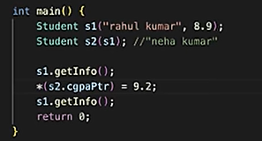
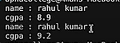
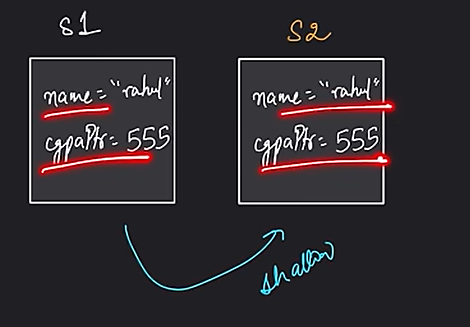
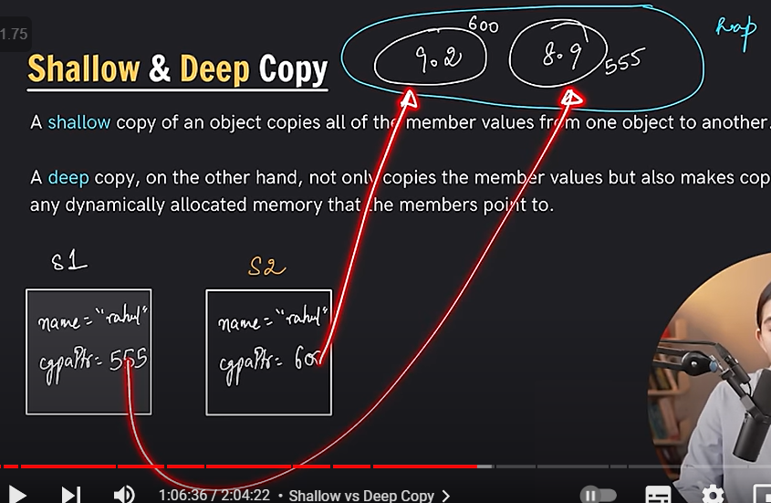
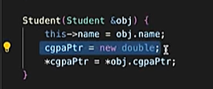

# 3.1.7 Shallow Copy/Deep Copy

Two types of copies in C++:

  1. Shallow Copy:

Default copy constructor and custom made copy constructor above, all do shallow copy.

Issue:

Static memory allocation -- in stack -- compile time

Dynamic memory allocation -- in heap -- during runtime

This works fine, but:

Both s1 and s2 pointers are pointing to same location, so any change in location 555, will make changes in cgpa of both. Shallow copy poses this problem in both default and self-defined copy constructor.

  1. Deep Copy:

There's no default constructor for deep copy. We have to write it ourselves.

What is a shallow copy and a deep copy?

A shallow copy copies the references of objects contained within an object, while a deep copy creates new instances of the objects contained.

A deep copy results in a completely independent copy of the original object and its contained objects.
