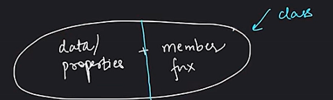
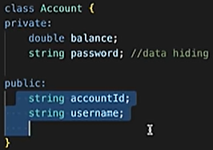
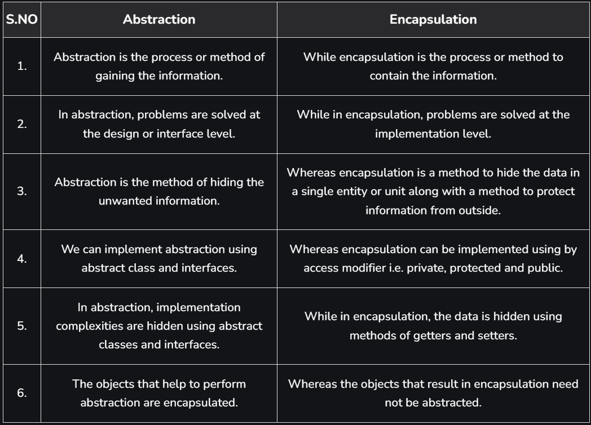

# 3.2.2 Encapsulation

**Encapsulation **

Encapsulation is wrapping up of data & member functions (that manipulate the data) in a single unit called class.

Data hiding = make them private.

The meaning of Encapsulation, is to make sure that "sensitive" data is hidden from users. To achieve this, you must declare class variables/attributes as private (cannot be accessed from outside the class). If you want others to read or modify the value of a private member, you can provide public get and set methods.

Class banayi tabhi access modifiers use kar paaye, and access modifiers use kiye tabhi data chhupa paaye

Access Private Members

To access a private attribute, use public "get" and "set" methods:

class Employee {

private:

// Private attribute

int salary;

public:

// Setter

void setSalary(int s) {

salary = s;

}

// Getter

int getSalary() {

return salary;

}

};

int main() {

Employee myObj;

myObj.setSalary(50000);

cout << myObj.getSalary();

return 0;

}

**Property of Encapsulation: **

**Data Protection:**Encapsulation protects the internal state of an object by keeping its data members private. Access to and modification of these data members is restricted to the class’s public methods, ensuring controlled and secure data manipulation.

**Information Hiding:**Encapsulation hides the internal implementation details of a class from external code. Only the public interface of the class is accessible, providing abstraction and simplifying the usage of the class while allowing the internal implementation to be modified without impacting external code.

**Features of Encapsulation:**

We can not access any function from the class directly. We need an object to access that function that is using the member variables of that class.

The function which we are making inside the class must use only member variables, only then it is called encapsulation.

If we don’t make a function inside the class which is using the member variable of the class then we don’t call it encapsulation.

Encapsulation improves readability, maintainability, and security by grouping data and methods together.

It helps to control the modification of our data members.

**Encapsulation also leads to data abstraction.**

**Encapsulation can be implemented using classes and access modifiers.**

**Why Encapsulation?**

It is considered good practice to declare your class attributes as private (as often as you can). Encapsulation ensures better control of your data, because you (or others) can change one part of the code without affecting other parts.

Increased security of data

How is encapsulation related to data hiding?

Encapsulation involves bundling data and methods together. Data hiding is the practice of making the internal data of an object inaccessible to the outside world, except through well-defined methods. Encapsulation helps achieve data hiding.

What is encapsulation?

Encapsulation is the concept of bundling data (attributes) and methods (functions) that operate on that data into a single unit (class). It hides the internal details of an object and provides controlled access through methods.

Difference between Abstraction and Encapsulation:

