# 3.2.3 Inheritance

When properties & member functions of base class are passed on to the derived class. For code reusability. It is useful for code reusability: reuse attributes and methods of an existing class when you create a new class.

**Definition:**The capability of a class to derive properties and characteristics from another class is called Inheritance.

In C++, it is possible to inherit **both attributes and methods** from one class to another. We group the "inheritance concept" into two categories:

derived class (child) - the class that inherits from another class

base class (parent) - the class being inherited from

To inherit from a class, use the : symbol.

**Inheritance Logic:**

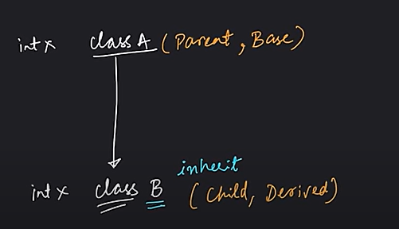

**Syntax: **

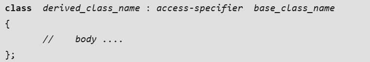

where,

derived_class_name: name of the new class, which will inherit the base class

**access-specifier:**Specifies the access mode which can be either of private, public or protected. If neither is specified, private is taken as default.

class ABC : private XYZ {...}        //  private derivation

class ABC : public XYZ {...}         //  public derivation

class ABC : protected XYZ {...}      //  protected derivation

class ABC: XYZ {...}                 //  private derivation by default

Example:

Parent Class -

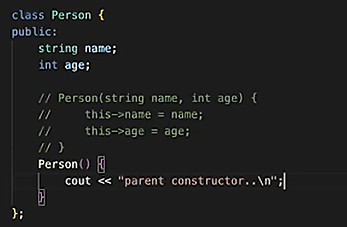

Child Class - (public => mode of inheritance )

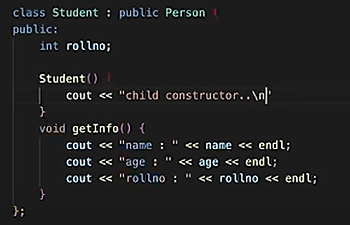

**Constructor & Destructor:**

  - Whenever we make object of derived class, then first constructor of base class is called and then the constructor of derived class is called.

  - In destructor, whenever an object goes out of scope, then child class memory is deallocated first and then parent class memory. So child destructor is called before parent destructor.

  - For parameterized constructor:

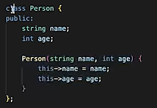

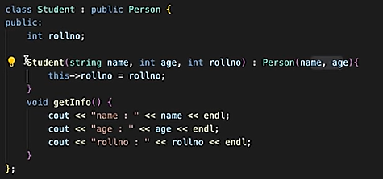

In the above example, we have accessed the public members of the base class in the derived class but we cannot access all the base class members directly in the derived class. It depends on the mode of inheritance and the access specifier in the base class.

**Modes of Inheritance: **

Mode of inheritance controls the access level of the inherited members of the base class in the derived class.

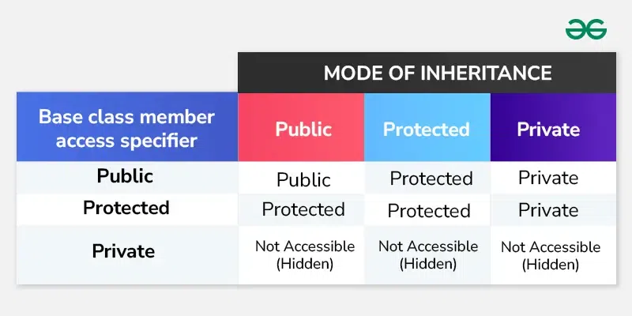

**Public Inheritance Mode**

If we derive a subclass from a public base class. Then the public member of the base class will become public in the derived class and protected members of the base class will become protected in the derived class.

Example:

class ABC : public XYZ {...}              //  public derivation

**Protected Inheritance Mode**

If we derive a subclass from a Protected base class. Then both public members and protected members of the base class will become protected in the derived class.

Example:

class ABC : protected XYZ {...}       //  protected derivation

**Private Inheritance Mode**

If we derive a subclass from a Private base class. Then both public members and protected members of the base class will become private in the derived class. They can only be accessed by the member functions of the derived class. Private mode is the default mode that is applied when we don’t specify any mode.

Note:

**Private members of base class are never inherited in any mode of inheritance. ****The private members in the base class cannot be directly accessed in the derived class, while protected and public members can be directly accessed. To access or update the private members of the base class in derived class:**

  - **we have to use the corresponding getter and setter functions of the base class or**

class Base {

private:

int privateVar;

public:

Base(int val): privateVar(val){}

int getPrivateVar() const { return privateVar; }

void setPrivateVar(int val) { privateVar = val; }

};

// Derived class

class Derived : public Base {

public:

Derived(int val) : Base(val){}

void displayPrivateVar()

{

cout << "Value of privateVar in Base class: "<< getPrivateVar() << endl;

}

void modifyPrivateVar(int val)

{

setPrivateVar(val);

}

};

int main()

{

Derived obj(10);

obj.displayPrivateVar();

obj.modifyPrivateVar(20);

obj.displayPrivateVar();

return 0;

}

Value of privateVar in Base class: 10

Value of privateVar in Base class: 20

The above program shows the method in which the private members of the base class remain encapsulated and are only accessible through controlled public or protected member functions.

  - ** declare the derived class as friend class.**

// Forward declaration of the Derived class

class Derived;

// Base class

class Base {

private:

int privateVar;

public:

Base(int val)

: privateVar(val)

{

}

// Declare Derived class as a friend

friend class Derived;

};

// Derived class

class Derived {

public:

void displayPrivateVar(Base& obj)

{

cout << "Value of privateVar in Base class: "

<< obj.privateVar << endl;

}

void modifyPrivateVar(Base& obj, int val)

{

obj.privateVar = val;

}

};

int main()

{

Base baseObj(10);

Derived derivedObj;

derivedObj.displayPrivateVar(baseObj);

derivedObj.modifyPrivateVar(baseObj, 20);

derivedObj.displayPrivateVar(baseObj);

return 0;

}

**NOTE:**

  - Public members are always inherited. In private mode, the public properties of base class becomes the private properties of the derived class and hence can't be accessed directly.

  - Protected properties are those private properties which are there to be inherited and no other use.

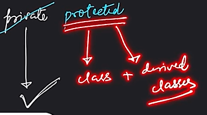

**TYPES OF INHERITANCE:**

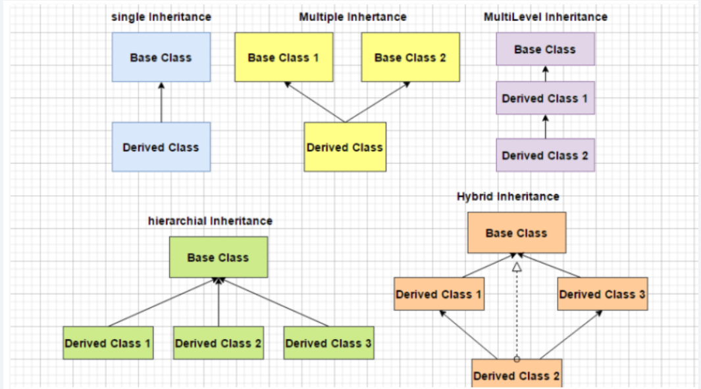

  1. Single Inheritance:

In single inheritance, a class is allowed to inherit from only one class. i.e. one base class is inherited by one derived class only.

class subclass_name : access_mode base_class

{

//  body of subclass

};

class A

{

... .. ...

};

class B: public A

{

... .. ...

};

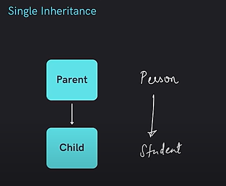

  1. Multi - Level Inheritance:

In this type of inheritance, a derived class is created from another derived class and that derived class can be derived from a base class or any other derived class. There can be any number of levels.

class derived_class1: access_specifier base_class

{

... .. ...

}

class derived_class2: access_specifier derived_class1

{

... .. ...

}

.....

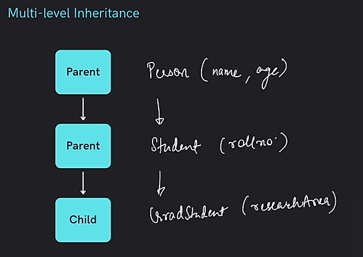

// C++ program to implement Multilevel Inheritance

#include <iostream>

using namespace std;

// base class

class Vehicle {

public:

Vehicle() { cout << "This is a Vehicle\\n"; }

};

// first sub_class derived from class vehicle

class fourWheeler : public Vehicle {

public:

fourWheeler() { cout << "4 Wheeler Vehicles\\n"; }

};

// sub class derived from the derived base class fourWheeler

class Car : public fourWheeler {

public:

Car() { cout << "This 4 Wheeler Vehical is a Car\\n"; }

};

// main function

int main()

{

// Creating object of sub class will

// invoke the constructor of base classes.

Car obj;

return 0;

}

This is a Vehicle

4 Wheeler Vehicles

This 4 Wheeler Vehical is a Car

  1. Multiple Inheritance

Multiple Inheritance is a feature of C++ where a class can inherit from more than one class. i.e one subclass is inherited from more than one base class. The constructors of inherited classes are called in the same order in which they are inherited.  The destructors are called in reverse order of constructors.

class C: public A,public B

{

... ... ... // Constructor called A then B then C

};

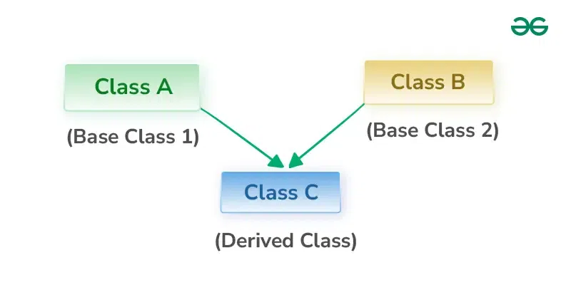

class subclass_name : access_mode base_class1, access_mode base_class2, ....

{

// body of subclass

};

Here, the number of base classes will be separated by a comma (‘, ‘) and the access mode for every base class must be specified and can be different.

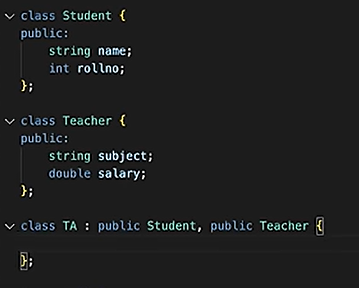

See DIAMOND PROBLEM = VERY IMPORTANT

  1. Hierarchial Inheritance:

In Hierarchical inheritance, more than one sub-class inherits the property of a single base class. There is one base class and multiple derived classes. Several other classes inherit the derived classes as well. Hierarchical structures thus form a tree-like structure.

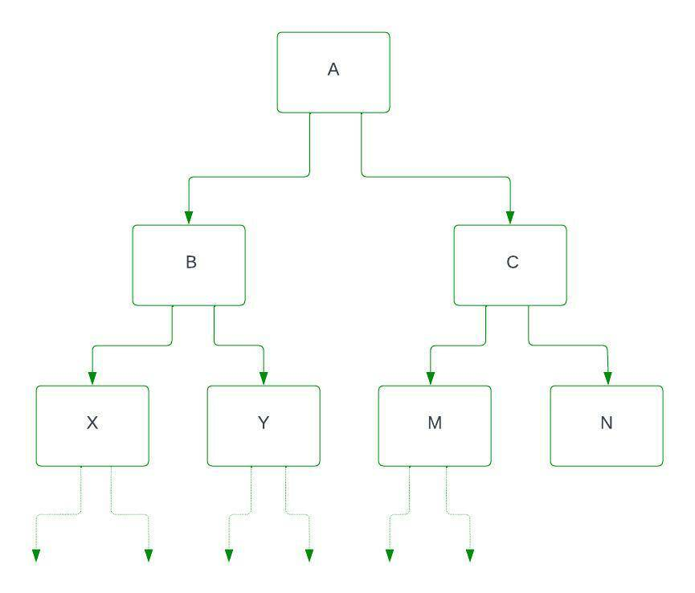

Here X and Y are sub-class (child class) that inherits property from class B, and M and N are sub-class (child class) that inherits property from class C. B is the parent class (superclass) of X and Y, and C is the parent class of M and N. access_specifier provides the visibility mode in the class declaration. By inheriting from the base class, the derived class inherits the members of the base class.

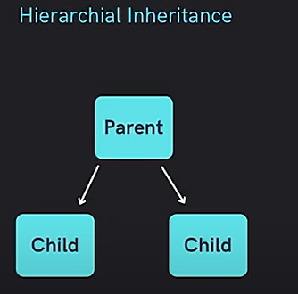

class derived_class1: access_specifier base_class

{

... .. ...

}

class derived_class2: access_specifier base_class

{

... .. ...

}

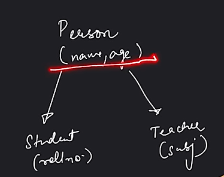

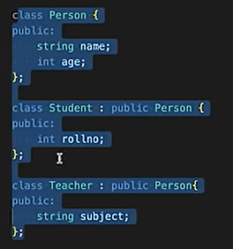

// base class

class Vehicle {

public:

Vehicle() { cout << "This is a Vehicle\\n"; }

};

// first sub class

class Car : public Vehicle {

public:

Car() { cout << "This Vehicle is Car\\n"; }

};

// second sub class

class Bus : public Vehicle {

public:

Bus() { cout << "This Vehicle is Bus\\n"; }

};

// main function

int main()

{

// Creating object of sub class will

// invoke the constructor of base class.

Car obj1;

Bus obj2;

return 0;

}

This is a Vehicle

This Vehicle is Car

This is a Vehicle

This Vehicle is Bus

  1. Hybrid Ineritance:

In Hybrid Inheritance, multiple types of inheritance are combined within a single class hierarchy, enabling a varied and flexible structure of classes. In hybrid inheritance, within the same class, we can have elements of single inheritance, multiple inheritance, multilevel inheritance, and hierarchical inheritance.

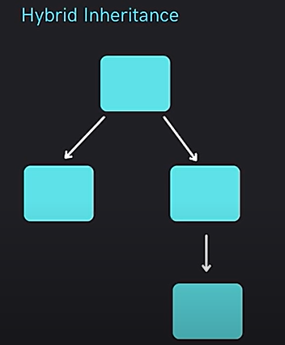

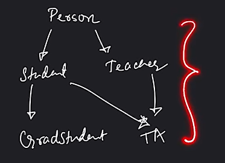

A Special Case of Hybrid Inheritance: Multipath Inheritance

In multipath inheritance, a class is derived from two base classes and these two base classes in turn are derived from one common base class. An ambiguity can arise in this type of inheritance in the most derived class. This problem is also called diamond problem due to the diamond shape formed in the UML inheritance diagram. The major goal of hybrid inheritance is to enhance code reusability by making it simpler for programmers to use the methods and attributes that are already present in other classes.

Hybrid Inheritance also poses some difficulties, like the possibility of ambiguity or inconsistencies between inherited attributes and methods. While implementing hybrid inheritance, careful design and a thorough understanding of the principles of programming languages are essential to ensure that it achieves its goals successfully and without introducing any unnecessary complications.

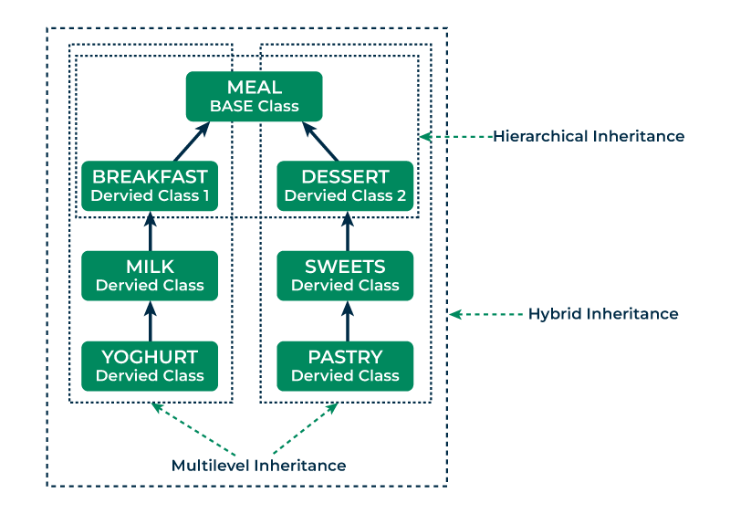

**Constructors and Destructors in Inheritance:**

Constructors and Destructors are generally defined by the programmer and if not, the compiler automatically creates them so they are present in every class in C++. Now, the question arises what happens to the constructor and destructor when a class is inherited by another class.

In C++ inheritance, the constructors and destructors are not inherited by the derived class, but we can call the constructor of the base class in derived class.

The constructors will be called by the complier in the order in which they are inherited. It means that base class constructors will be called first, then derived class constructors will be called.

The destructors will be called in reverse order in which the compiler is declared.

We can also call the constructors and destructors manually in the derived class

https://www.geeksforgeeks.org/order-constructor-destructor-call-c/

Interview Questions :

[What is a diamond problem in Object-Oriented Programming? (educative.io)](<https://www.educative.io/answers/what-is-a-diamond-problem-in-object-oriented-programming>)

What is inheritance?

Inheritance is a mechanism where a new class (subclass or derived class) inherits properties and behaviors from an existing class (superclass or base class). It promotes code reuse and supports hierarchical relationships.

What is the difference between composition and inheritance?

Inheritance creates a relationship between a subclass and a superclass, allowing the subclass to inherit properties and methods.

Composition involves creating an object within another object to achieve complex behavior without the tight coupling of inheritance.

**What is the diamond problem in multiple inheritance?**

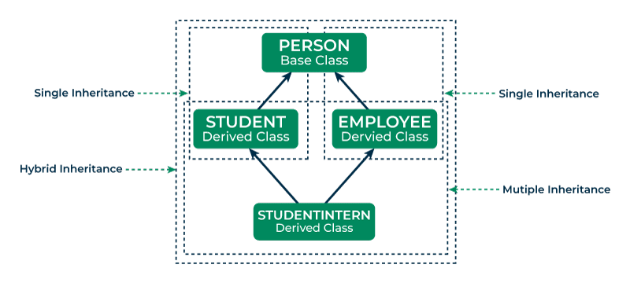

The diamond problem occurs in languages that support multiple inheritance, where a class inherits from two classes that have a common base class. This can lead to ambiguity in method resolution. Some languages provide mechanisms to handle this, like **virtual inheritance.**

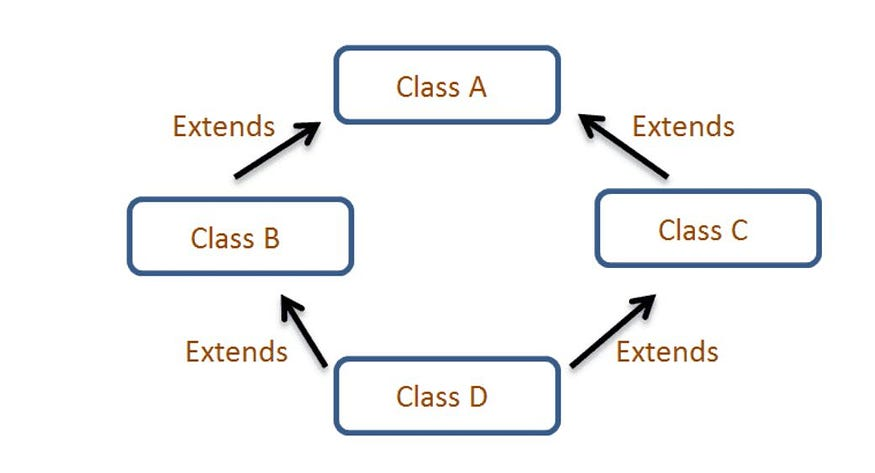

The diamond problem The diamond problem occurs when two superclasses of a class have a common base class. For example, in the following diagram, the TA class gets two copies of all attributes of Person class, this causes ambiguities.

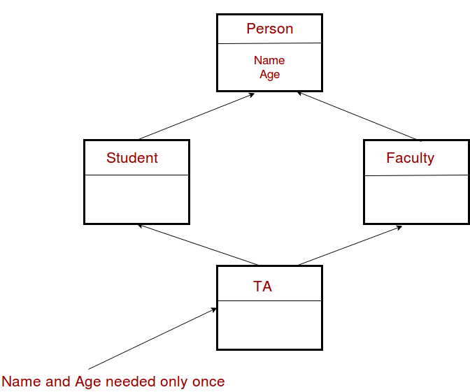

class Person {

// Data members of person

public:

Person(int x)  { cout << "Person::Person(int ) called" << endl;   }

};

class Faculty : public Person {

// data members of Faculty

public:

Faculty(int x):Person(x)   {

cout<<"Faculty::Faculty(int ) called"<< endl;

}

};

class Student : public Person {

// data members of Student

public:

Student(int x):Person(x) {

cout<<"Student::Student(int ) called"<< endl;

}

};

class TA : public Faculty, public Student  {

public:

TA(int x):Student(x), Faculty(x)   {

cout<<"TA::TA(int ) called"<< endl;

}

};

int main()  {

TA ta1(30);

}

Person::Person(int ) called

Faculty::Faculty(int ) called

Person::Person(int ) called

Student::Student(int ) called

TA::TA(int ) called

In the above program, constructor of ‘Person’ is called two times. Destructor of ‘Person’ will also be called two times when object ‘ta1’ is destructed. So object ‘ta1’ has two copies of all members of ‘Person’, this causes ambiguities. The solution to this problem is ‘virtual’ keyword. We make the classes ‘Faculty’ and ‘Student’ as virtual base classes to avoid two copies of ‘Person’ in ‘TA’ class.

#include<iostream>

using namespace std;

class Person {

public:

// parameterised constructor

Person(int x)  { cout << "Person::Person(int ) called" << endl;   }

// default constructor

Person()     { cout << "Person::Person() called" << endl;   }

};

class Faculty : virtual public Person {

public:

Faculty(int x):Person(x)   {

cout<<"Faculty::Faculty(int ) called"<< endl;

}

};

class Student : virtual public Person {

public:

Student(int x):Person(x) {

cout<<"Student::Student(int ) called"<< endl;

}

};

class TA : public Faculty, public Student  {

public:

TA(int x):Student(x), Faculty(x)   {

cout<<"TA::TA(int ) called"<< endl;

}

};

int main()  {

TA ta1(30);

}

Output:

Person::Person() called

Faculty::Faculty(int ) called

Student::Student(int ) called

TA::TA(int ) called

In the above program, constructor of ‘Person’ is called once. One important thing to note in the above output is, the default constructor of ‘Person’ is called. When we use ‘virtual’ keyword, the default constructor of grandparent class is called by default even if the parent classes explicitly call parameterized constructor.

How to call the parameterized constructor of the ‘Person’ class? The constructor has to be called in ‘TA’ class.

**class Person {**

**public:**

**    Person(int x)  { cout << "Person::Person(int ) called" << endl;   }**

**    Person()     { cout << "Person::Person() called" << endl;   }**

**};**

**class Faculty : virtual public Person {**

**public:**

**    Faculty(int x):Person(x)   {**

**       cout<<"Faculty::Faculty(int ) called"<< endl;**

**    }**

**};**

**class Student : virtual public Person {**

**public:**

**    Student(int x):Person(x) {**

**        cout<<"Student::Student(int ) called"<< endl;**

**    }**

**};**

**class TA : public Faculty, public Student  {**

**public:**

**    TA(int x):Student(x), Faculty(x), Person(x)   {**

**        cout<<"TA::TA(int ) called"<< endl;**

**    }**

**};**

**int main()  {**

**    TA ta1(30);**

**}**

**Output:**

**Person::Person(int ) called**

**Faculty::Faculty(int ) called**

**Student::Student(int ) called**

**TA::TA(int ) called**

In general, it is not allowed to call the grandparent’s constructor directly, it has to be called through parent class. It is allowed only when ‘virtual’ keyword is used.

Can the derived class inherit static members?

Yes, a derived class can inherit static members (such as static variables or static functions) from the base class. However, these members are shared across all instances of the derived class.

What are a base class and a derived class?

A base class (also called a superclass) is an existing class from which other classes inherit properties and methods. A derived class (also called a subclass) is a new class created by inheriting from the base class.

What are the rules for calling a base class constructor in a derived class?

The base class constructor can be explicitly called in the initializer list of the derived class constructor. If not specified, the default constructor of the base class is called automatically. If the base class does not have a default constructor, the derived class must explicitly call one of the base class’s constructors.

https://www.geeksforgeeks.org/does-overloading-work-with-inheritance/?ref=lbp

https://www.geeksforgeeks.org/inheritance-and-friendship-in-cpp/?ref=lbp

https://www.geeksforgeeks.org/constructor-in-multiple-inheritance-in-cpp/?ref=lbp
