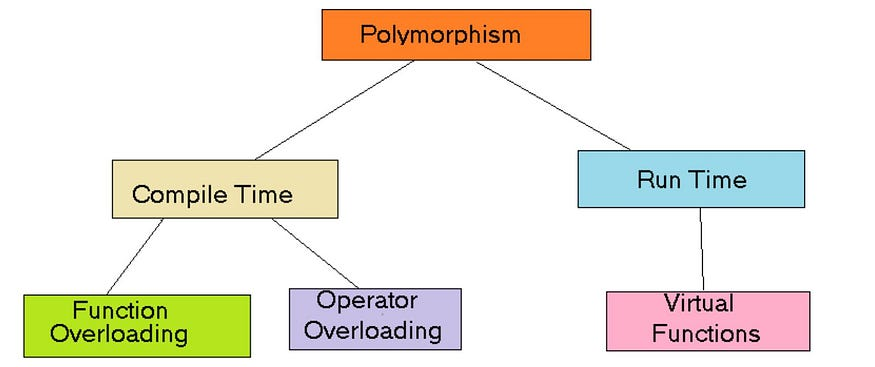
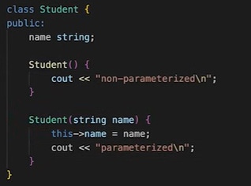
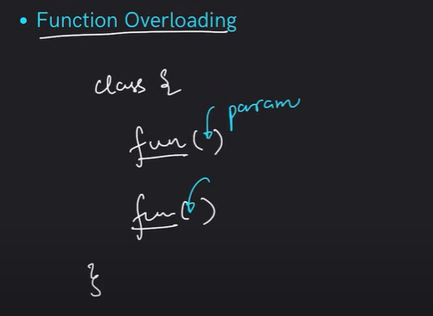
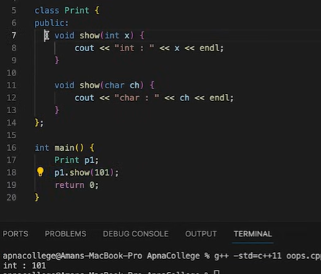
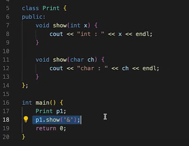
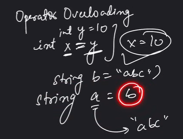
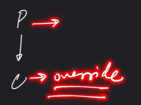
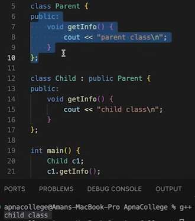
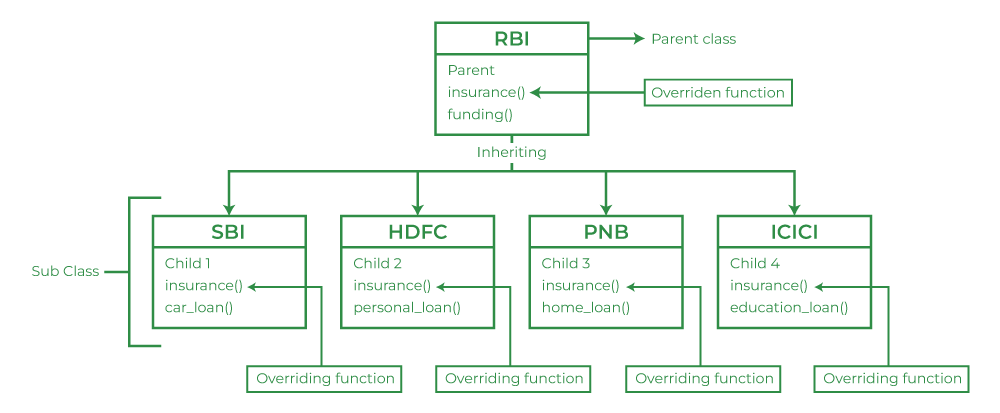
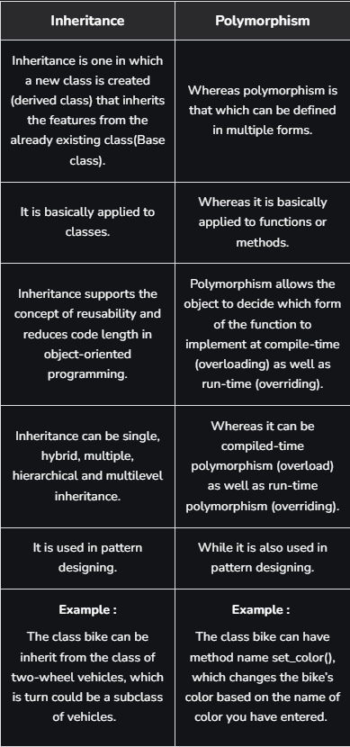

# 3.2.4 Polymorphism

  - Polymorphism means "many/multiple forms", and it occurs when we have many classes that are related to each other by inheritance.

  - Polymorphism is the ability of objects to take on different forms or behave in different  ways depending on the context in which they are used.

  - Polymorphism uses inherited methods from other class to perform different tasks. This allows us to perform a single action in different ways.

  - Why And When To Use "Inheritance" and "Polymorphism"?

It is useful for code reusability: reuse attributes and methods of an existing class when you create a new class.

eg: A real-life example of polymorphism is a person who at the same time can have different characteristics. A man at the same time is a father, a husband, and an employee. So the same person exhibits different behavior in different situations.

Eg: Constructor overloading (compile time polymorphism)

Depending upon the context, parametrized or non-parametrized constructor will be called.

• Compile Time Polymorphism

• Run Time Polymorphism

TYPES OF POLYMORPHISM =

Compile time polymorphism: (statically, method overloading)

  1. Function overloading -

When there are multiple functions with the same name but different parameters, then the functions are said to be overloaded, hence this is known as Function Overloading.

Functions can be overloaded by changing the number of arguments or/and changing the type of arguments.

return type may be same of different, but parameters should differ

  1. Operator Overloading

C++ has the ability to provide the operators with a special meaning for a data type, this ability is known as operator overloading. For example, we can make use of the addition operator (+) for string class to concatenate two strings. We know that the task of this operator is to add two operands. So a single operator ‘+’, when placed between integer operands, adds them and when placed between string operands, concatenates them.

class Complex {

private:

int real, imag;

public:

Complex(int r = 0, int i = 0)

{

real = r;

imag = i;

}

// This is automatically called

// when '+' is used with between

// two Complex objects

Complex operator+(Complex const& obj)

{

Complex res;

res.real = real + obj.real;

res.imag = imag + obj.imag;

return res;

}

void print() { cout << real << " + i" << imag << endl; }

};

// Driver code

int main()

{

Complex c1(10, 5), c2(2, 4);

// An example call to "operator+"

Complex c3 = c1 + c2;

c3.print();

}

12 + i9

RUN TIME Polymorphism (Dynamic, Method overriding):

This type of polymorphism is achieved by **Function Overriding**. Late binding and dynamic polymorphism are other names for runtime polymorphism.

The function call is resolved at runtime in runtime polymorphism. In contrast, with compile time polymorphism, the compiler determines which function call to bind to the object after deducing it at runtime.

Parent & Child both contain the same function with different implementation.

The parent class function is said to be overridden (Inheritance).

Child class function has higher priority.

  1. Function Overriding

Function overriding in C++ is termed as the redefinition of base class function in its derived class (inherited from base class) with the same signature i.e. return type and parameters. That base class function is said to be overridden. The overridden function in the subclass has the same name, return type, and parameters.

So, when we call the function using its name for the parent object, the parent class function is executed. But when we call the function using the child object, the child class version will be executed.

Real Life Example -

the relationship between RBI(The Reserve Bank of India) and Other state banks like SBI, PNB, ICICI, etc. Where the RBI passes the same regulatory function and others follow it as it is.

**NOTE: Runtime Polymorphism cannot be achieved with Data Members**

Runtime Polymorphism cannot be achieved by data members in C++. Let’s see an example where we are accessing the field by reference variable of parent class which refers to the instance of the derived class.

**// C++ program for function overriding with data members**

**//  base class declaration.**

**class Animal {**

**public:**

**    string color = "Black";**

**};**

**// inheriting Animal class.**

**class Dog : public Animal {**

**public:**

**    string color = "Grey";**

**};**

**// Driver code**

**int main(void)**

**{**

**    Animal d = Dog(); // accessing the field by reference**

**                      // variable which refers to derived**

**    cout << d.color;**

**}**

Output

Black

We can see that the parent class reference will always refer to the data member of the parent class.

Types of Function Overriding in C++

Unlike other languages such as Java where function overriding is strictly done at compile time, C++ supports two types of function overriding:

  - Compile Time Overriding (Not an example of run-time polymorphism)

In compile time function overriding, the function call and the definition is binded at the compilation of the program. Due to this, it is also called early binding or static binding.

class Parent {

access_modifier :

// overridden function

return_type name_of_the_function() {}

};

class child : public Parent {

access_modifier :

// overriding function

return_type name_of_the_function() {}

};

eg:

class Parent {

public:

void GeeksforGeeks_Print()

{

cout << "Base Function" << endl;

}

};

class Child : public Parent {

public:

void GeeksforGeeks_Print()

{

cout << "Derived Function" << endl;

}

};

int main()

{

Child Child_Derived;

Child_Derived.GeeksforGeeks_Print();

return 0;

}

Output

Derived Function

the call to the overridden function is resolved during compile time. It is also called early binding where the function call is binded to its definition during compilation.

the original example without virtual functions is not demonstrating polymorphism

  - Runtime Function Overriding (Virtual Functions)

Function overriding can also be performed at the runtime, which means that function call will be binded to its definition during runtime (also known as late binding or dynamic binding). This can be done with the help of virtual functions.

class Base {

public:

virtual func()

{

// definition

}

};

class Derived : public Base {

public:

func() override

{

// new definition

}

};

Here, override keyword tells the compiler that the given overridden function should be declared as virtual in the parent class. It is a kind of double check as the program can compile without errors even if the function is not virtual. But then, it will be compile time polymorphism and we won’t get the desired behaviour of the function overriding.

  1. Virtual Functions

  - A virtual function is a member function that you expect to be redefined in derived classes. A virtual function is a member function that is declared in the base class using the keyword virtual and is re-defined (Overridden) in the derived class.

  - Virtual functions are Dynamic in nature.

  - Defined by the keyword "virtual" inside a base class and are always declared with a base

class and overridden in a child class.

  - A virtual function is called during Runtime

**// Declaring a Base class**

**class GFG_Base {**

**public:**

**    // virtual function**

**    virtual void display()**

**    {**

**        cout << "Called virtual Base Class function"**

**             << "\\n\\n";**

**    }**

**    void print()**

**    {**

**        cout << "Called GFG_Base print function"**

**             << "\\n\\n";**

**    }**

**};**

**// Declaring a Child Class**

**class GFG_Child : public GFG_Base {**

**public:**

**    void display()**

**    {**

**        cout << "Called GFG_Child Display Function"**

**             << "\\n\\n";**

**    }**

**    void print()**

**    {**

**        cout << "Called GFG_Child print Function"**

**             << "\\n\\n";**

**    }**

**};**

**int main()**

**{**

**    // Create a reference of class GFG_Base**

**    GFG_Base\* base;**

**    GFG_Child child;**

**    base = &child;**

**    // This will call the virtual function, **

**binded at runtime (Runtime polymorphism)**

**    base->display();**

**    // This will call the non-virtual function **

**binded at compile time**

**    base->print();**

**}**

Called GFG_Child Display Function

Called GFG_Base print function

Interview Questions:

What is polymorphism?

Polymorphism allows objects of different classes to be treated as instances of a common superclass. It enables methods to be invoked on objects without knowing their specific types, as long as they adhere to the common interface.

What is a virtual method?

A virtual method is a method declared in a base class that can be overridden by its subclasses. The actual implementation invoked is determined by the runtime type of the object, supporting polymorphism.

What is method hiding?

Method hiding is a concept in object-oriented programming where a subclass defines a method with the same name as a method in its superclass, but the subclass method doesn’t override the superclass method.

Instead, it creates a new, independent method with the same name. This can lead to confusion and unexpected behavior, so it’s generally recommended to use method overriding instead.

Difference between inheritance and polymorphism:

