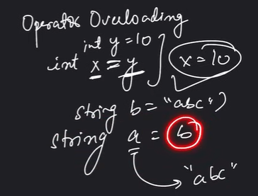

# 3.2.4.1 Compile - Overloading

1. Operator Overloading

C++ has the ability to provide the operators with a special meaning for a data type, this ability is known as operator overloading.

Operator overloading is a compile-time polymorphism. It is an idea of giving special meaning to an existing operator in C++ without changing its original meaning.

For example, we can make use of the addition operator (+) for string class to concatenate two strings. We know that the task of this operator is to add two operands. So a single operator ‘+’, when placed between integer operands, adds them and when placed between string operands, concatenates them.

WHY IS OPERATOR OVERLOADING NEEDED?

*// C++ Program to Demonstrate the *

*// working/Logic behind Operator*

*// Overloading*

**class ****A **{

statements;

};

int main()

{

A a1, a2, a3;

a3 = a1 + a2;

**return **0;

}

In this example, we have 3 variables “a1”, “a2” and “a3” of type “class A”. Here we are trying to add two objects “a1” and “a2”, which are of user-defined type i.e. of type “class A” using the “+” operator. This is not allowed, because the addition operator “+” is predefined to operate only on built-in data types. But here, “class A” is a user-defined type, so the compiler generates an error. This is where the concept of “Operator overloading” comes in.

Now, if the user wants to make the operator “+” add two class objects, the user has to redefine the meaning of the “+” operator such that it adds two class objects. This is done by using the concept of “Operator overloading”. So the main idea behind “Operator overloading” is to use C++ operators with class variables or class objects. Redefining the meaning of operators really does not change their original meaning; instead, they have been given additional meaning along with their existing ones.

*// C++ Program to Demonstrate*

*// Operator Overloading*

#include *<iostream>*

**using namespace ****std**;

**class** **Complex **{

**private**:

int real, imag;

**public**:

Complex(int r = 0, int i = 0)

{

real = r;

imag = i;

}

*// This is automatically called when '+' is used with*

*// between two Complex objects*

Complex **operator**+(Complex **const**& obj)

{

Complex res;

res.real = real + obj.real;

res.imag = imag + obj.imag;

**return **res;

}

void print() { cout << real << " + i" << imag << '\\n'; }

};

int main()

{

Complex c1(10, 5), c2(2, 4);

Complex c3 = c1 + c2;

c3.print();

}

12 + i9

Operator functions are the same as normal functions. The only differences are, that the name of an operator function is always the **operator keyword **followed by the symbol of the operator, and operator functions are called when the corresponding operator is used.

Operators that can be overloaded examples -

| Binary Arithmetic | +, -, \*, /, % |
| --- | --- |
| Unary Arithmetic | +, -, ++, — |
| Assignment | =, +=,\*=, /=,-=, %= |
| Bitwise | & , \| , << , >> , ~ , ^ |
| De-referencing | (->) |
| Dynamic memory allocation, De-allocation | New, delete |
| Subscript | \[ \] |
| Function call | () |
| Logical | &,  \| \|, ! |
| Relational | >, < , = =, <=, >= |

Operators that can't be overloaded examples -

sizeof

typeid

Scope resolution (::)

Class member access operators (.(dot), .\* (pointer to member operator))

Ternary or conditional (?:)
