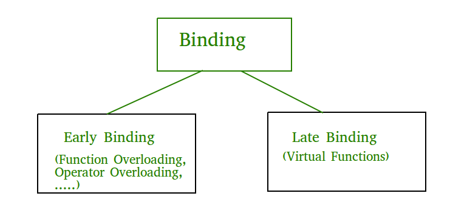

# 3.2.4.2 Runtime

**Early binding and Late binding in C++**

Last Updated : 05 Feb, 2018

Binding refers to the process of converting identifiers (such as variable and performance names) into addresses. Binding is done for each variable and functions. For functions, it means that matching the call with the right function definition by the compiler. It takes place either at compile time or at runtime.

**Early Binding (compile-time time polymorphism)** As the name indicates, compiler (or linker) directly associate an address to the function call. It replaces the call with a machine language instruction that tells the mainframe to leap to the address of the function.

By default early binding happens in C++. Late binding (discussed below) is achieved with the help of [virtual keyword](<https://www.geeksforgeeks.org/virtual-function-cpp/>))

// CPP Program to illustrate early binding.

// Any normal function call (without virtual)

// is binded early. Here we have taken base

// and derived class example so that readers

// can easily compare and see difference in

// outputs.

#include<iostream>

**using** **namespace** std;

**class** Base

{

**public**:

**void** show() { cout<<" In Base \\n"; }

};

**class** Derived: **public** Base

{

**public**:

**void** show() { cout<<"In Derived \\n"; }

};

**int** main(**void**)

{

Base \*bp = **new** Derived;

// The function call decided at

// compile time (compiler sees type

// of pointer and calls base class

// function.

bp->show();

**return** 0;

}

Output:

In Base

**Late Binding : (Run time polymorphism)** In this, the compiler adds code that identifies the kind of object at runtime then matches the call with the right function definition (Refer [this](<https://www.geeksforgeeks.org/virtual-functions-and-runtime-polymorphism-in-c-set-1-introduction/>) for details). This can be achieved by declaring a [virtual function](<https://www.geeksforgeeks.org/virtual-function-cpp/>).

// CPP Program to illustrate late binding

#include<iostream>

**using** **namespace** std;

**class** Base

{

**public**:

**virtual** **void** show() { cout<<" In Base \\n"; }

};

**class** Derived: **public** Base

{

**public**:

**void** show() { cout<<"In Derived \\n"; }

};

**int** main(**void**)

{

Base \*bp = **new** Derived;

bp->show();  // RUN-TIME POLYMORPHISM

**return** 0;

}

Output:

In Derived
