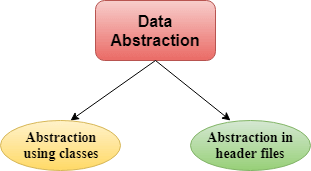
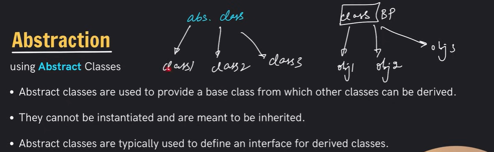
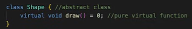
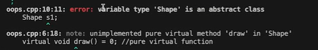
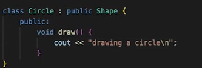
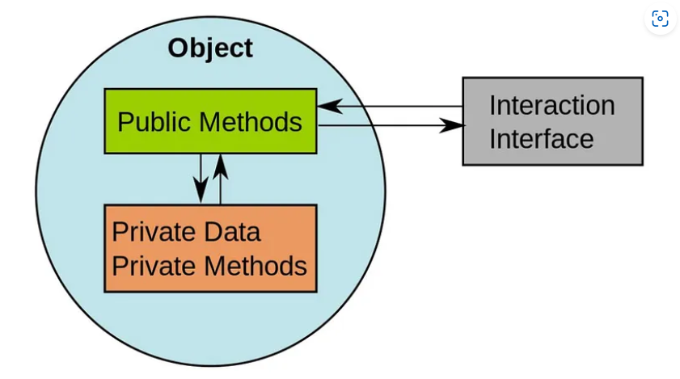

# 3.2.5 Abstraction

Data abstraction refers to providing only essential information about the data to the outside world, hiding the background details or implementation.

Abstraction is like data hiding. Hiding all unnecessary/sensitive details and showing only the important parts. Done through access modifier/specifiers (private/public/protected)

Real life example:

Consider a real-life example of a man driving a car. The man only knows that pressing the accelerator will increase the speed of the car or applying brakes will stop the car but he does not know how on pressing the accelerator the speed is actually increasing, he does not know about the inner mechanism of the car or the implementation of the accelerator, brakes, etc in the car. This is what abstraction is.

Types of Abstraction:

Data abstraction – This type only shows the required information about the data and hides the unnecessary data.

Control Abstraction – This type only shows the required information about the implementation and hides unnecessary information.

**Data abstraction can be achieved in two ways: **

**Abstraction using Classes using Access Specifiers: **

We can implement Abstraction in C++ using classes. The class helps us to group data members and member functions using available access specifiers. A Class can decide which data member will be visible to the outside world and which is not.  The members that define the internal implementation can be marked as private in a class. And the important information needed to be given to the outside world can be marked as public. And these public members can access the private members as they are inside the class.

**Abstraction in Header files**

One more type of abstraction in C++ can be header files. For example, consider the pow() method present in math.h header file. Whenever we need to calculate the power of a number, we simply call the function pow() present in the math.h header file and pass the numbers as arguments without knowing the underlying algorithm according to which the function is actually calculating the power of numbers.

Abstracts classes ki objects nahi ban sakti

They define template, layout of other classes.

**Advantages of Data Abstraction**

Implementation details of the class are protected from the inadvertent user level errors.

Helps the user to avoid writing the low-level code

Avoids code duplication and increases reusability.

Can change the internal implementation of the class independently without affecting the user.

Helps to increase the security of an application or program as only important details are provided to the user.

The main aim of the data abstraction is to reuse the code and the proper partitioning of the code across the classes.

It reduces the complexity as well as the redundancy of the code, therefore increasing the readability.

**C++ Interfaces:  (Concept, does not exist)**

In C++, an interface is a conceptual construct that specifies a set of methods that must be implemented by any class that claims to conform to the Interface. It acts as a blueprint that enforces consistent behavior among its implementers while shielding the details of the actual implementation.

  - Although C++ lacks a defined interface keyword, the idea of an interface is accomplished through abstract classes and pure virtual functions.

  - An abstract class has one or more pure virtual functions - functions specified in the base class but not implemented.

  - These pure virtual functions serve as the methods of the Interface, setting up the requirements for any class that derives from the abstract base.

**class Interface {  **

**public:  **

**virtual void method1() = 0; // Pure virtual function  **

**virtual void method2() = 0; // Pure virtual function  **

**// ... more pure virtual functions  **

**};**

**Implementing the Interface**

Classes that implement the interface must override all pure virtual functions declared in the abstract base. These classes provide the necessary implementations for the interface methods, adhering to the prescribed contract.

**class ConcreteClass: public Interface {  **

**public:  **

**void method1() override {  **

**// Implementation for method1  **

**}  **

**void method2() override {  **

**// Implementation for method2  **

**}  **

**};  **

**Pure Virtual Function:**

A pure virtual function is a function in C++ specified in a base class that does not have an implementation, signified by "= 0" in its declaration. It serves as a contract that derived classes must implement.

virtual void myFunction() = 0;

"virtual": It indicates that this function is virtual, enabling polymorphism.

"void": Specifies the return type.

"myFunction": Name of the function.

"= 0": Marks it as pure virtual, meaning it has no implementation in the base class and must be overridden in derived classes.

**Rules for Using Interfaces:**

Use Abstract Classes: Define interfaces as abstract classes with pure virtual functions.

Prefix Interface Names: Consider prefixing interface names with 'I' or similar to indicate their role.

No Member Data: Interfaces should not contain member data (attributes).

Public Access: Declare interface methods as public for external usage.

Explicit virtual and override: Use virtual when overriding, and override to indicate explicit overriding.

Implement All Methods: Any class deriving from an interface must implement all interface methods.

Keep It Focused: Keep interface methods related to a specific theme or purpose.

Document Interfaces: Document the purpose and usage of interfaces.

Consider Segregation: Avoid forcing classes to implement unrelated methods (Interface Segregation Principle).

Stable Interfaces: Avoid making breaking changes to interfaces once in use.

**Interview Questions: **

What is the difference between an abstract class and an interface?

An abstract class can have both abstract and concrete methods, while an interface only has method signatures (no method implementations). A class can implement multiple interfaces, but it can inherit from only one abstract class.

What is an abstract class?

An abstract class is a class that cannot be instantiated on its own. It may contain abstract methods (methods without a body) that must be implemented by its concrete subclasses. Abstract classes provide a common interface.

A class is abstracted in C++ by defining at least one of its functions as a>strong>pure virtual function. "= 0" is used in the declaration of a pure virtual function. Derived classes must provide its implementation.

class Shape

{

public:

virtual void draw()=0;

};

class Rectangle: Shape

{

public:

void draw()

{

cout < <"drawing rectangle..." < <endl;

}

};

class Circle: Shape

{

public:

void draw()

{

cout <<"drawing circle..." < <endl;

}

};

What is an interface?

An interface is a contract that defines a set of methods that a class must implement. It allows multiple classes to adhere to the same interface, promoting a form of multiple inheritance. Interfaces only declare method signatures, not implementations.

What is Abstraction?

It is hiding non-essential details from the user.

OR

Abstraction is the concept of object-oriented programming that “shows” only essential attributes and “hides” unnecessary information. The main purpose of abstraction is to hide unnecessary details from the users.

Can you tell me about Abstract Keyword?

There is no abstract keyword in C++.We use the pure virtual function in order to use abstraction. A class having at least one pure virtual function is termed an abstraction.

Can you please code an example of Abstraction?

//This is an Abstract Class

class Instrument{

public:

virtual void Makesound() = 0;

//this is the definition of Pure Function

//Now we can't make any particular object for Instrument Function

};

class Guitar: public Instrument{

public:

void Makesound(){

cout<<"Guitar Playing"<<endl;

}

};

int main(){

//i1 is pointer of Instrument pointing to guitar

Instrument\* i1 = new Guitar;

i1->Makesound();

//Because i1 is a pointer,we can not use . else we use ->

Guitar i2;

i2.Makesound();

// i1.Makesound();

}

//Output

Guitar Playing

Guitar Playing

Can we create an object of an abstract class like for example, of the above example we try to create an object of class Instrument?

No, we can not, because we don't have a function definition in the abstract class.
