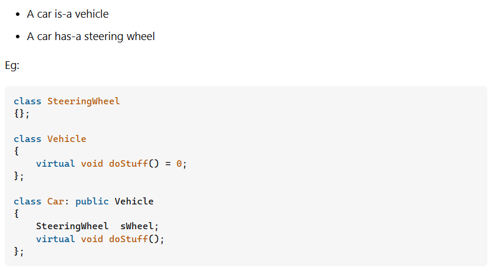

# 3.3.3 HAS-A, IS-A

C++ Aggregation (HAS-A Relationship)

In C++, aggregation is a process in which one class defines another class as any entity reference. It is another way to reuse the class. It is a form of association that represents HAS-A relationship.

C++ Aggregation Example

Let's see an example of aggregation where Employee class has the reference of Address class as data member. In such way, it can reuse the members of Address class.

  1. #include <iostream>

  1. **using** **namespace** std;

  1. **class** Address {

  1. **public**:

  1. string addressLine, city, state;

  1. Address(string addressLine, string city, string state)

  1. {

  1. **this**->addressLine = addressLine;

  1. **this**->city = city;

  1. **this**->state = state;

  1. }

  1. };

  1. **class** Employee

  1. {

  1. **private**:

  1. Address\* address;  //Employee HAS-A Address

  1. **public**:

  1. **int** id;

  1. string name;

  1. Employee(**int** id, string name, Address\* address)

  1. {

  1. **this**->id = id;

  1. **this**->name = name;

  1. **this**->address = address;

  1. }

  1. **void** display()

  1. {

  1. cout<<id <<" "<<name<< " "<<

  1. address->addressLine<< " "<< address->city<< " "<<address->state<<endl;

  1. }

  1. };

  1. **int** main(**void**) {

  1. Address a1= Address("C-146, Sec-15","Noida","UP");

  1. Employee e1 = Employee(101,"Nakul",&a1);

  1. e1.display();

  1. **return** 0;

  1. }

**IsA and HasA Relationship in C++ with Examples**

In this article, I am going to discuss **IsA and HasA Relationship in C++** with Examples. Please read our previous article where we discussed [Access Specifiers in C++](<https://dotnettutorials.net/lesson/access-specifiers-in-cpp/>) with Example.

**IsA and HasA Relationship in C++ with Examples:**

Let us understand IsA and HasA Relationship in C++ with Examples. This is useful for understanding access specifiers or the accessibility of members of a class. So, for this please have a look at the below example.

Advertisements

**class Rectangle{**

**         Some Data Members**

**         Some Member Functions**

**}**

This is a class called Rectangle. Let us assume data we have some members inside this class. Next, we have a class Cuboid which is inheriting from the above Rectangle class as follows.

**class Cuboid : public Rectangle{**

**          Some Data Members**

**          Some Member Functions**

**}**

This is the Cuboid class which is inheriting from the Rectangle class. Also, assume that this class also has some members inside it. Now let us write one more class as follows.

Advertisements

**class Table{**

**          Rectangle top;**

**          Int legs;**

**}**

This is the Table class which is not inherited from any class. This class has two data members that are object top of class Rectangle and integer type variable legs.

So first we have created a class called Rectangle. Then we created another class called Cuboid which is inherited from the Rectangle class and then we created another class called Table. Inside the Table class, we have created an object of the type Rectangle and an integer variable.

The class Cuboid is inherited from the Rectangle class. So, can we say that a **Cuboid is a Rectangle?** **Yes**. So, the relationship between the Rectangle class and Cuboid class is the ‘**Is A**’ relationship.

Next, our Table class is having a table top that is of the type Rectangular. The Table class is having an object of the Rectangle class. So, can we say that the **Table class has a Rectangle? Yes**, the Table class Has a Rectangle. So, the relationship between the Table class and the Rectangle class is the ‘**Has A**’ relationship.

So, we can use our class in two ways that are ‘Is A’ and ‘Has A’. This is common in object-oriented programming just not for C++. A class can be used in two ways. One is that a class can be derived means we can write child classes inheriting from that one. The second one is that object of that class can be used. So, there are two ways of using one class. Either you can create the object and use it or you can inherit it from that class.

**Real-time Example to Understand Is A and Has A Relationship:**

Let us take an example.

Suppose the above image shows the design of my car. Now I can manufacture the car from this design and I can sell it.

So, this is the object. Now I can sell this design to your company and you can manufacture it as your car with some changes in the above design.

**So, what are the uses of design class?**

Either we share it with the derived classes or create an object. If a class is inheriting from some other class, then it is having ‘**Is A**’ relationship with that class or if a class is having an object of some other class, then it is having ‘**Has A**’ relationship with that class. So, **Table has a Rectangle,** and a **Cuboid is a Rectangle**.

Next important thing is that a class can have three types of members that are **private**, **protected,** and **public**. These three types of members can be there inside a class.

Now when you have those three types of members then which members are accessible inside the class, which members are accessible in the class which is having ‘Is A’ relationship and the class which is having ‘Has A’ relationship? So, it means what is accessible inside the class and what is accessible in derived classes, and what is accessible upon an object. We already discussed this in our previous article.

**Is-A Relationship Example in C++**

In C++. the Is-A relationship depends on inheritance. It is used for code reusability in C++. For example, a Tomato is a vegetable, a Car is a vehicle, a TV is an electronic device, and so on. For a better understanding, please have a look at the below example.

**#include <iostream>**

**using namespace** std;

**class** Rectangle

**{**

**public**:

**int** length;

**int** breadth;

**int **Area**()**

**{**

**return** length \* breadth;

**}**

**int **Perimeter **()**

**{**

**return** 2 \* **(**length + breadth**)**;

**}**

**}**;

**class** Cuboid:**public** Rectangle

**{**

**public**:

**int** height;

Cuboid**(****int** l, **int** b, **int** h**)**

**{**

length = l;

breadth = b;

height = h;

**}**

**int **Volume **()**

**{**

**return** length \* breadth \* height;

**}**

**}**;

**int**

main **()**

**{**

Cuboid c **(**2, 4, 6**)**;

cout **<< **"Volume is " **<<** c.Volume**() <<** endl;

cout **<< **"Area is " **<<** c.Area**() <<** endl;

cout **<< **"Perimeter is " **<<** c.Perimeter**() <<** endl;

**}**

**Output:**

**Has-A Relationship Example in C++**

In C++, the Has-A relationship is also known as composition. It is also used for code reusability in C++. In C++, the Has-A relationship meaning is that an instance of one class has a reference to an instance of another class or an instance of the same class. For example, a Bus has an engine, a Cow has a tail, and so on. For a better understanding, please have a look at the below example.

**#include <iostream>**

**using namespace** std;

**class** Address

**{**

**public**:

string AddressLine, City, State;

Address **(**string addressLine, string city, string state**)**

**{**

**this**-**>**AddressLine = addressLine;

**this**-**>**City = city;

**this**-**>**State = state;

**}**

**}**;

**class** Employee

**{**

**private**:

Address\* address; //Employee HAS-A Address

**public**:

**int** Id;

string Name;

Employee **(****int** id, string name, Address\* address**)**

**{**

**this**-**>**Id = id;

**this**-**>**Name = name;

**this**-**>**address = address;

**}**

**void **Display**()**

**{**

cout **<<** Id **<< **" " **<<** Name **<< **" " **<<** address-**>**AddressLine **<< **" " **<<** address-**>**City **<< **" " **<<** address-**>**State **<<** endl;

**}**

**}**;

**int **main **()**

**{**

Address address = Address**(**"B1-2019", "Mumbai", "Maharashtra"**)**;

Employee employee = Employee**(**1011, "Anurag", &address**)**;

employee.Display**()**;

**return** 0;

**}**

**Output: ****1011 Anurag B1-2019 Mumbai Maharashtra**
