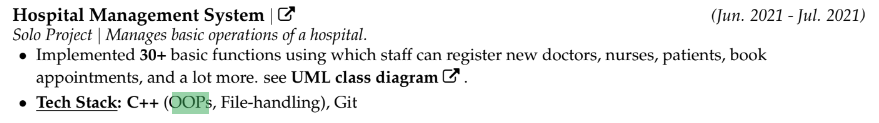

# 3.3.4 Links

[Lecture 42: OOPs Concepts in C++ || Part-1](<https://youtu.be/i_5pvt7ag7E?si=Hd0APXmiKtFpNxlA>)

[Lecture 43 : 4 Pillars of OOPs Concept -Inheritance, Polymorphism, Encapsulation & Abstraction](<https://youtu.be/b3GccK5_KSQ?si=8KqsQqECQuoZnFa2>)

[Complete OOP Object Oriented Programming in One Shot (5 Hours) | Semester Exam | In Hindi](<https://youtu.be/eWHzz-WHQh4?si=tpHj3rqihnkorVAl>)

PYTHON:

[Complete OOP in Python in 1 Video | End to End OOP in Python in 4 hours](<https://youtu.be/Mf2RdpEiXjU?si=FtQvsRgUEYCFaafs>)

[Object Oriented Programming in python](<https://youtu.be/6soT3DMBJGQ?si=-e7JsBV92K0eTVO7>)

[40+ OOPs Interview Questions and Answers (2024) - InterviewBit](<https://www.interviewbit.com/oops-interview-questions/>)

[Object Oriented Programming in C++ - GeeksforGeeks](<https://www.geeksforgeeks.org/object-oriented-programming-in-cpp/>)

[C++ Classes and Objects (tutorialspoint.com)](<https://www.tutorialspoint.com/cplusplus/cpp_classes_objects.htm>)

https://whimsical.com/object-oriented-programming-cheatsheet-by-love-babbar-YbSgLatbWQ4R5paV7EgqFw

what

does OOPs stand for, what are its four pillars, etc. They asked me to

explain compile time polymorphism, runtime polymorphism with examples

for each. I gave the example of function overloading for the former and

function overriding for the latter. I was also asked to write an example code

which explains function overriding on paper which evidently encompassed

the use of the ‘virtual’ keyword.

Questions regarding constructors and

destructors followed by questions like ‘Explain inheritance, its types,

access specifiers, etc’ were asked which included questions pertaining to

the famous diamond problem(again the ‘virtual’ keyword).

They also asked

questions regarding operator overloading like ‘What is operator

overloading?’ which also included writing an example code. Next I was

asked to explain the ‘static’ keyword.

● After checking on my grip on OOPs, they tested my knowledge regarding

other C++ concepts like pointers, strings, etc. I was supposed to give the

outputs for the codes they had written on paper regarding pointers and

references followed by inevitable questions on dynamic memory allocation.

Questions like ‘What is memory leak?’, ‘Explain the malloc keyword’, ‘What

is the difference between pointers and references?’, etc where asked.

Honestly, I wasn’t able to explain the ‘malloc’ keyword as it had been a

while since I studied it.

Tech: Again, they ask what you know. I clearly told them I had not read anything about OOPS since my 12th board finals so they did not ask me questions on that. If you are preparing for Software roles, you’d already be familiar with OOPS - if not, any resource available online works, focus on understanding the different concepts rather than rote learning. For DSA, they asked LC easy - medium questions only. (nothing above DP), so interviewbit should be more than enough.

Employee Payroll System, Programming Club, IIT Kanpur  AyushGarg-123/employeePayrollSystem (Jan’22 )

– Developed an end to end Java application using Object Oriented Programming(OOP) Principles

– Learnt and implemented various OOPs concepts like Inheritance, abstraction, overriding and overloading etc

– Developed Interface and abstract classes to achieve abstraction and enhance the readability of code significantly

– Application scans the employee details given by the user via the terminal and prints the output at the terminal

[AyushGarg-123/employeePayrollSystem (github.com)](<https://github.com/AyushGarg-123/employeePayrollSystem>)

There were 2 interviewees. It majorly

involved checking your command on OOPS especially in C++. The interview was quite

conceptual. They went in depth to ask about the OOPS concept and majorly covered all the

topics in OOPS. That's why the interview was quite long. Their requirement was that you

must know C++. They also asked 2 DSA questions. They also asked me 2-3 questions where

they gave a code and I was supposed to predict the output. More about those questions

will be discussed below. Below are various questions they asked me in the interview. There

was a LOT of cross questioning, checking your capabilities and skills in C++ and OOPS.

Now they started asking me OOPS concepts, starting with: What are various features

of OOPS.

5. What advantages to OOPS provide over procedural language. They asked me to

explain this with an example.

6. Then they asked about the pillars of OOPS.

[Object Oriented Programming CheatSheet - by Love Babbar (whimsical.com)](<https://whimsical.com/object-oriented-programming-cheatsheet-by-love-babbar-YbSgLatbWQ4R5paV7EgqFw>)

I was interviewed by 2 Senior Employees of DOLAT Capital at their office.The

Interview will be completely on Cpp and OOPs and DSA.

The interview began with Introduction .

Then OOPS Question asked :

1. Pillars of OOPs. Explain all (Encapsulation, Abstraction, Polymorphism,

Inheritance)

2. Difference in Abstraction and Encapsuslation

3. Implement Polymorphism with code and example :

I started directly compile time polymorphism . then they asked which

polymorphism writing . what are the types of polymorphism

What is difference between polymorphism .

Which func will get called when?

→What happens when base class pointer points to child class

→What happens when child class pointer points to base class

(UPCASTING AND DOWNCASTING)

How run time polymorphism happening at execution level .

Another thing Morgan Stanley focuses a lot on is Object-Oriented System Design. He

asked me if I knew OOPs and gave me a simple task of implementing my own book using

OOPs concepts. I would recommend reading some standard questions from internet

beforehand like parking lot, hotel reservation system etc. Here, don't assume anything

on your part. Clarify what entitites Interviewer has in mind and what functionalities

he wants you to code. Here, A book has several pages and every page has paragraphs and

every paragraph has certain words. Some functionalities include counting the

occurences of a particular word inside the entire book. Easy question rather, as I had

to simply define respective classes (keep mentioning to him, why you kept some

attributes as public and why some as private) and I used a hash map for the

functionality. We had a small discussion on the demerits of hash-map (basically you

have to mention collisions) and techniques by which we can resolve it (separate

chaining/ probing).

->

OOPS :

  - COMMONLY ASKED QUESTION : https://www.geeksforgeeks.org/oops-interview-questions/

C++ : https://whimsical.com/oops-TUAUufS5pzRYUTG6satHwm

[code-chaser/hospital-management-system: A hospital management system, made using object oriented programming and file handling (in C++), that keeps records of doctors, their appointments, patients, staff and more. (github.com)](<https://github.com/code-chaser/hospital-management-system/tree/main>)

https://www.almabetter.com/bytes/articles/top-oops-interview-questions

https://www.indeed.com/career-advice/interviewing/object-oriented-programming-interview-questions

https://leetcode.com/discuss/interview-question/3828150/OOPS-Cheatsheet-for-Interviews-or-30-questions

https://www.naukri.com/code360/library/oops-interview-questions

https://www.geeksforgeeks.org/oops-interview-questions/

https://www.interviewbit.com/oops-interview-questions/
