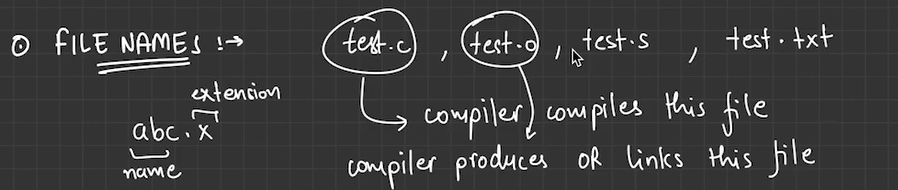
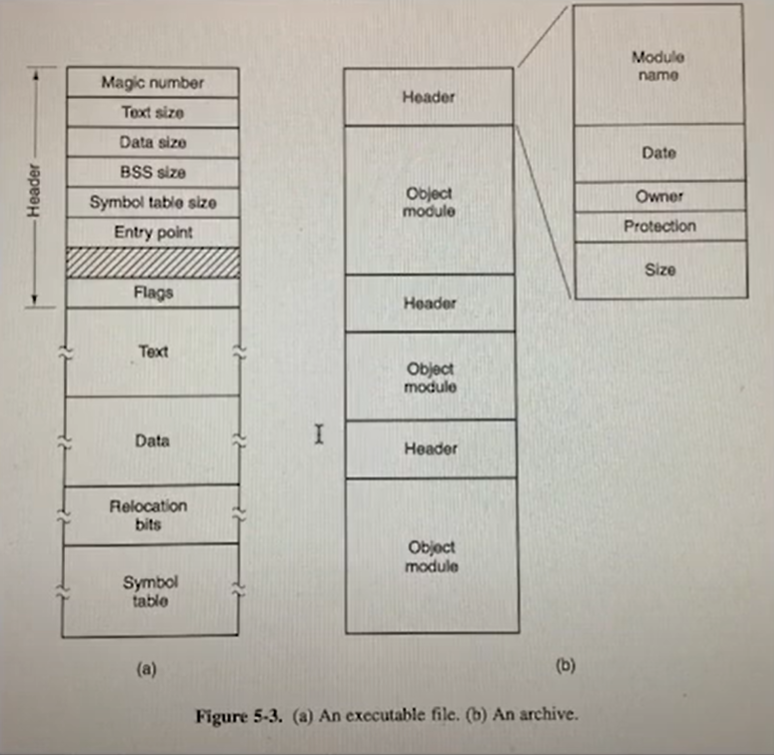
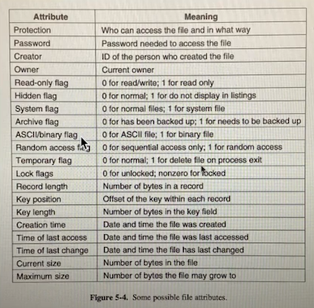

# 4.12.2 Introduction

Need for File System

- **While running a process, It might need more memory than its address space to retrieve some information.**

- **Second use case is, if one process has to store information for long time in non-volatile manner.**

- **Third use case might be multiple processes - wants to use the info at same time and if one process stores in its address space It would not be accessible to other process.**

The solution to these problems/use-cases is to store information on disk in units called Files.

**Two POV**

  1. users (filesystem interface, names, protection)

  1. designers (block size, linked list / bitmaps for free memory etc.)

User programs are aware about file extensions & behave differently when we open .mp3, .exe etc

FILE-TYPES:

  - Regular files are the ones which have user's info. Regular files are generally ASCII or binary files. ASCII file's output can be easily connected to other file's input (pipes).

  - Directories are system files for maintaining the structure of the file system.

  - Character special files are used for I/O, terminals and networks. (stdin, stdout, bytestream)

  - Block files are used for storing/map files to the disks.

Difference between Archive and Executable file

If we convert .mp3 to mp4 it will not become video file. The bitstream will still be of mp3 type.

a) os only executes a file if it has a proper structure.

→ magic number tells if file is - executable or not

→ text and data are of program itself

→ these are loaded into memory using relocation bits and symbol table is for debugging an executable.

**FILE ACCESS :-**

Sequential files were used when data is to be read in sequence without skipping and data can not be jumped over. In this, starting point is at file start.

But now, Random access files are more convienent beca files can be accessed randomly using keys etc. In this starting point of file is given from any position, which is called seek, and after this Point file can be read - sequentially.

FILE ATTRIBUTES (EXTRA INFO OR METADATA):

