# 4.13.1 CONCURRENCY, MULTI-THREADING

**CONCURRENCY**

Concurrency is the execution of the multiple instruction sequences at the same time. It happens in the operating system when there are several process threads running in parallel.

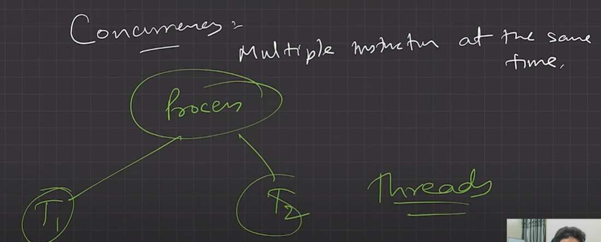

**THREAD**

  - improvement over fork

  - A thread is a basic unit of CPU utilization, consisting of a program counter, a stack, and a set of registers, ( and a thread ID. )

  - Traditional (heavyweight) processes have a single thread of control - There is one program counter, and one sequence of instructions that can be carried out at any given time.

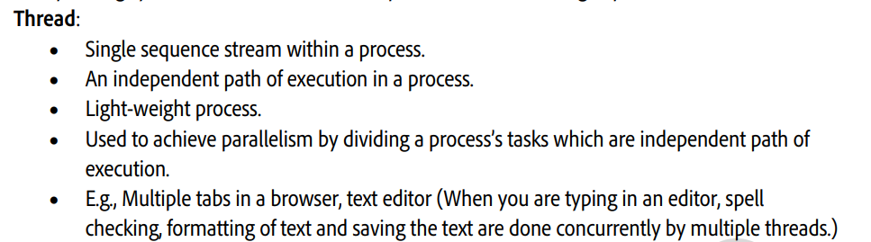

  - Multi-threaded applications have multiple threads within a single process, each having their own program counter, stack and set of registers, but sharing common code, data, and certain structures such as open files.

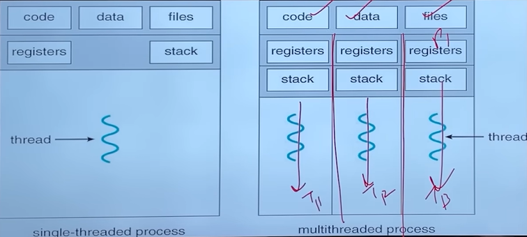

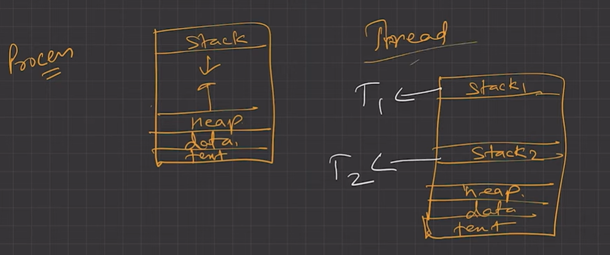

**MULTI THREADING MODELS**

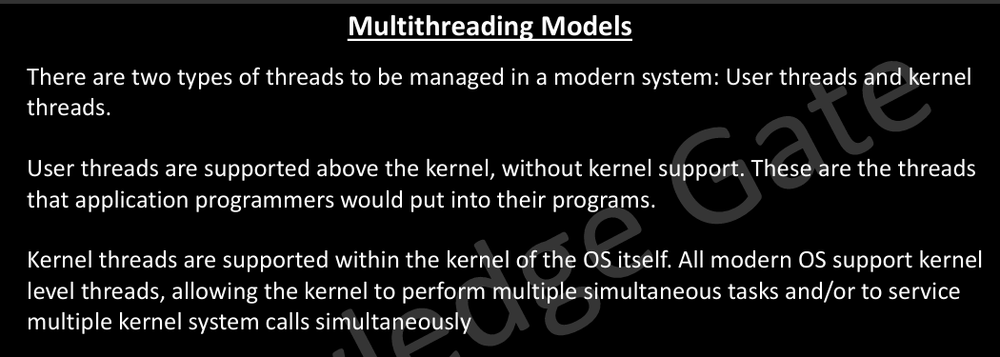

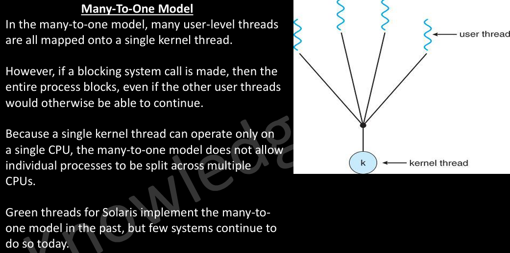

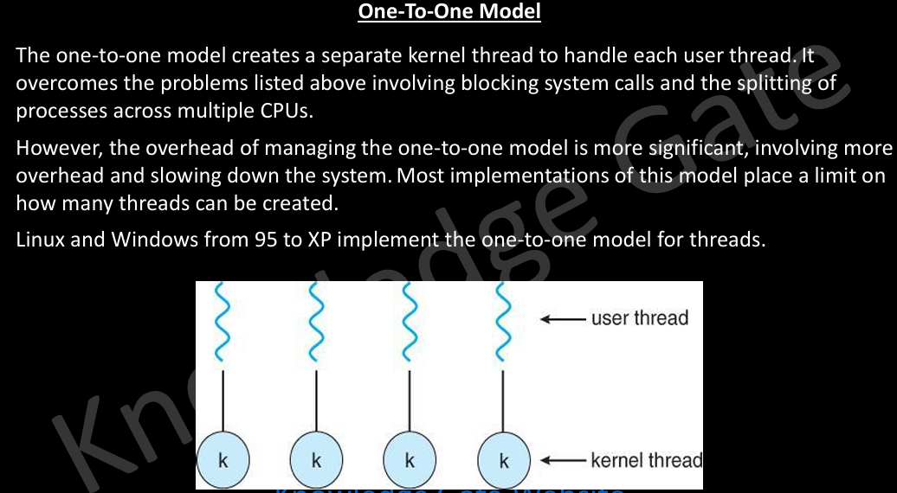

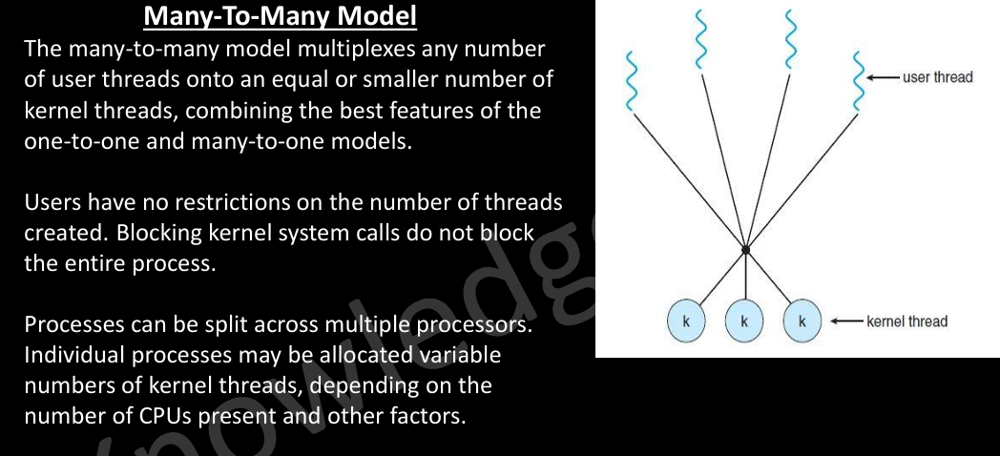

**THREAD SCHEDULING**

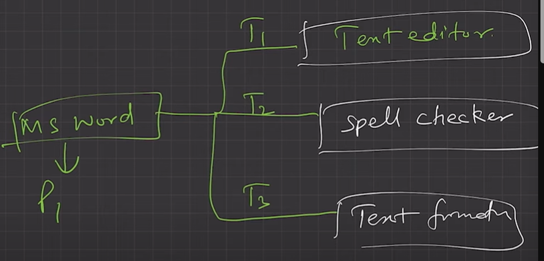

Threads are scheduled for execution based on their priority. Even though threads are executing within the runtime, all threads are assigned processor time slices by the operating system. Threads have TCB (THREAD CONTROL BLOCK)

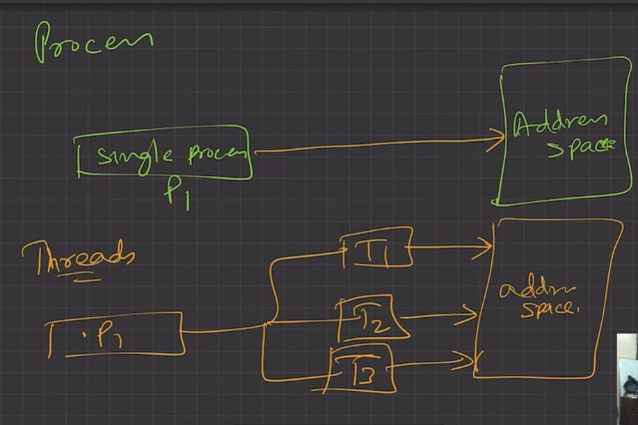

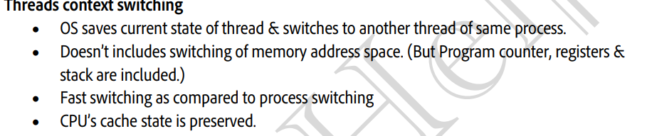

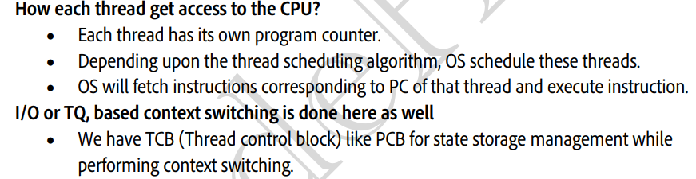

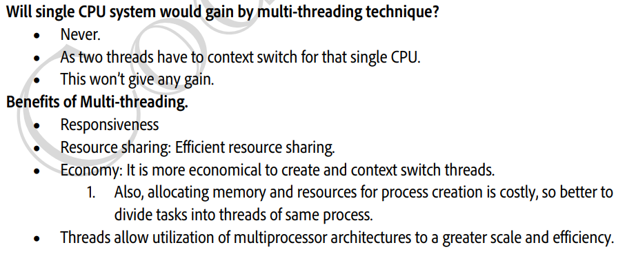

**MULTITHREADING IN C++**

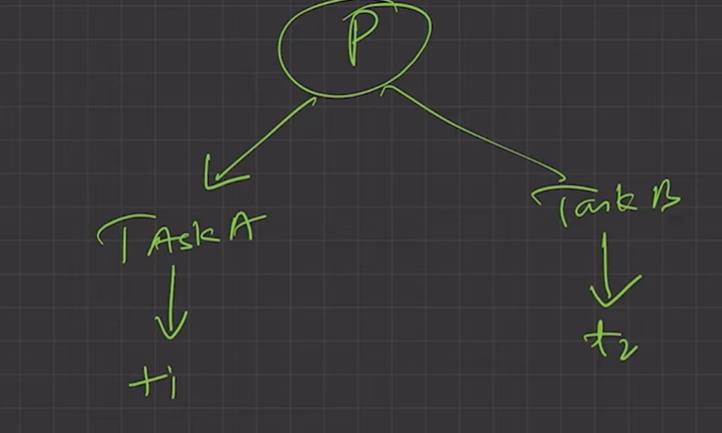

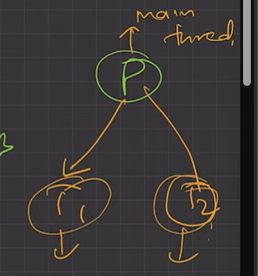

EXECUTE:

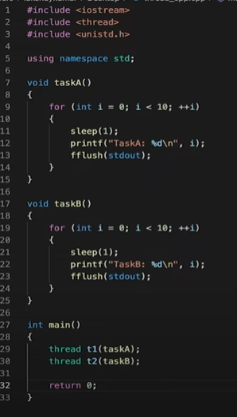

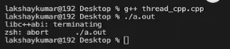

PROCESS ABORTED BECAUSE MAIN THREAD MAIN() EXITED

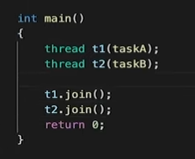

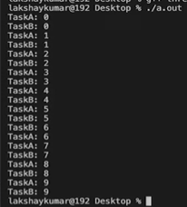
