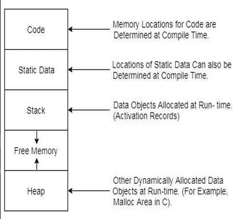

# 4.14.1 FORK

**FORK**

**Requirement of Fork command **

• In number of applications specially in those where work is of repetitive nature, like web server i.e. with every client we have to run similar type of code. Have to create a separate process every time for serving a new request.

• So it must be a better solution that instead to creating a new process every time from scratch we must have a short command using which we can do this logic.

**Idea of fork command**

• Here fork command is a system command using which the entire image of the process can be copied and we create a new process, this idea help us to complete the creation of the new process with speed.

• After creating a process, we must have a mechanism to identify weather in newly created process which one is child and which is parent.

**Implementation of fork command **

• In general, if fork return 0 then it is child and if fork return 1 then it is parent,and then using a programmer level code we can change the code of child process to behave as new process.

2^n -1 child processes are created for n fork commands

**Advantages of using fork commands **

• Now it is relatively easy to create and manage similar types of process of repetitive nature with the help of fork command.

**Disadvantage **

• To create a new process by fork command we have to do system call as, fork is system function

• Which is slow and time taking

• Increase the burden over Operating System

Different image of the similar type of task have same code part which means we have the multiple copy of the same data waiting the main memory

[Operating System | OS in one shot | Complete GATE Course | Hindi #withsanchitsir](<https://youtu.be/009FHqBo87Q?si=MBLk6YhgAzaKJB1y&t=41975>)
