# 4.15.1 Virtualisation

Kernel is subpart of OS.

Bare Metal

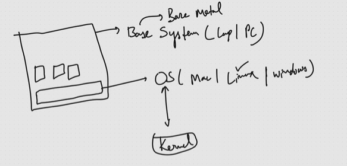

Bare Metal Installation:

  - First OS installation.

  - Binaries is where OS code is written.

  - Kernel is that part of OS, which helps to interact with base hardware.  Kernel can only run one process at a time, so to manage multiple tasks (scheduling) we need an entire OS.

  - 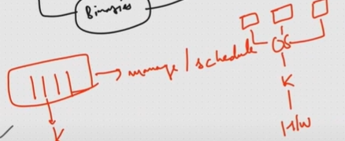

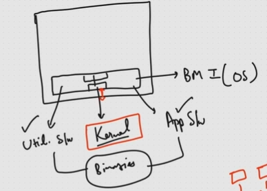

**Operating Systems (OS):**

  - An OS is like a common playground where different applications interact and communicate (examples: Gokuldham Society, Avengers Compound).

  - Choosing the right OS is crucial for backend development.

  - **Industry Standard:** Linux is the OS used to deploy the majority (95%+) of industry applications.

  - **Key Concepts:**

    - **OS vs. Kernel:** Understanding the difference is important.

    - **Virtualization:** A key concept, important for interviews and setting up Linux systems.

**Linux Focus:**

  - The series will focus on setting up a Linux system for backend development.

**Backend Development Starting Point:**

  - Begin with a "base system."

  - **Base System:** Can be a laptop, PC, or other system.

  - **OS Installation:** The first step is to install an OS on the base system.

  - **Software Installation:** Software like C++, Java, or web browsers require an OS to run on the base system.

**Bare Metal Installation (BMI)**

  - Instead of saying base system, you can use "bare metal" in technical discussions.

  - Bare metal is the physical hardware before OS installation.

  - Bare Metal Installation (BMI) refers to installing an OS directly onto the hardware.

**Operating System Components**

  - **Kernel:** A key component of the OS.

  - **Utility Software:** Supports the OS to function smoothly (e.g., RAM management, task manager). Users don't buy a system specifically for these.

  - **Application Software:** Software that users primarily use the system for (e.g., browser, media player, compilers).

  - **Binaries:** Files containing the actual OS code.

**Kernel Details**

  - It is the part of the OS that interacts directly with the hardware (RAM, hard disk, processor).

  - Kernel handles one process at a time.

  - Modern systems are multiprocessing which require scheduling and threading to run parallelly.

  - The OS manages and schedules multiple tasks.

**Linux and Free Source Software**

  - Linux is free to use.

  - You don't pay for an OS if its a free source software

**Open Source Software (OSS)**

  - You can view and modify the entire code.

  - Linux allows this while Windows does not.

**Windows OS**

  - Provides certain powers to users.

  - E.g. Task Manager for managing CPU, RAM, etc.

**FOSS Power (Linux)**

  - Allows deeper modification and customization than Windows.

  - You can see and modify the source code.

  - You can make your own Linux operating system

**Linux Creation & FOSS Community**

  - Linux kernel was created by Linus Torvalds, maintained by the Linux Foundation.

  - Others can use the Linux kernel to build custom OS.

  - They add utilities, application software, branding, etc. and repackage it.

  - This is free because of the FOSS kernel.

  - **Rule:** If you use FOSS as a base, your derived product must also be FOSS.

**Linux Distributions (Distros)**

  - Groups like Debian and Fedora used the Linux kernel to create their own operating systems.

  - Debian and Fedora have different software, utilities, and optimizations.

  - Debian-based examples: Ubuntu, OpenSUSE, Kali.

  - Fedora-based examples: Red Hat.

**Enterprise Linux**

  - Usually paid versions.

  - You pay for OS licensing rather than for the OS.

  - Includes support (Red Hat team helps if the system crashes).

  - Ubuntu, OpenSUSE, Kali rely on community support.

  - **FOSS Rule:** Enterprise versions of FOSS-based products must have a free version.

  - Red Hat's free version: CentOS.

  - If you need paid support, buy the Red Hat Enterprise Linux license.

  - The FOSS community has grown incredibly large with many contributors.

**Why not Mac/Windows for Deployment?**

  - Linux is a powerful FOSS.

  - Allows OS-level customization and tweaking for specific use cases.

**Bare Metal and Linux**

  - Start with "bare metal".

  - Perform "Bare Metal Installation" with Linux (BMI).

  - Install applications on top (web server, JavaScript, SQL).

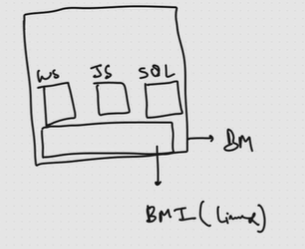

**Backend Systems and Scalability**

  - Typically, many users don't hit the same backend system.

  - Multiple backend systems exist to handle user requests.

  - If a system fails, another must be brought up quickly.

  - Automation can setup new web server, javascript and SQL instances in ~15 seconds.

**Backend Development and System Design**

  - Backend development is more than just individual technologies.

  - **Companies generally follow a three-tier application architecture: Frontend, Backend, and Database.**

  - Modern applications have even more tiers.

  - Tools and tool stacks are kept on the same system/machine for each tier.

  - Frontend tools on one machine, backend tools on another, and databases on another.

  - This is a sign of seniority: understanding "why" certain choices are made.

  - Experience helps understanding the rational behind decisions and overall system design.

**3 Tier Application Architecture**

  - The web server, JavaScript setup, and SQL setup all reside on a single system.

  - Is this a good architecture or not.

**Application Architecture Vulnerabilities**

  - Bad application architecture occurs, for instance, when an unpatched frontend vulnerability leads to complete system compromise.

  - A SQL injection attack can also compromise not only the database but also the entire system.

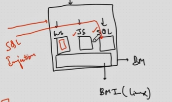

  - Better practice: separate systems for web server, backend server, and database (DB).

  - There should be separate networking and firewall policies between each

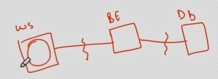

  - The attacker should not be able to compromise all your systems

  - Using 3 systems become costly, and the way to manage cost is talked about later.

  - **Solution: On one bare metal, we try to install three operating systems. 3 OS will be running independently on top of our base OS. These are like processes running on top of base OS. \[VIRTUALIZED OS\]**

**Mitigating Security Risks**

  - Using separate systems with firewalls and networking increases security.

  - This can prevent a front-end compromise from affecting the backend and database.

  - Even if the front-end is compromised, backend & DB are likely safe due to increased security measures.

**Cost Optimization: Virtualization**

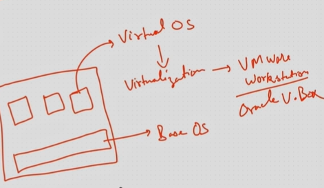

  - Deploying to 3 systems adds cost.

  - Virtualization helps reduce costs.

  - Use one bare metal server, but install three different operating systems on top.

  - These operating systems are virtualized, running as independent processes.

  - This is your base OS.

**Virtual OS (Guest OS)**

  - They aren't real operating systems; they're processes running on the base OS.

  - These processes are referred to as a Virtual OS.

**Achieving Virtualization**

  - Virtualization enables the creation and deployment of virtual operating systems.

  - Tools: VMware Workstation, Oracle VirtualBox.

**Hypervisor: The Key to Virtualization**

  - Virtualization is implemented using tools like VirtualBox.

  - These tools implement a layer called the "hypervisor."

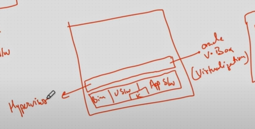

**Hypervisor**** Explained**

  - Achieve Virtualization using Hypervisors.

  - By implementing a hypervisor you get virtualization

**Terminology: Chrome vs. Browser vs. Browsing**

  - Using chrome the family of softwares are browser used for browsing.

  - Similary we achieve Virtualization using hypervisors.

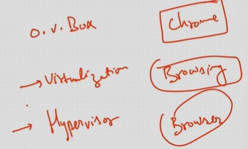

**Hypervisor Software**

  - These allow you to run multiple OS as independent processes.

  - Each virtual OS has its own kernel, apps, and utilities.

  - These virtual operating system will have their own limitations and boundaries for accessing RAM and processors.

  - Boundaries: each virtual OS has limitations on accessing hardware.

**Limiting Attack Surfaces**

  - If a hacker attacks a web server (on a virtual OS), they only attack that OS's resources.

  - They can't breach the boundaries and access other systems.

  - This limits attack surfaces as you only affect part of the hard disk.

**How Hypervisors Work**

  - Hypervisors allow virtual kernels to communicate with the base kernel.

  - The base kernel then sends requests to the hardware.

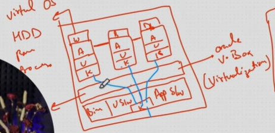

[OS Virtualization with Examples | Virtualisation Types with Real life example](<https://youtu.be/MnU-t31MtRY?si=-qatvh5DPbfxxjQ4>)

[Hypervisors and Virtualization Explained | What is a Hypervisor? | What is Virtualization?](<https://youtu.be/dhQtoYEODlk?si=EWtNbWdb6f1e9CHu>)

[Virtualization Explained](<https://youtu.be/UBVVq-xz5i0?si=qzqdEa5MA9NkSY92>)

[Hypervisors - Georgia Tech - Advanced Operating Systems](<https://youtu.be/Q0XyphhfJXE?si=eFV9ae3vSQiHCIZY>)

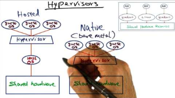
