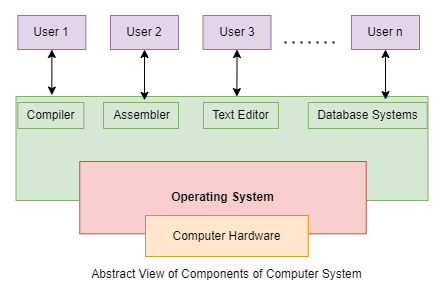
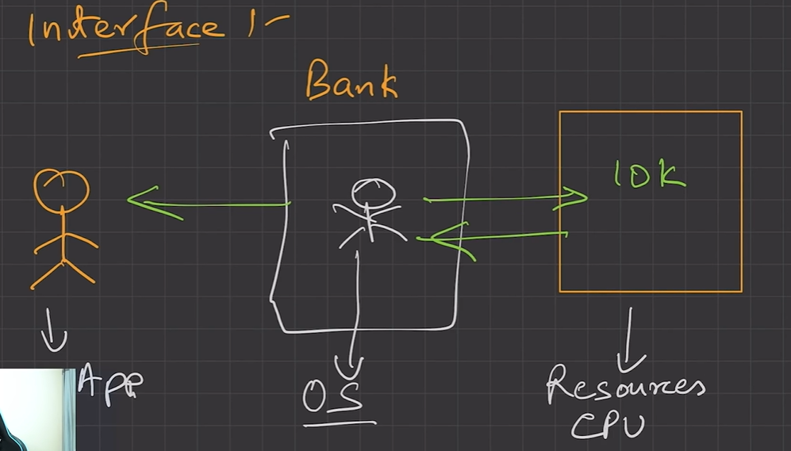
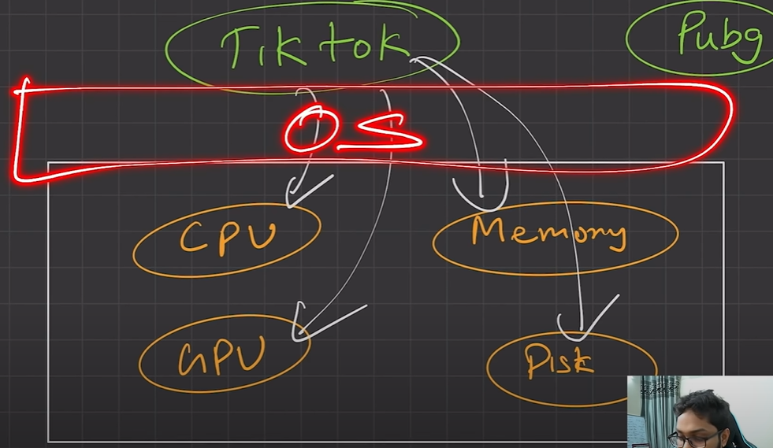
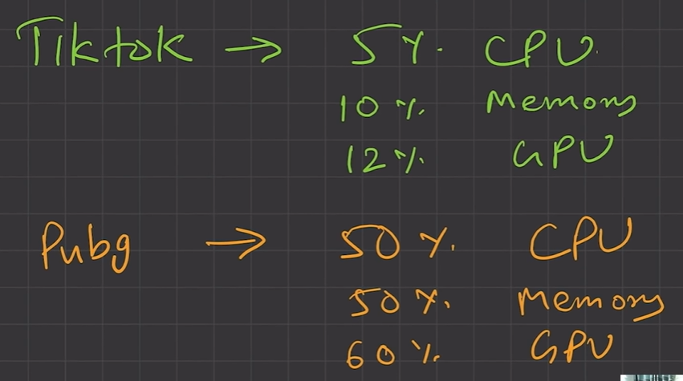
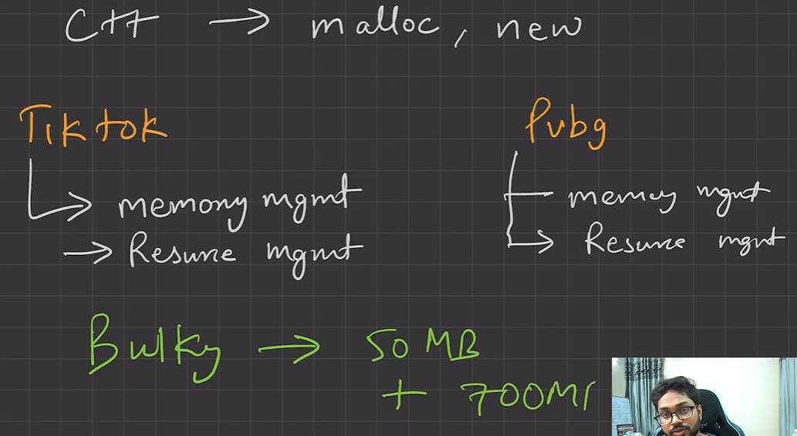
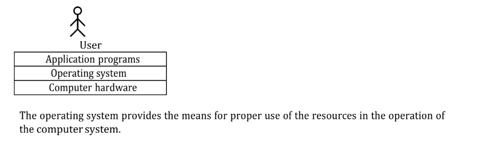
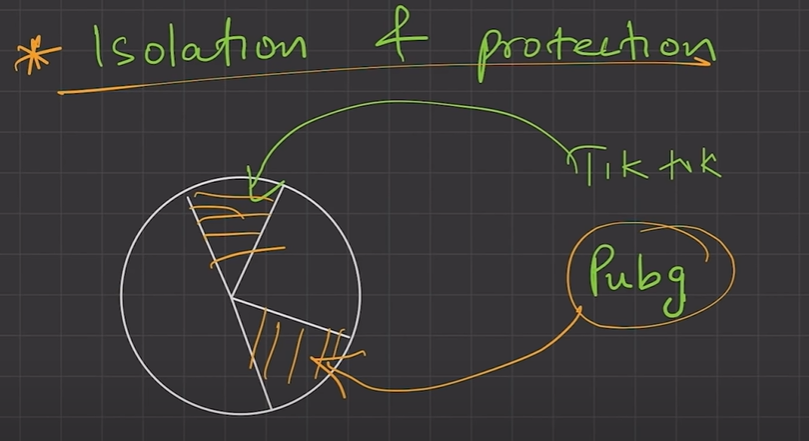
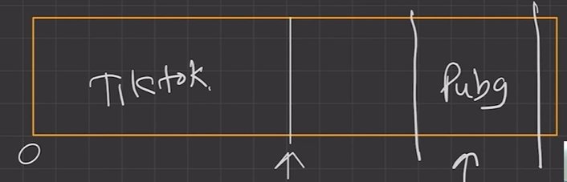

# 4.2.1 Introduction

Application software performs specific task for the user.

System software operates and controls the computer system and provides a platform to run

application software.

An operating system is a piece of software that manages all the resources of a computer

system, both hardware and software, and provides an environment in which the user can

execute his/her programs in a convenient and efficient manner by hiding underlying

complexity of the hardware and acting as a resource manager.

  - OS acts as a intermediary between user and hardware.

  - Resource Manager/ Allocator - Operating system controls and coordinates the use of system resources among various application programs in an unbiased fashion.

  - Platform - OS provides platform on which other application programs can be installed, provides the environment within which programs are executed.

Why OS?

1. What if there is no OS?

a. Bulky and complex app. (Hardware interaction code must be in app’s code base)

b. Resource exploitation by 1 App.

c. No memory protection.

2. What is an OS made up of?

a. Collection of system software.

An operating system function -

  - Access to the computer hardware.

  - interface between the user and the computer hardware

| OS AS AN INTERFACE  |  |
| --- | --- |

  - Resource management (Aka, Arbitration) (memory, device, file, security, process etc)

| OS A A RESOURCE MANAGER  |  |
| --- | --- |
|  | VIOLATION OF DO NOT REPEAT YOURSELF PRINCIPLE: if every app having its own memory management code.  >>> |

  - Hides the underlying complexity of the hardware. (Aka, Abstraction)

| Abstraction |  |
| --- | --- |

  - facilitates execution of application programs by providing isolation and protection.

| ISOLATION AND PROTECTION  | What OS Does?  |
| --- | --- |
