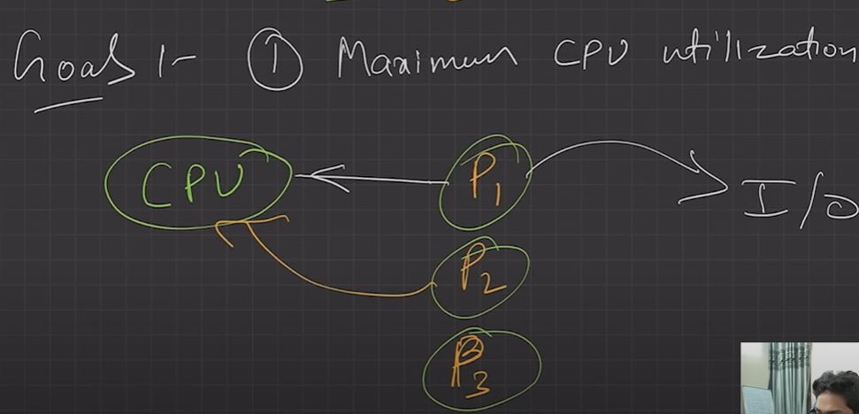
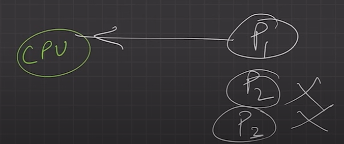
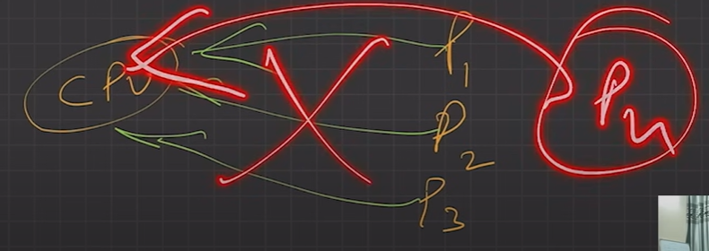

# 4.2.2 Goals/Functions of OS

OS goals –

Goals are the ultimate destination, but we follow functions to implement goals.

Goals of operating system:

1. Primary goals (Convenience / user friendly)

2. Secondary goals (Efficiency (Using resources in efficient manner) / Reliability / maintainability)

| • Maximum CPU utilization |  while P1 is doing I/O execute P2 |
| --- | --- |
| • Less process starvation |  p1 is taking all the time, p2, p3 not executing.... this should not happen. |
| • Higher priority job execution |  |

Functions of OS:

  - 1. Process Management: Involves handling the creation, scheduling, and termination of processes, which are executing programs.

  - 2. Memory Management: Manages allocation and deallocation of physical and virtual memory spaces to various programs.

  - 3. I/O Device Management: Handles I/O operations of peripheral devices like disks, keyboards, etc., including buffering and caching.

  - 4. File Management: Manages files on storage devices, including their information, naming, permissions, and hierarchy.

  - 5. Network Management: Manages network protocols and functions, enabling the OS to establish network connections and transfer data.

  - 6. Security & Protection: Ensures system protection against unauthorized access and other security threats through authentication, authorization, and encryption.
