# 4.2.3 Type of OS

TYPES OF OS:

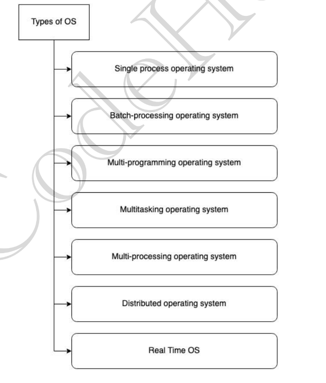

Types of operating systems -

  - **Single process operating system \[MS DOS, 1981\]**

    - only 1 process executes at a time from the ready queue. \[Oldest\]

    - Maximum CPU utilization - NO

    - Less process starvation - NO

    - Higher priority job execution - NO

  - **Batch-processing operating system \[ATLAS,** Manchester Univ., late 1950s - early 1960s\]

    - Firstly, user prepares his job using punch cards.

Early computers were not interactive device, there user use to prepare a job which consist three parts

1. Program

2. Control information

3. Input data

  - Then, he submits the job to the computer operator.

Only one job is given input at a time as there was no memory, computer will take the input then process it and then generate output.

Common input/output device were punch card or tape drives. So these devices were very slow, and processor remain ideal most of the time.  -- This was improved a little by **spooling**

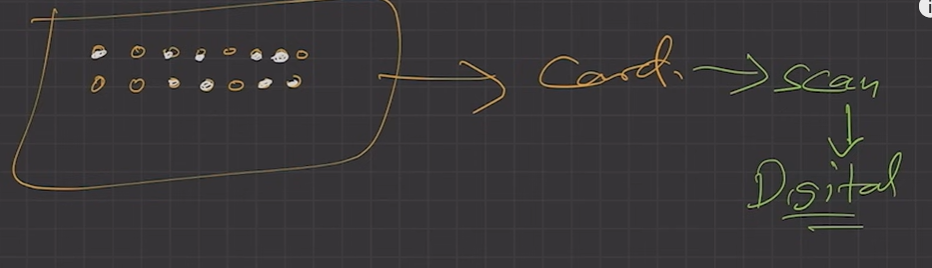

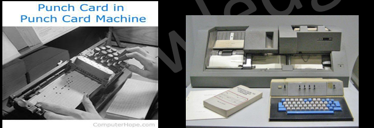

  - Operator collects the jobs from different users and sort the jobs into batches w similar needs.

  - To speed up the processing job with similar types (for e.g. FORTRAN jobs, COBOL jobs etc. ) were batched together and were run through the processor as a group (batch)

  - In some system grouping is done by the operator while in some systems it is performed by the 'Batch Monitor' resided in the low end of main memory.

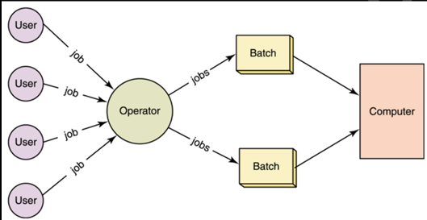

  - Then jobs (as a deck of punched cards) are bundled into batches with similar requirement.

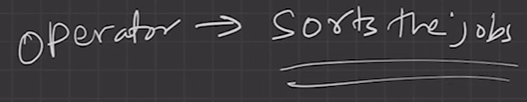

  - Then, operator submits the batches to the processor one by one. Each batch sequentially goes to CPU.

  - All the jobs of one batch are executed together.

    - Priorities cannot be set, if a job comes with some higher priority.

    - May lead to starvation. (A batch may take more time to complete) CPU may become idle in case of I/O operations.

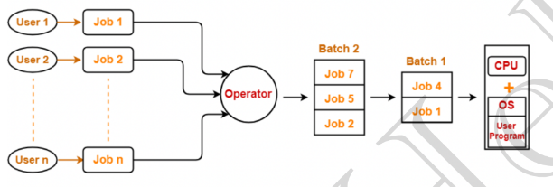

  - Maximum CPU utilization - NO (each batch is sequential)

  - Less process starvation - NO (if any process in Batch 1 takes long time , BATCH STARVATION)

  - Higher priority job execution - NO

  - SPOOLING:

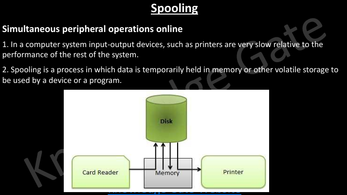

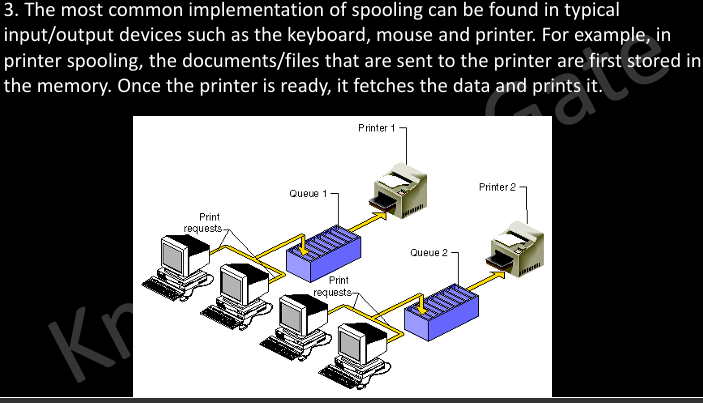

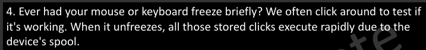

  - **Multiprogramming operating system   \[THE, Dijkstra**, early 1960s\]

    - Multiprogramming increases CPU utilization by keeping multiple jobs (code and data) in the memory so that the CPU always has one to execute in case some job gets busy with I/0.

      - Multiple Jobs: Keeps several jobs in main memory simultaneously, allowing more efficient utilization of the CPU.

      - Job Execution: The OS picks and begins to execute one of the jobs in memory.

      - Waiting Jobs: Eventually, a job may need to wait for a task, such as an I/O operation, to complete.

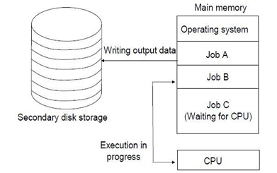

  - Non-Multiprogrammed: CPU sits idle while waiting for a job to complete.

  - **Multiprogrammed**: The OS switches to and executes another job if the current job needs to wait, utilizing the CPU effectively

  - Jobs are scheduled in "ready queue"

  - Single CPU

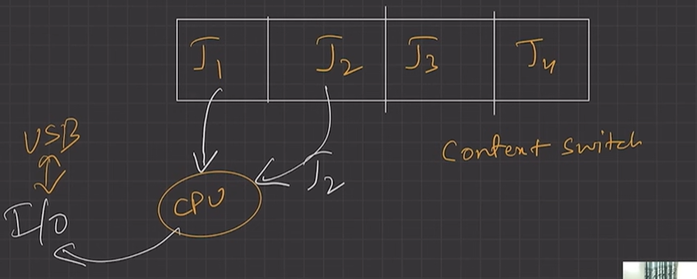

  - Context switching for processes. when p1 goes in wait state, its context is saved in PCB (PROCESS CONTROL BLOCK) and then take information of P2 from PCB , the context of P2 is restored and the wok on P2 begins while P1 is in wait state.

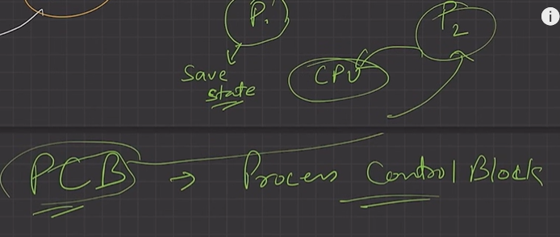

  - Switch happens when current process goes to wait state. Ensures that the CPU is never idle as long as at least one job needs to execute, leading to better utilization of resources.

  - **CPU idle time reduced.**

  - "PROCESSOR KISI KE LIYE NAHI RUKEGA" "THE SHOW MUST GO ON"

  - **Multitasking operating system \[CTSS**, MIT, early 1960s\]

    - Multitasking is a logical extension of multiprogramming.

    - AKA Time Sharing/Multiprogramming with Round Robin/ Fair Share

    - Time sharing (or multitasking) is a logical extension of multiprogramming, it allows many users to share the computer simultaneously. the CPU executes multiple jobs (May belong to different user) by switching among them, but the switches occur so frequently that, each user is given the impression that the entire computer system is dedicated to his/her use, even though it is being shared among many users.

    - Single CPU

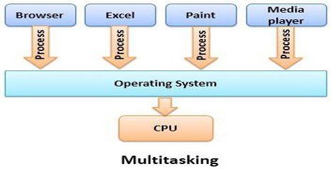

  - Able to run more than one task simultaneously.

  - Context switching and time sharing used.

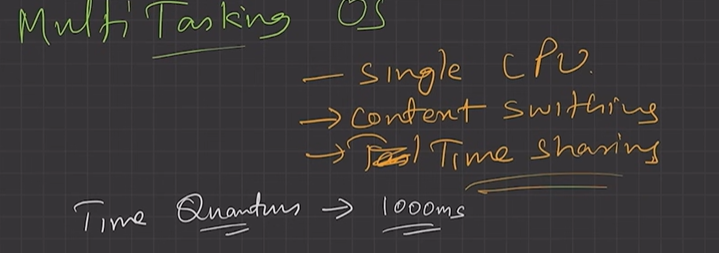

P1 for 1000ms, then FORCED CONTXT SWITCH to P2 then 1000ms, then switch to P3.

1000ms = TIME QUANTUM.

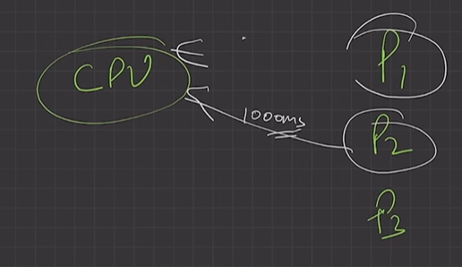

  - Increases responsiveness.

  - CPU idle time is further reduced.

  - **Maximum CPU utilization - YES**

  - **Less process starvation - YES**

  - **Higher priority job execution - YES**

  - In the modern operating systems, we are able to play MP3 music, edit documents in Microsoft Word, surf the Google Chrome all running at the same time. (by context switching, the illusion of parallelism is achieved) \[TRUE PARALLELISM IS NOT THERE\]

  - For multitasking to take place, firstly there should be multiprogramming i.e. presence of multiple programs ready for execution. And secondly the concept of time sharing.

  - **Multi-processing operating system \[Windows NT\]**

    - aka tightly coupled system

    - Multi-processing OS, more than 1 CPU in a single computer.

    - Increases reliability, 1 CPU fails, other can work

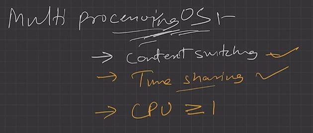

  - Better throughput.

  - Lesser process starvation, if 1 CPU is working on some process, other can be executed on other CPU.

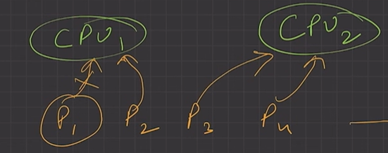

  - Multiprocessor Operating System refers to the use of two or more central processing units (CPU) within a single computer system. These multiple CPU’s share system bus, memory and other peripheral devices.

  - Multiple concurrent processes each can run on a separate CPU, here we achieve a true parallel execution of processes. (REAL PARALLELISM ACHIEVED)

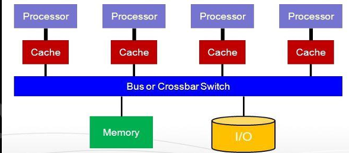

  - Becomes most important in computer system, where the complexity of the job is more, and CPU divides and conquers the jobs. Generally used in the fields like artificial intelligence and expert system, image processing, weather forecasting etc.

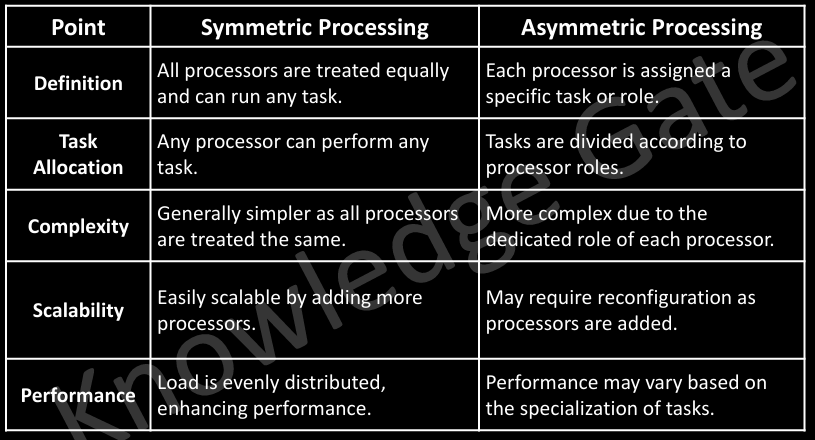

DIFFERENCE MULTI PROGRAMMING & PROCESSING

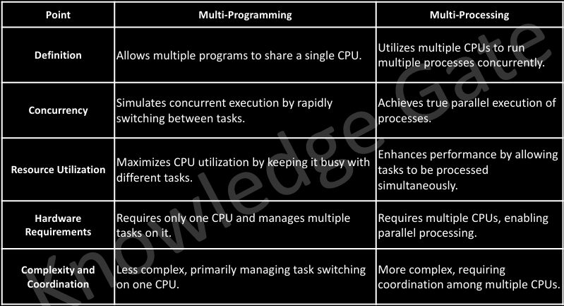

  - **Distributed system \[LOCUS\]**

    - Loosely Coupled Operating System

    - OS manages many bunches of resources,

    - >=1 CPUs, >=1 memory, >=1 GPUs, etc

    - **Loosely connected autonomous,**

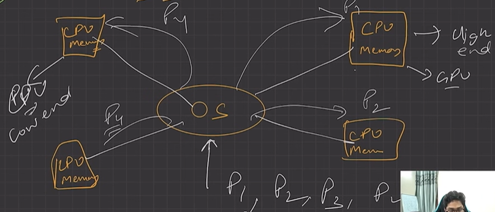

  - interconnected computer nodes.

  - collection of independent, networked, communicating, and physically separate computational nodes.

  - AIX operating system

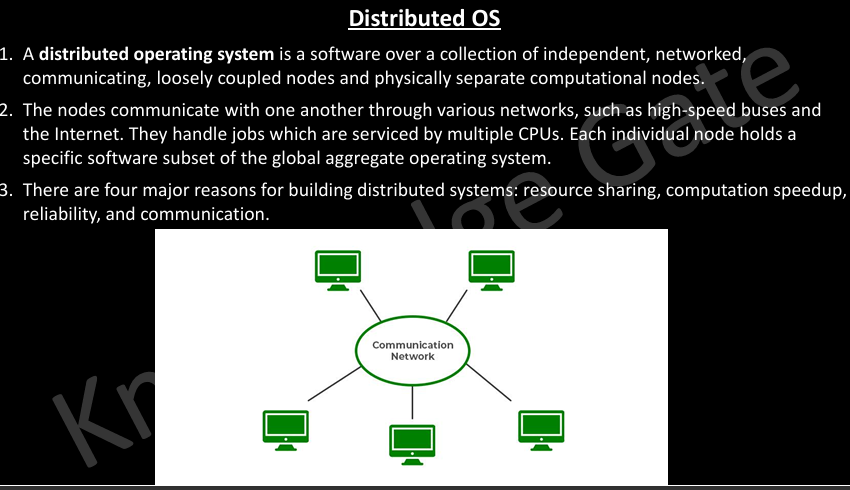

  - **Real time OS \[ATCS\]**

    - Real time error free, computations

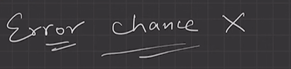

  - A real time operating system is a special purpose operating system which has well defined fixed time constraints. Processing must be done within the defined time limit or the system will fail.

  - Valued more for how quickly or how predictably it can respond, without buffer delays than for the amount of work it can perform in a given period of time.

  - For example, a petroleum refinery, Airlines reservation system, Air traffic control system, Systems that provide up to the minute information on stock prices, Defense application systems like as RADAR.

  - within tight-time boundaries.

  - Air Traffic control system, ROBOTS etc.

| Hard Real Time OS | Soft Real Time OS |
| --- | --- |
| This is also a type of OS and it is predicted by a deadline. The predicted deadlines will react at a time t = 0. Some examples of this operating system are air bag control in cars. | The soft real-time operating system has certain deadlines, may be missed and they will take the action at a time t=0+. The critical time of this operating system is delayed to some extent. The examples of this operating system are the digital camera, mobile phones and online data etc |
| 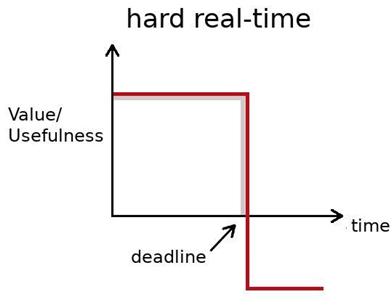 | 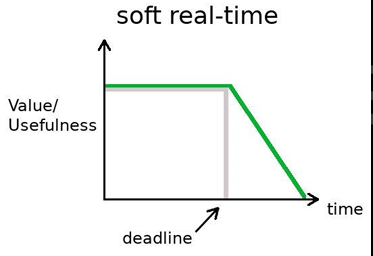 |

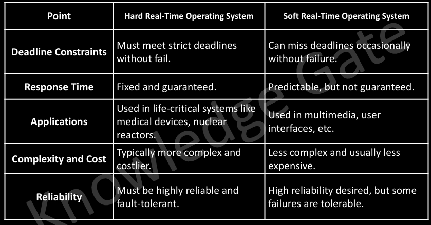

[Lecture 2: Types of Operating Systems](<https://www.youtube.com/watch?v=LBqNWOqSzBA&list=PLDzeHZWIZsTr3nwuTegHLa2qlI81QweYG&index=3&pp=iAQB>)
