# 4.2.4 Multi-Tasking vs Multi-Threading

**Program: **

A Program is an executable file which contains a certain set of instructions written

to complete the specific job or operation on your computer.

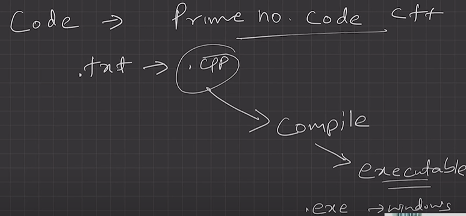

• It’s a compiled code. Ready to be executed.

• Stored in Disk

**Process:**Program under execution. Resides in Computer’s primary memory (RAM).

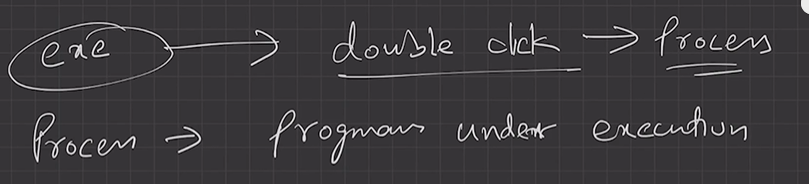

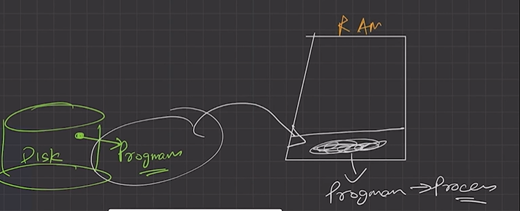

**Thread:**

• Single sequence stream within a process.

• An independent path of execution in a process.

• Light-weight process.

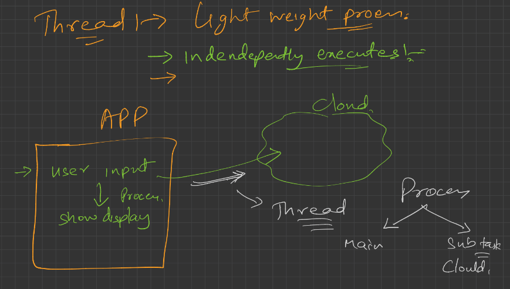

• Used to achieve parallelism by dividing a process’s tasks which are independent path

of execution.

eg: JPG TO PNG CONVERTOR

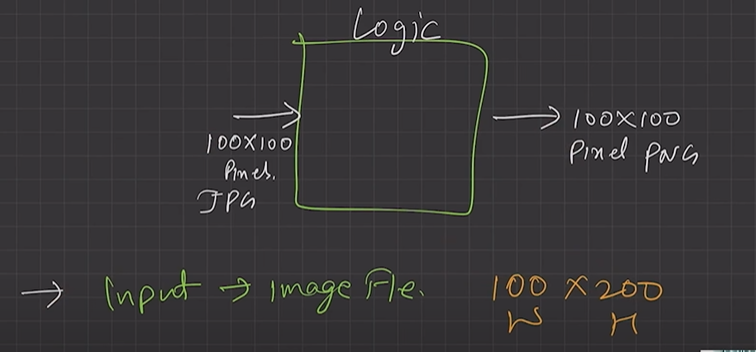

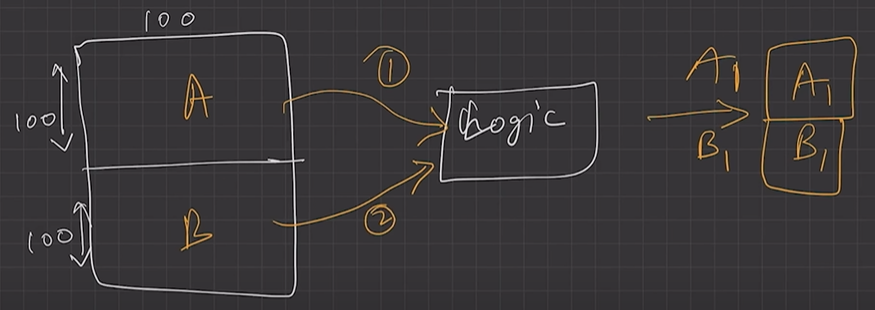

Sequential execution --> using multithreading --> execute parallely

Divide process into two threads, as both had independent paths of executions

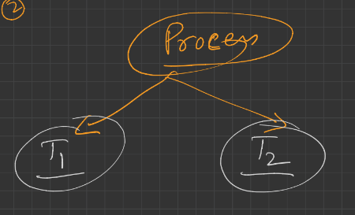

Give A part to T1 thread and B to T2 thread and both threads use same logic and execute parallely and independently.

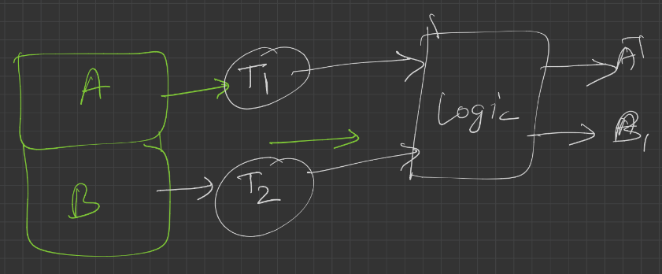

• E.g., Multiple tabs in a browser,** text editor (When you are typing in an editor, spell-**

**checking, formatting of text and saving the text are done concurrently by multiple threads.)**

MULTI-THREADING REQUIRES MORE THAN 1 CPU (MULTIPROCESSING ENVIRONMENT). SINGLE CPU ME MULTUTHREADING POSSIBLE NAHI H. IT IS SIMILAR TO SEQUENTIAL WORK ONLY.

THREADS ARE LIKE CHILD/PARTS OF PROCESSES. THERE IS NO ISOLATION BETWEEN THREADS, AS THEY ARE PART OF SAME PROCESSES.

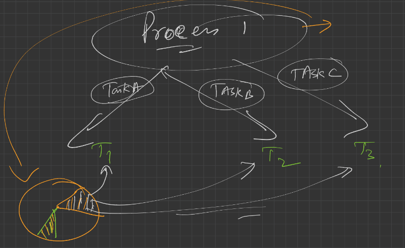

| **Multi-Tasking ** | **Multi-Threading** |
| --- | --- |
| The execution of more than one task simultaneously is called as multitasking. | A process is divided into several different sub-tasks called as threads, which has its own path of execution. This concept is called as multithreading. |
| Concept of more than 1 processes being context switched. | Concept of more than 1 thread. Threads are context switched. |
| No. of CPU 1. | No. of CPU >= 1. (Better to have more than 1) **Number of threads = Number of CPU Cores** |
| Isolation and memory protection exists. OS must allocate separate memory and resources to each program that CPU is executing. 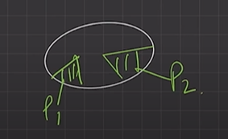 PROCESS SCHEDULE | No isolation and memory protection, resources are shared among threads of that process. OS allocates memory to a process; multiple threads of that process share the same memory and resources allocated to the process. 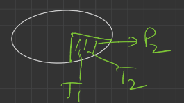 THREADS SCHEDULE |

**Thread Scheduling:**

Threads are scheduled for execution based on their **priority**.  Threads are spawned (created) with a priority. Even though threads are executing within the runtime, all threads are assigned processor time slices by the operating system.

Difference between Thread Context Switching and Process Context Switching:

| **Thread Context switching ** | **Process context switching** |
| --- | --- |
| OS saves current state of thread & switches to another thread of same process. | OS saves current state of process & switches to another process by restoring its state. |
| Doesn’t includes switching of memory address space. (But Program counter, registers & stack are included.) | Includes switching of memory address space. |
| Fast switching. | Slow switching. |
| CPU’s cache state is preserved. (because same process) | CPU’s cache state is flushed. |

Multi Programming vs Multi processing -

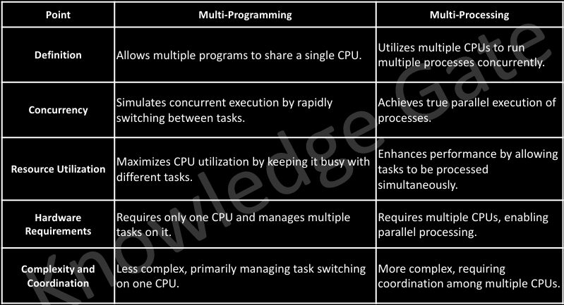

[Lecture 3: Multi-Tasking vs Multi-Threading](<https://www.youtube.com/watch?v=iAnEvdCya6M&list=PLDzeHZWIZsTr3nwuTegHLa2qlI81QweYG&index=4&pp=iAQB>)
