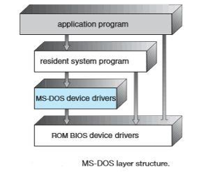
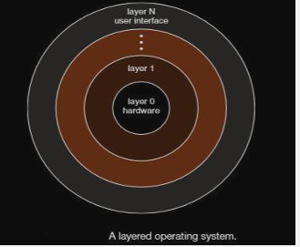
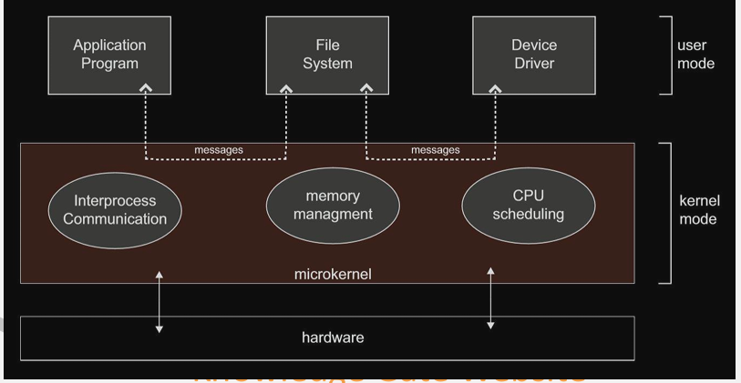

# 4.3.1 2- STRUCTURE OF OS

SIMPLE STRUCTURE:

A common approach is to partition the task into small components, or modules, rather than have one monolithic system. Each of these modules should be a well-defined portion of the system, with carefully defined inputs, outputs, and functions.

Simple Structure - Many operating systems do not have well-defined structures. Frequently, such systems started as small, simple, and limited systems and then grew beyond their original scope. MS-DOS is an example of such a system.

Not divided into modules. Its interface , levels and functionality are not well separated

LAYERED APPROACH:

With proper hardware support, operating systems can be broken into pieces. The operating system can then retain much greater control over the computer and over the applications that make use of that computer.

  - Implementers have more freedom in changing the inner workings of the system and in creating modular operating systems.

  - Under a top-down approach, the overall functionality and features are determined and are separated into components.

  - Information hiding is also important, because it leaves programmers free to implement the low-level routines as they see fit.

  - A system can be made modular in many ways. One method is the layered approach, in which the operating system is broken into a number of layers (levels). The bottom layer (layer 0) is the hardware; the highest (layer N) is the user interface

MICROKERNEL APPROACH

  - In the mid-1980s, researchers at Carnegie Mellon University developed an operating system called Mach that modularized the kernel using the microkernel approach.

  - This method structures the operating system by removing all nonessential components from the kernel and implementing them as system and user-level programs. The result is a smaller kernel.

  - One benefit of the microkernel approach is that it makes extending the operating system easier. All new services are added to user space and consequently do not require modification of the kernel.

  - When the kernel does have to be modified, the changes tend to be fewer, because the microkernel is a smaller kernel.

  - The MINIX 3 microkernel, for example, has only approximately 12,000 lines of code. Developer Andrew S. Tanenbau

