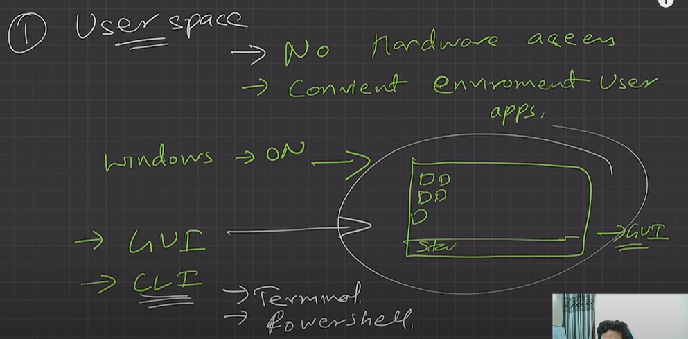
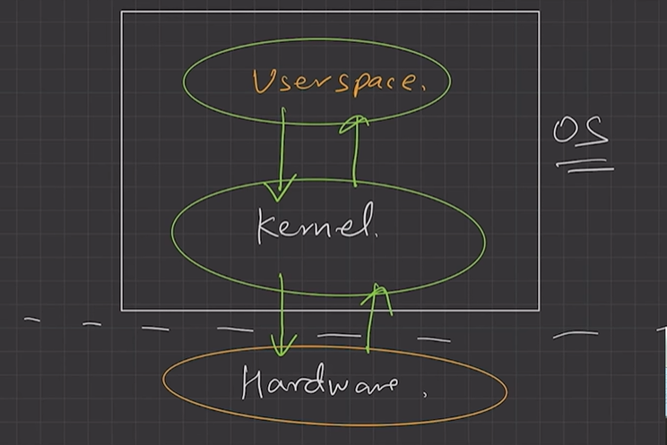
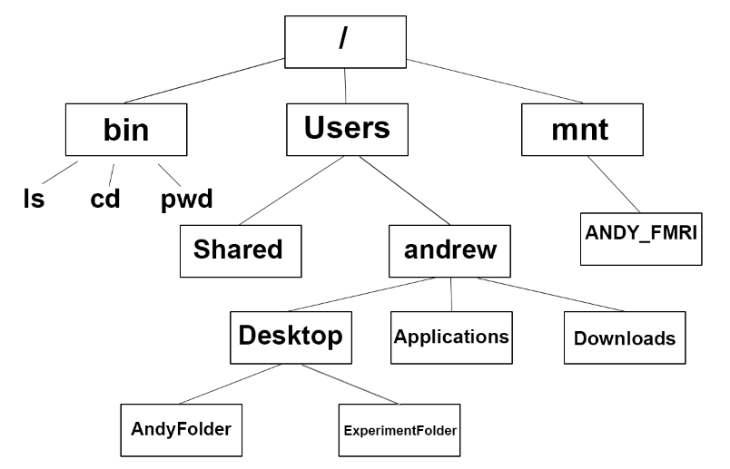
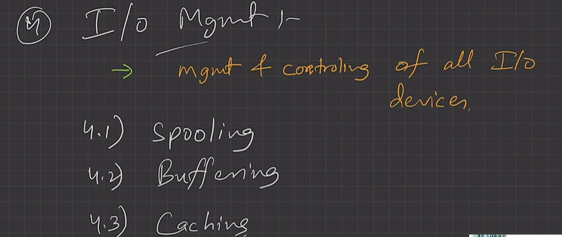
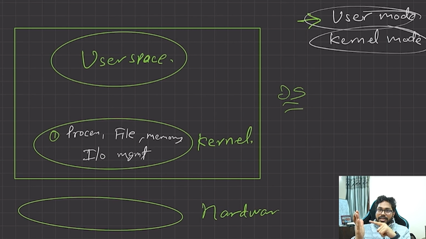
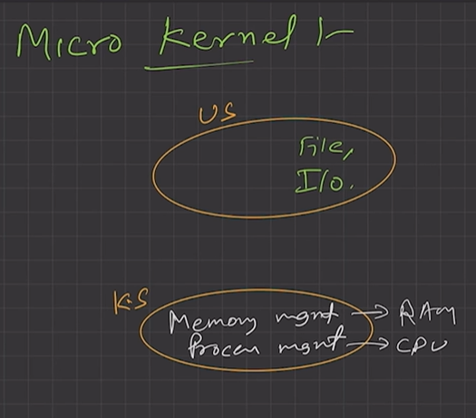
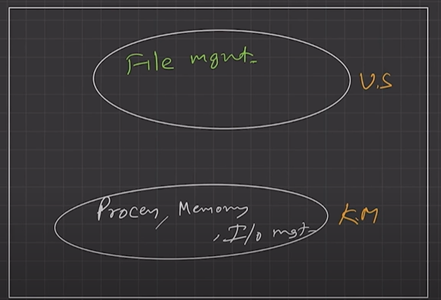
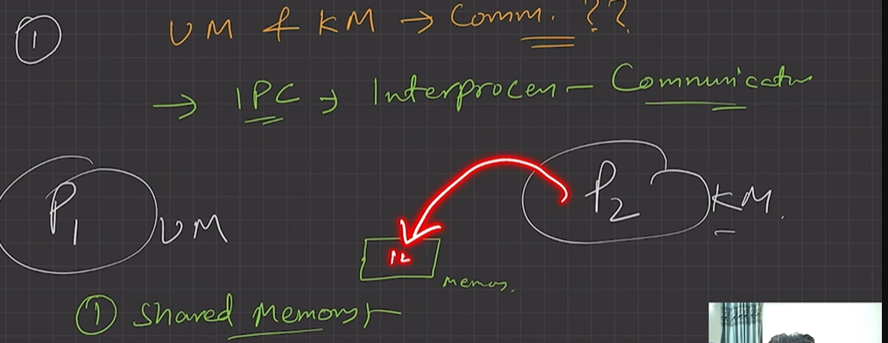

# 4.3.2 Components: Kernel, User Space

Components of OS:

  1. **Kernel:** A kernel is that part of the operating system which** interacts directly with the hardware** and performs the most crucial tasks. Access to underlying hardware.

    - Heart of OS/Core component

    - Very first part of OS to load on start-up.

    - Central Component: Manages the system's resources and communication between hardware and software

  1. **User space:** Where application software runs, apps don’t have privileged access to the underlying hardware. It interacts with kernel. Apps run here.  There are several ways for users to interface with the operating system.

    - **GUI - Graphical User Interfaces.**

      - A second strategy for interfacing with the operating system is through a user- friendly graphical user interface, or GUI. Here, users employ a mouse-based window- and-menu system characterized by a desktop.

      - The user moves the mouse to position its pointer on images, or icons, on the screen (the desktop) that represent programs, files, directories, and system functions. Depending on the mouse pointer’s location, clicking a button on the mouse can invoke a program, select a file or directory—known as a folder —or pull down a menu that contains commands.

    - **CLI - Command-line interface, or command interpreter**

      - Some operating systems include the command interpreter in the kernel. Others, such as Windows and UNIX, treat the command interpreter as a special program that is running when a job is initiated or when a user first logs on (on interactive systems).

      - On systems with multiple command interpreters to choose from, the interpreters are known as shells. For example, on UNIX and Linux systems, a user may choose among several different shells, including the Bourne shell, C shell,

    - **Touch Systems in Mobile**

      - Because a mouse is impractical for most mobile systems, smartphones and handheld tablet computers typically use a touchscreen interface.

      - Here, users interact by making gestures on the touchscreen—for example, pressing and swiping fingers across the screen

mkdir --> system call --> storage management --> directory banao

user space interacts with kernel

A **shell**, also known as a command interpreter, is that part of the operating system that receives commands from the users and gets them executed.

Functions of Kernel:

  - Process management:

    - Process creation, termination... process and thread scheduling... process synchronization.... context switching and thread switching... process communication (communication between P1 and P2)

    - Scheduling processes and threads on the CPUs.

    - Creating & deleting both user and system process.

    - Suspending and resuming processes

    - Providing mechanisms for process synchronization or process communication.

    - Process Scheduler: Determines the execution of processes.

    - Process Control Block (PCB): Contains process details such as process ID, priority, status, etc.

    - Concurrency Control: Manages simultaneous execution

  - Memory management:

    - allocate, deallocate memory.... free space management...

    - Allocating and deallocating memory space as per need.

    - Keeping track of which part of memory are currently being used and by which process.

    - • Physical Memory Management: Manages RAM allocation. • Virtual Memory Management: Simulates additional memory using disk space. • Memory Allocation: Assigns memory to different processes.

  - File management:

    - create/delete file and directory management

    - hierarchial tree structure

  - Creating and deleting files.

  - Creating and deleting directories to organize files.

  - Mapping files into secondary storage.

  - Backup support onto a stable storage media.

  - File System Management • File Handling: Manages the creation, deletion, and access of files and directories. • File Control Block: Stores file attributes and control information. • Disk Scheduling: Organizes the order of reading or writing to disk

  - I/O management: to manage and control I/O operations and I/O devices

    1. Buffering (data copy between two devices), caching and spooling.

      - Spooling

      - Within differing speed two jobs.

      - Eg. Print spooling and mail spooling.

    1. Buffering

      - 1. Within one job.

      - 2. Eg. Youtube video buffering

    1. Caching

      - 1. Memory caching, Web caching etc.

  - 5 Device Management • Device Drivers: Interface between the hardware and the operating system. • I/O Controllers: Manage data transfer to and from peripheral devices.

  - 6. Security and Access Control • Authentication: Verifies user credentials. • Authorization: Controls access permissions to files and directories. • Encryption: Ensures data confidentiality and integrity.

  - 7. User Interface • Command Line Interface (CLI): Text-based user interaction. • Graphical User Interface (GUI): Visual, user-friendly interaction with the OS.

  - 8. Networking • Network Protocols: Rules for communication between devices on a network. • Network Interface: Manages connection between the computer and the network

Types of Kernels:

**1. Monolithic kernel**

  - All (four) functions are in kernel itself.

  - Bulky in size.

  - Memory required to run is high.

  - Less reliable, one module crashes -> whole kernel is down.

  - High performance as communication is fast. (Less user mode, kernel mode overheads)

*Switch between user mode and kernel mode is done by CPU using software interrupts. User mode and kernel mode kept separated by OS. CPU jab user mode me hota h toh sirf user mode ka kaam karta hai and so on....*

*user mode: mkdir + enter + goes to kernel mode*

*kernel mode: file management + directory make + feedback + goes to user mode*

  - Eg: Linux, Unix, MS-DOS

**2. Micro Kernel**

| Only major functions are in kernel.   - Memory mgmt.   - Process mgmt. |  |
| --- | --- |

  - File mgmt. and IO mgmt. are in User-space.

  - smaller in size.

  - More Reliable

  - More stable

  - Performance is slow.

  - Overhead switching b/w user mode and kernel mode takes time. Overhead increase.

  - L4 Linux, Symbian OS, MINIX etc.

**3. Hybrid Kernel:**

| Advantages of both worlds. (File mgmt. in User space and rest in Kernel space. ) |  |
| --- | --- |

  - Combined approach.

  - Speed and design of mono.

  - Modularity and stability of micro.

  - Eg. MacOS, Windows NT/7/10

  - IPC also happens but lesser overheads

4. Nano/Exo kernels...

Q. How will communication happen between user mode and kernel mode?

Ans. Inter process communication (IPC).

1. Two processes executing independently, having independent memory space (Memory

protection), But some may need to communicate to work.

2. Done by shared memory and message passing.

[Lecture 4: Components of Operating System](<https://www.youtube.com/watch?v=kHMXP_i6zew&list=PLDzeHZWIZsTr3nwuTegHLa2qlI81QweYG&index=5&pp=iAQB>)
