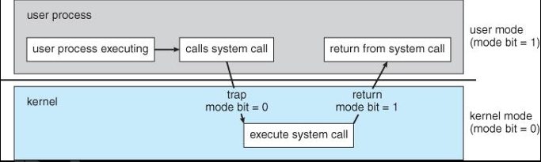

# 4.3.3 Mode: Kernel Mode, User Mode

- We need two separate modes of operation: User mode and Kernel mode (also called supervisor mode, system mode, or privileged mode).

- A bit, called the mode bit, is added to the hardware of the computer to indicate the current mode: kernel (0) or user (1).

- When the computer system is executing on behalf of a user application, the system is in user mode. However, when a user application requests a service from the operating system (via a system call), the system must transition from user to kernel mode to fulfill the request.

