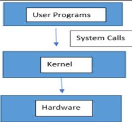
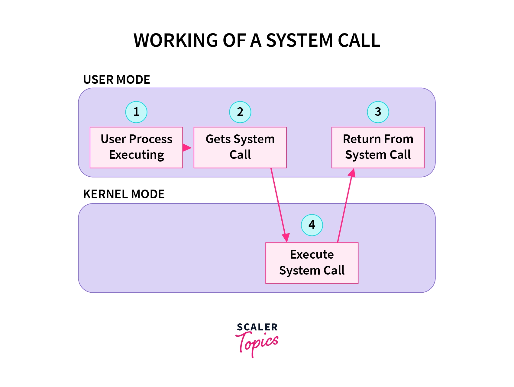
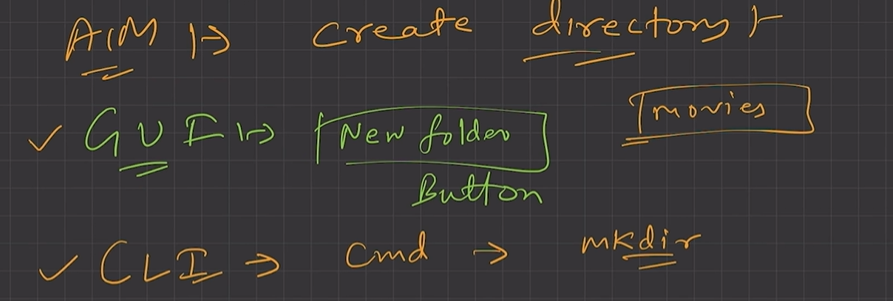
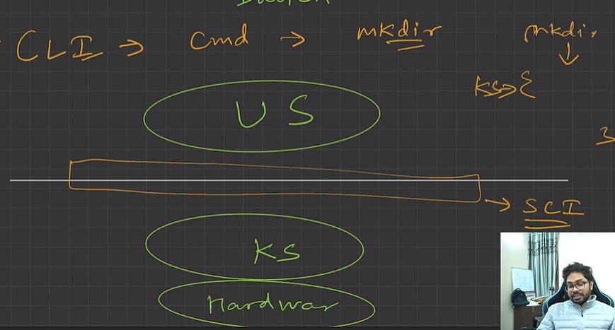
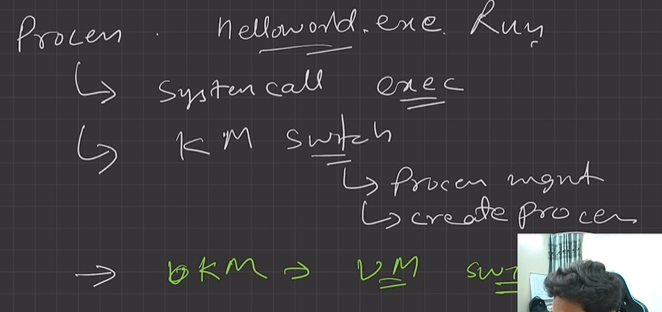
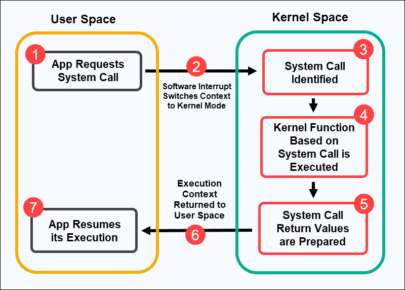
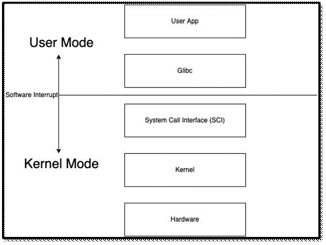
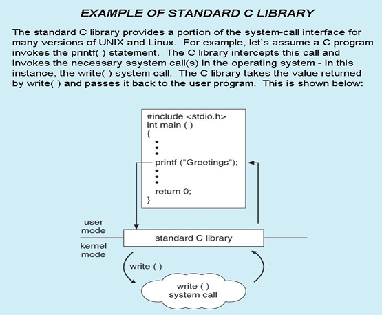
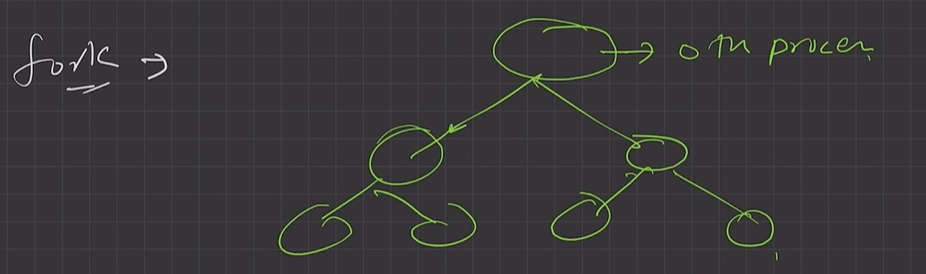
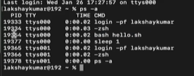

# 4.3.4 LEC-5: System Calls

**LEC-5: System Calls**

**How do apps interact with Kernel? **-> using system calls.

Eg. Mkdir laks

  - System calls provide mechanisms for user space to communicate with kernel space (request resources). System calls is the way to switch between US and KS.

  - Mkdir indirectly calls kernel and asked the file mgmt. module to create a new directory.

  - Mkdir is just a wrapper of actual system calls. It goes to SCI and asks to give the pre-implemented calls for mkdir and sends it to KS to run it.

  - Mkdir interacts with kernel using system calls.

Example - making a new directory:

Actual implementation of mkdir system calls is done in LOW LEVEL C

The mkdir we see is the interface to that C implementation.

  - **Eg. Creating a process.**

  - User executes a process. (User space)

  - Gets system call. (US)

  - Exec system call to create a process. (KS)

  - Return to US.

**Transitions from US to KS done by software interrupts. System calls **are implemented in C.

SYSTEM CALL:

  - A **system call **is a mechanism using which a user program can request a service from the kernel for which it does not have the permission to perform.

  - User programs typically do not have permission to perform operations like accessing I/O devices and communicating other programs.

  - System Calls are the only way through which a process can go into kernel mode from user mode. Execute process, then software interrupt.

  - System calls provide the means for a user program to ask the operating system to perform tasks reserved for the operating system on the user program’s behalf.

  - System calls provide an interface to the services made available by an operating system. These calls are generally available as routines written in C and C++.

  - The API specifies a set of functions that are available to an application programmer, including the parameters that are passed to each function and the return values the programmer can expect

|  | Glibc -- to interact with SCI |
| --- | --- |
|  |  |

TWO WAY ABSTRACTION:

write() doesnt know which langauge called it , program doesnt know what internal call will be made.

**Types of System Calls: **System calls can be grouped roughly into six major categories: process control, file manipulation, device manipulation, information maintenance, communications, and protection.

  1. Process Control

    1. end, abort

    1. load, execute

    1. create process, terminate process

    1. get process attributes, set process attributes

    1. wait for time

    1. wait event, signal event

    1. allocate and free memory

  1. File Management

    1. create file, delete file

    1. open, close

    1. read, write, reposition

    1. get file attributes, set file attributes

  1. Device Management

    1. request device, release device

    1. read, write, reposition

    1. get device attributes, set device attributes

    1. logically attach or detach devices

  1. Information maintenance

    1. get time or date, set time or date

    1. get system data, set system data

    1. get process, file, or device attributes

    1. set process, file, or device attributes

  1. Communication Management (inter-process communication, IPC)

    1. create, delete communication connection

    1. send, receive messages

    1. transfer status information

    1. attach or detach remote devices

  1. Protection

**Examples of Windows & Unix System calls:**

| **Category** | **Windows** | **Unix** |
| --- | --- | --- |
|  |  |  |
| Process Control | CreateProcess() ExitProcess() WaitForSingleObject() | fork() exit() wait() |
|  |  | Initial process is root process, fork creates child of the root process.  example: open terminal = parent process, run .exe = child process |
| File Management | CreateFile() ReadFile() WriteFile() CloseHandle() SetFileSecurity() InitlializeSecurityDescriptor() SetSecurityDescriptorGroup() | open () read () write () close () chmod() // set read/write mode of file umask() chown() |
|  |  |  |
| Device Management | SetConsoleMode() ReadConsole() WriteConsole() | ioctI() read() write() |
|  |  |  |
| Information Management | GetCurrentProcessID() SetTimer() Sleep() | getpid () alarm () sleep () |
|  |  |  |
| Communication | CreatePipe() CreateFileMapping() MapViewOfFile() | pipe ()                    // message passing in IPC shmget ()               // shared memory in IPC mmap() |

**vim hello.sh**

** #!/bin/bash**

**while \[true\]**

**do**

**echo "hello lavesh"**

**sleep 1**

**done **

**bash hello.sh**

**process call **

**kill - 9 19354**

[Lecture 5: System Calls in Operating System  \[Theory + Example + Hands-on Terminal\]](<https://www.youtube.com/watch?v=lo8Z61qCDqQ&list=PLDzeHZWIZsTr3nwuTegHLa2qlI81QweYG&index=6&pp=iAQB>)

[L1: Introduction & System calls \| Applied Operating Systems for Engineers & Interviews](<https://www.youtube.com/watch?v=H0riqM-nrlk&list=PL7CBVLpg0zqfIdcwDNa5c2xbhvK4crNqc&index=1&t=47s&pp=iAQB>)

[L2: System calls for Signaling, Interprocess Communication \| Applied Operating Systems](<https://www.youtube.com/watch?v=P0sInk31n54&list=PL7CBVLpg0zqfIdcwDNa5c2xbhvK4crNqc&index=2&pp=iAQB>)

[L3: System calls for file management, Process communication \| Applied Operating Systems](<https://www.youtube.com/watch?v=xxLrI4gOP04&list=PL7CBVLpg0zqfIdcwDNa5c2xbhvK4crNqc&index=3&pp=iAQB>)
