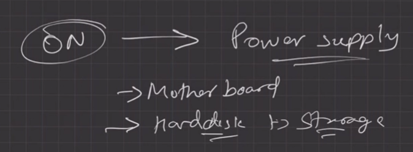
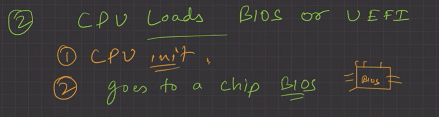
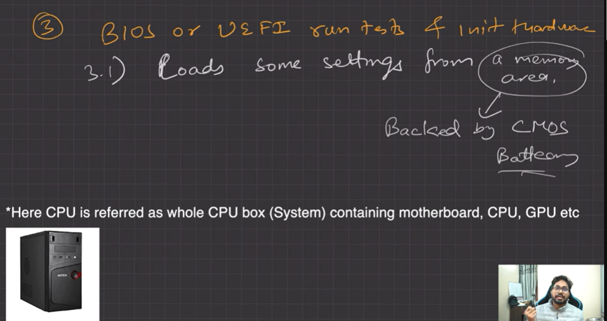
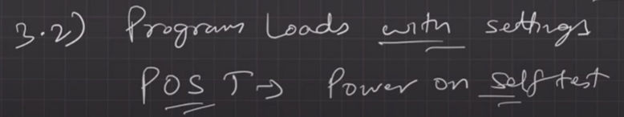
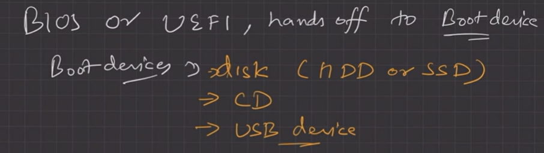
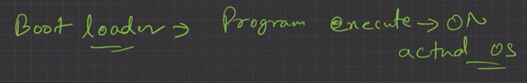
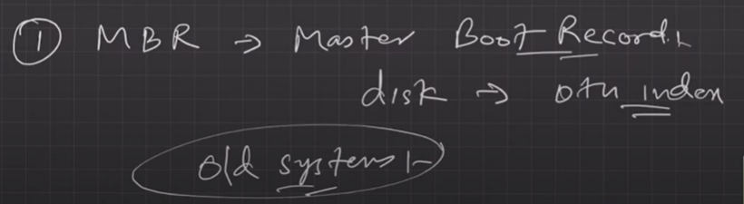
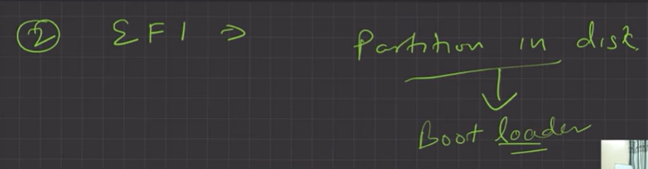
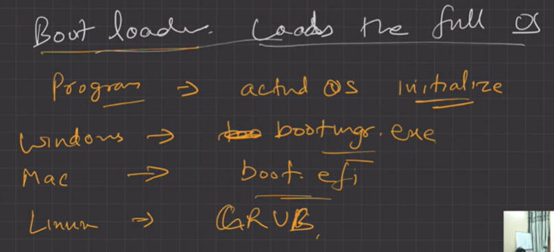

# 4.3.5 What happens when you turn on your computer?

i. PC On

ii. CPU initializes itself and looks for a firmware program (BIOS) stored in the **BIOS Chip **

**      (Basic input-output system chip**is a ROM chip found on the motherboard that allows access & setup of the computer system at the most basic level.)

1. In modern PCs, CPU loads **UEFI (Unified Extensible Firmware Interface).**

iii. CPU runs the BIOS, which tests and initializes system hardware. BIOS loads configuration settings. If something is not appropriate (like missing RAM), an error is thrown, and the boot process is stopped. This is called the **POST (Power-on self-test)**process. (UEFI can do a lot more than just initialize hardware; it’s really a tiny operating system.

For example, Intel CPUs have the Intel Management Engine. This provides a variety of features,

including powering Intel’s Active Management Technology, which allows for remote management of business PCs.)

iv. BIOS will hand off responsibility for booting your PC to your **OS’s bootloader**.

1. BIOS looks at the MBR (Master Boot Record), a special boot sector at the beginning of a disk. The MBR contains code that loads the rest of the operating system, known as a “bootloader.”

The BIOS executes the **bootloader**, which takes it from there and begins booting the actual operating system—Windows or Linux, for example. In other words, the BIOS or UEFI examines a storage device on your system to look for a small program, either in the MBR or on an EFI system partition, and runs it.

BIOS --> MBR

UEFI --> EFI

v. The bootloader is a small program that has the large task of booting the rest of the operating system (Boots Kernel, then User Space). Windows uses a bootloader named Windows Boot Manager (Bootmgr.exe), most Linux systems use GRUB, and Macs use something called** boot.efi.**

[Lecture 6: How Operating System Boots up?](<https://www.youtube.com/watch?v=nAr2sLiLDWw&list=PLDzeHZWIZsTr3nwuTegHLa2qlI81QweYG&index=7&pp=iAQB>)
