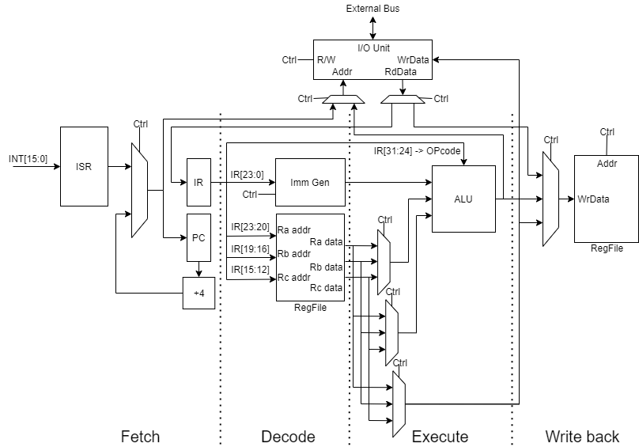
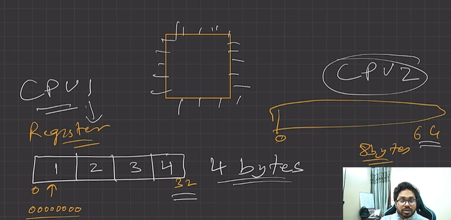
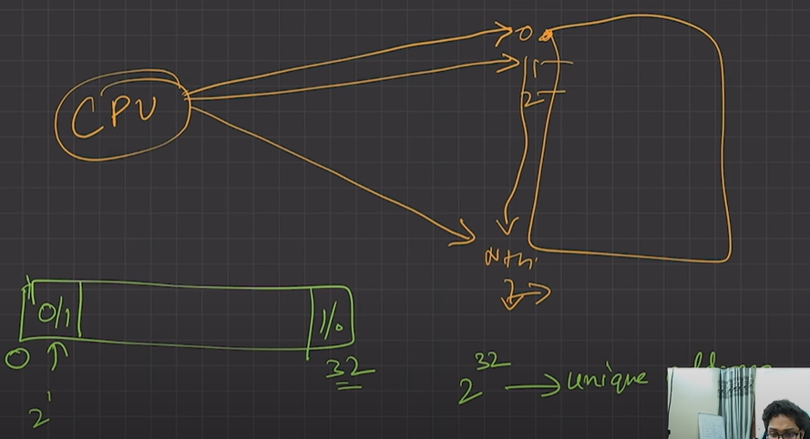

# 4.3.6 32-Bit vs 64-Bit OS

  - A 32-bit OS has 32-bit registers, and it can access 2^32 unique memory addresses. i.e., 4GB of physical memory.

|  |  |
| --- | --- |

  - A 64 -bit OS has 64-bit registers, and it can access 2^64 unique memory addresses. i.e., 17,179,869,184 GB of physical memory.

  - 32-bit CPU architecture can process 32 bits of data & information.

  - 64-bit CPU architecture can process 64 bits of data & information.

  - Advantages of 64-bit over the 32-bit operating system:

    - **Addressable Memory:** 32-bit CPU -> 2^32 memory addresses, 64-bit CPU -> 2^64

memory addresses.

  - **Resource usage:** Installing more RAM on a system with a 32-bit OS doesn't impact performance. However, upgrade that system with excess RAM to the 64-bit version of Windows, and you'll notice a difference.

  - **Performance:** All calculations take place in the registers. When you’re performing math in your code, operands are loaded from memory into registers. So, having larger registers allow you to perform larger calculations at the same time.

  - 32-bit processor can execute 4 bytes of data in 1 instruction cycle while 64-bit means that processor can execute 8 bytes of data in 1 instruction cycle. (In 1 sec, there could be thousands to billons of instruction cycles depending upon a processor design)

  - **Compatibility:** 64-bit CPU can run both 32-bit and 64-bit OS. While 32-bit CPU can only run 32-bit OS.

  - **Better Graphics performance:** 8-bytes graphics calculations make graphics-intensive apps run faster.

[Lecture 7: Difference between 32-bit & 64-bit Operating System](<https://www.youtube.com/watch?v=cE6WoaUnpAM&list=PLDzeHZWIZsTr3nwuTegHLa2qlI81QweYG&index=8&pp=iAQB>)
