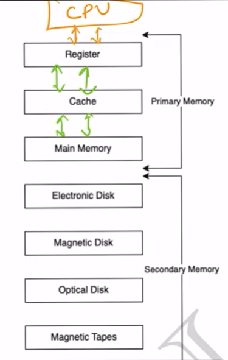

# 4.3.7 STORAGES IN COMPUTER

What are the different memory present in the computer system?

1. **Register:**Smallest unit of storage. It is a part of CPU itself.

A register may hold an instruction, a storage address, or any data (such as bit sequence or individual

characters).

Registers are a type of computer memory used to quickly accept, store, and transfer data and

instructions that are being used immediately by the CPU.

2.** Cache:**Additional memory system that temporarily stores frequently used instructions and data for

quicker processing by the CPU.

3. **Main Memory: RAM.**

4. **Secondary Memory:**Storage media, on which computer can store data & programs.

Comparison

  - 1. Cost:

    - a. Primary storages are costly. Register > Cache > RAM > Secondary

    - b. Registers are most expensive due to expensive semiconductors & labour.

    - c. Secondary storages are cheaper than primary.

  - 2. Access Speed:

    - a. Primary has higher access speed than secondary memory.

    - b. Registers has highest access speed, then comes cache, then main memory.

  - 3. Storage size:

    - a. Secondary has more space.

  - 4. Volatility:

    - a. Primary memory is volatile.

    - b. Secondary is non-volatile.

[Lecture 8: Comparison between different STORAGES used in Computer](<https://www.youtube.com/watch?v=KFIStTj2DFw&list=PLDzeHZWIZsTr3nwuTegHLa2qlI81QweYG&index=9&pp=iAQB>)
