# 4.4.1 Introduction to Processes

1. What is a program? Compiled code, that is ready to execute.

.pp --> compiler --> compile ---> convert to executable ---> program.exe (in DISC, eg. TitkTok)

On double click: OS --> convert program ---> into process

1. What is a process? Program under execution.

| - A Program is not a Process by default. A program is a passive entity, i.e. a file containing a list of instructions stored on disk (secondary memory) (often called an executable file)   - A program becomes a Process when an executable file is loaded into main memory and when it’s PCB is created.   - A process on the other hand is an Active Entity, which require resources like main memory, CPU time, registers, system buses etc. | 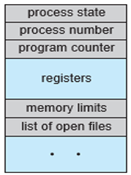 |
| --- | --- |

| Even if two processes may be associated with same program, they will be considered as two separate execution sequences and are totally different process. For instance, if a user has invoked many copies of web browser program, each copy will be treated as separate process. even though the text section is same but the data, heap and stack sections can vary. | 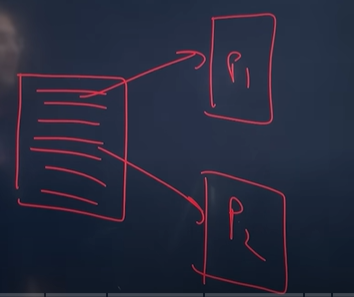 |
| --- | --- |

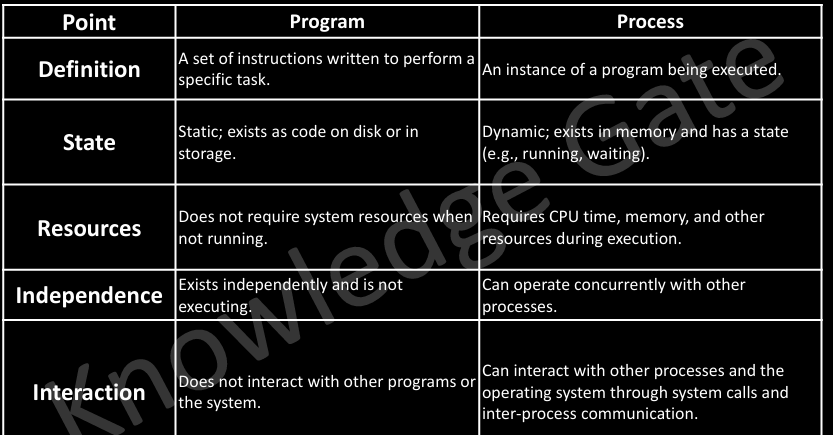

1. How OS creates a process? Converting program into a process.

**STEPS:**

**a. Load the program & static data (used for initialization) into memory.**

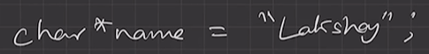

**b. Allocate runtime stack.**

stack is part of memory used for local variables, function arguments and return values.

**c. Heap memory allocation.**

part of memory used for dynamic allocations

**d. IO tasks.**

input, output, error handles eg: fprintf(stderr, "hang")

**e. OS handoffs control to main ().**

main(){

return 0; // denotes successful execution of program (parent ko pata chalne ke liye)

}

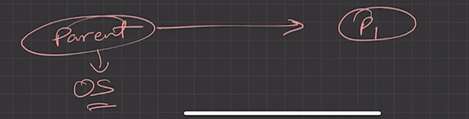

4. **Architecture of process:**

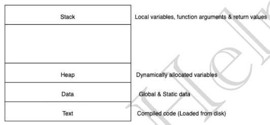

  - Text section: Also known as Program Code.

  - Stack: Which contains the temporary data (Function Parameters, return addresses and local variables)

  - Data Section: Containing global variables

  - Heap: Which is memory dynamically allocated during process runtime

| **Stack overflow**when stack reaches heap... To avoid: add base case, to terminate recursion call, stack unwinding... | 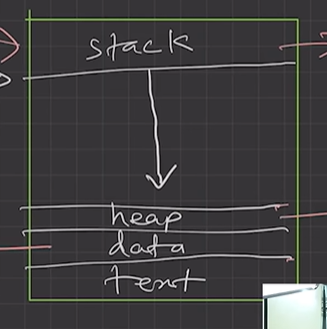 |
| --- | --- |
| **Out of memory**error: when we do not deallocate heap memory and it reaches the stack.... To avoid: deallocate unnecessary objects | 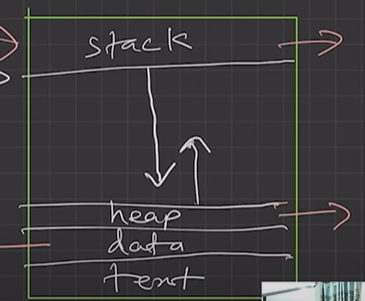 |

5. **Attributes of process:**

  - a. Feature that allows identifying a process uniquely.

  - b. Process table

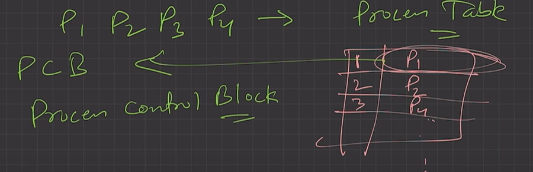

    - All processes are being tracked by OS using a table like data structure.

    - Each entry in that table is** process control block (PCB)**. OS identifies process through a PCB i.e. each process has its own PCB.

  - c. PCB: Stores info/attributes of a process.

    - Data structure used for each process, that stores information of a process such as process id, program counter, process state, priority etc.

6. **PCB structure:**

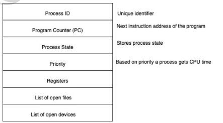

Each process is represented in the operating system by a process control block (PCB) — also called a task control block.

PCB simply serves as the repository for any information that may vary from process to process. It contains many pieces of information associated with a specific process, including these:

**1. Process state:**The state may be new, ready, running, waiting, halted, and so on. PROCESS STATE: NEW, WAIT, RUN

**2. Program counter:**The counter indicates the address of the next instruction to be executed for this process.

**3. CPU registers: **

  - The registers vary in number and type, depending on the computer architecture. They include accumulators, index registers, stack pointers, and general-purpose registers, plus any condition-code information. Along with the program counter, this state information must be saved when an interrupt occurs, to allow the process to be continued correctly afterward

  - Registers in the PCB, it is a data structure. When a processes is running and it's time slice expires, the current value of process specific registers would be stored in the PCB and the process would be swapped out.

  - When the process is scheduled to be run, the register values is read from the PCB and written to the CPU registers. This is the main purpose of the registers in the PCB.

REGISTER: Stack Pointer, Base Pointer, SAVE THE REGISTERS

  1. **CPU-scheduling information:** This information includes a process priority, pointers to scheduling queues, and any other scheduling parameters.

  1. Memory-management information: This information may include such items as the value of the base and limit registers and the page tables, or the segment tables, depending on the memory system used by the operating system.

  1. Accounting information: This information includes the amount of CPU and real time used, time limits, account numbers, job or process numbers, and so on.

  1. I/O status information: This information includes the list of I/O devices allocated to the process, a list of open files, and so on

File descriptors and Device Descriptors

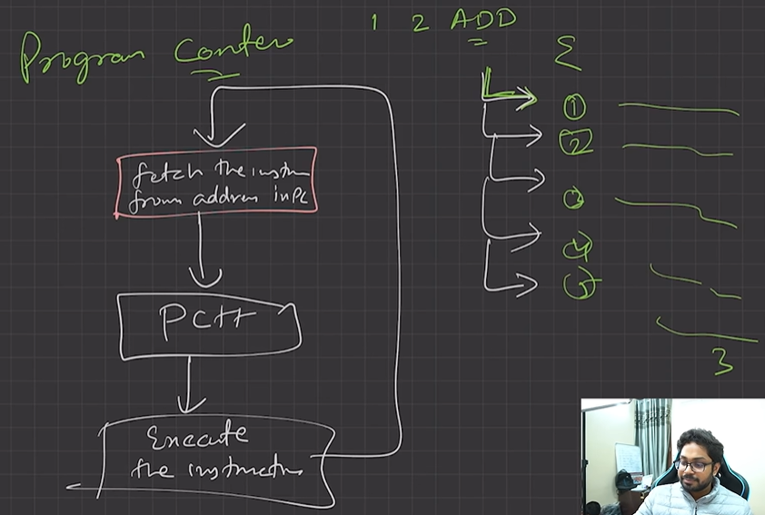
