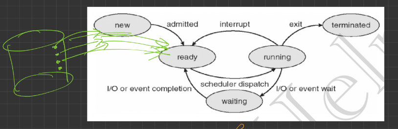
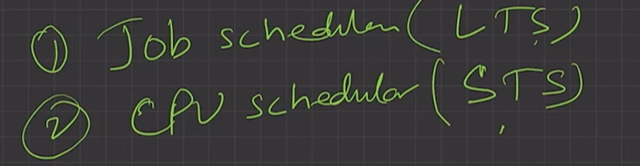
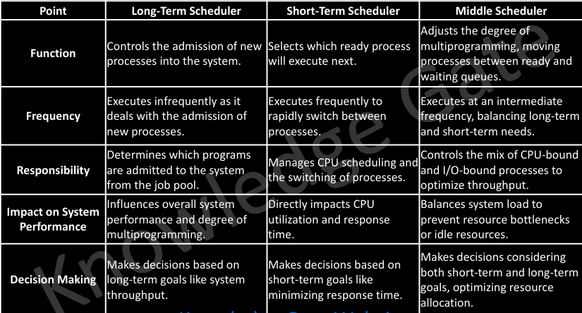

# 4.4.3 Process States | Process Queues

1. **Process States**: As process executes, it changes state. A Process changes states as it executes. The state of a process is defined in parts by the current activity of that process. Each process may be in one of the following states.

**a. New:**OS is about to pick the program & convert it into process. OR the process is being

created. "Program --> process" is being done

**b. Ready:**The process is in memory, waiting to be assigned to a processor. Process is in ready queue.

**c. Run:**Instructions are being executed; CPU is allocated. P1 --> CPU allocated.

**c. Waiting:**Waiting for IO completion. The process is waiting for some event to occur (such as an I/O completion or reception of a signal).

**d. Terminated:**The process has finished execution. PCB entry removed from process table.

P1 P2 P3 in ready queue

Schedule P3 ---> P3 in running state, P1P2 in ready queue

P3 in IO, run state empty, P2 schedule, P1 in ready queue

P2 in run state, P3 in ready queue, P1 in ready queue

2. **Process Queues:**

a. **Job Queue:**

**i. Processes in new state.**

ii. Present in secondary memory.

iii. **Job Schedular (Long term schedular (LTS))**picks process from the pool and

loads them into memory for execution. Disk se uthake, new me dalke, ready state tak schedule karke leke jaana.

Job Scheduler has less frequency, so it has lot of idle time.

b. Ready Queue:

i. Processes in Ready state.

ii. Present in main memory.

iii. **CPU Scheduler (Short-term schedular)**picks process from ready queue and

dispatch it to CPU. **Works on very high frequency. Idle time very less.**

c. Waiting Queue:

i. Processes in Wait state.

**3. Degree of multi-programming: The number of processes in the memory.**

**a. LTS controls degree of multi-programming**.

4. Dispatcher: The module of OS that gives control of CPU to a process selected by STS

  1. **Schedulers**

A process migrates among the various scheduling queues throughout its lifetime. The operating system must select, for scheduling purposes, processes from these queues in some fashion. The selection process is carried out by the appropriate scheduler.

**Types of Schedulers**

  - **Long Term Scheduler (LTS)/Spooler:** Long-term schedulers determine which processes enter the ready queue from the job pool. Operating less frequently than short-term schedulers, they focus on long-term system goals such as maximizing throughput.

  - **Medium-term scheduler:** The medium-term scheduler swaps processes in and out of memory to optimize CPU usage and manage memory allocation. By doing so, it adjusts the degree of multiprogramming and frees up memory as needed. Swapping allows the system to pause and later resume a process, improving overall system efficiency.

  - **Short Term Scheduler (STS):** The short-term scheduler, or CPU scheduler, selects from among the processes that are ready to execute and allocates the CPU to one of them.

**Dispatcher**

  - The dispatcher is the module that gives control of the CPU to the process selected by the short-term scheduler.

  - This function involves the following: Switching context, switching to user mode, jumping to the proper location in the user program to restart that program.

  - The dispatcher should be as fast as possible, since it is invoked during every process switch. The time it takes for the dispatcher to stop one process and start another running is known as the dispatch latency.

**CPU Bound and I/O Bound Processes**

A process execution consists of a cycle of CPU execution or wait and i/o execution or wait. Normally a process alternates between two states.

Process execution begin with the CPU burst that may be followed by a i/o burst, then another CPU and i/o burst and so on. Eventually in the last will end up on CPU burst. So, process keep switching between the CPU and i/o during execution.

  - I/O Bound Processes: An I/O-bound process is one that spends more of its time doing I/O than it spends doing computations.

  - CPU Bound Processes: A CPU-bound process, generates I/O requests infrequently, using more of its time doing computations.

It is important that the long-term scheduler select a good process mix of I/O-bound and CPU-bound processes.If all processes are I/O bound, the ready queue will almost always be empty, and the short-term scheduler will have little to do. Similarly, if all processes are CPU bound, the I/O waiting queue will almost always be empty, devices will go unused, and again the system will be unbalanced.

[Lecture 10: What are different Process States in Operating System ?](<https://www.youtube.com/watch?v=BoH-yzA2nj8&list=PLDzeHZWIZsTr3nwuTegHLa2qlI81QweYG&index=11&pp=iAQB>)
