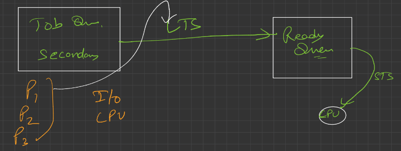
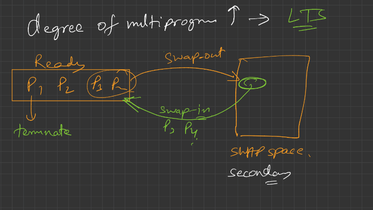
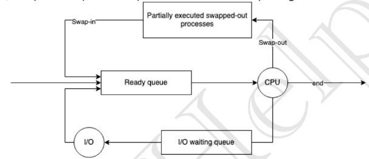
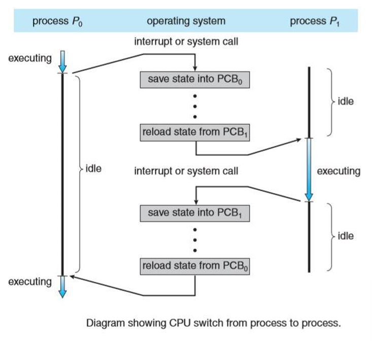
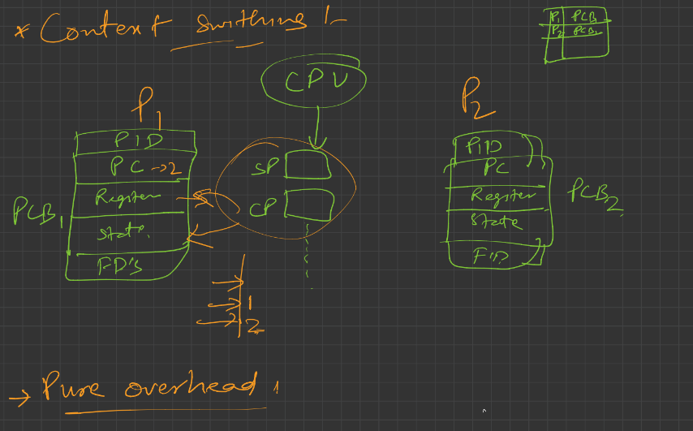
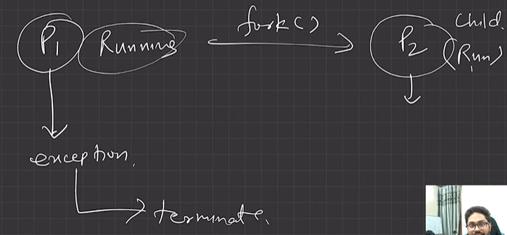
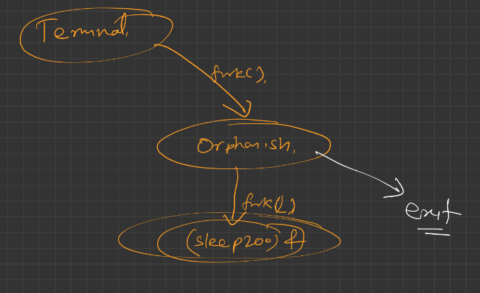
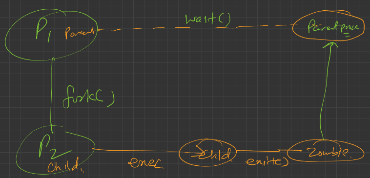

# 4.4.4 Context Switching

**Short Term Scheduler aka CPU Scheduler**

**Long Term Scheduler aka Job Scheduler**

Job Scheduler creates a good mix of CPU Intensive and I/O intensive processes so as to avoid starvation etc.

SWAPPING ---->

**Medium Term Scheduler:**

Degree of multiprogramming increased by LTS by putting a lot of processes in the ready queue.

P1 was memory intensive, so space in ready queue not sufficient ---> P3 P4  swapped out to secondary storage (swap space). Now if P1 terminate/complete ---> P3 P4 swap in into the ready queue again.

  - Time-sharing system may have medium term schedular (MTS).

  - Remove processes from memory to reduce degree of multi-programming.

  - These removed processes can be reintroduced into memory, and its execution can be continued where it left off. This is called Swapping.

  - Swap-out and swap-in is done by MTS.

  - Swapping is necessary to improve process mix or because a change in memory requirements has overcommitted available memory, requiring memory to be freed up.

  - Swapping is a mechanism in which a process can be swapped temporarily out of main memory (or move) to secondary storage (disk) and make that memory available to other processes. At some later time, the system swaps back the process from the secondary storage to main memory.

**CONTEXT SWITCHING**

  - Switching the CPU to another process requires performing a state save of the current process and a state restore of a different process. This task is known as a context switch.

  - When a context switch occurs, the kernel saves the context of the old process in its PCB and loads the saved context of the new process scheduled to run. Context-switch time is pure overhead, because the system does no useful work while switching.

  - CONTEXT SWITCHING IS PURE OVERHEAD. NO PROCESS IS HAPPENING, WHILE CONTEXT SWITCHING IS HAPPENING.

a. Switching the CPU to another process requires performing a state save of the current process and a state restore of a different process.

b. When this occurs, the kernel saves the context of the old process in its PCB and loads the saved context of the new process scheduled to run.

c. It is pure overhead, because the system does no useful work while switching.

d. Speed varies from machine to machine, depending on the memory speed, the number of registers that must be copied etc.

[Zombie and Orphan Process in OS \| Scaler Topics](<https://www.scaler.com/topics/operating-system/zombie-and-orphan-process-in-os/>)

Orphan process

a. The process whose parent process has been terminated and it is still running.

b. Orphan processes are adopted by init process.

c. Init is the first process of OS. init --> first process --> PID = 1

Zombie process / Defunct process

a. A zombie process is a process whose execution is completed but it still has an entry in the process table.

b. Zombie processes usually occur for child processes, as the parent process still needs to read its child’s exit status. Once this is done using the wait system call, the zombie process is eliminated from the process table. This is known as **reaping**the zombie process.

c. It is because parent process may call wait () on child process for a longer time duration and child process got terminated much earlier.

d. As entry in the process table can only be removed, after the parent process reads the exit status of child process. Hence, the child process remains a zombie till it is removed from the process table.

Windows: Windows Operating System limits the number of process table entries to 65536. Linux: The maximum number of process table entries in Linux varies based on the distribution, architecture and kernel version. In general, it ranges from 32768 to 4194304.

[Lecture 11: Context Switching in OS \| Medium Term Scheduler \| Orphan/Zombie Process](<https://www.youtube.com/watch?v=arlIBez-W_I&list=PLDzeHZWIZsTr3nwuTegHLa2qlI81QweYG&index=12&pp=iAQB>)
