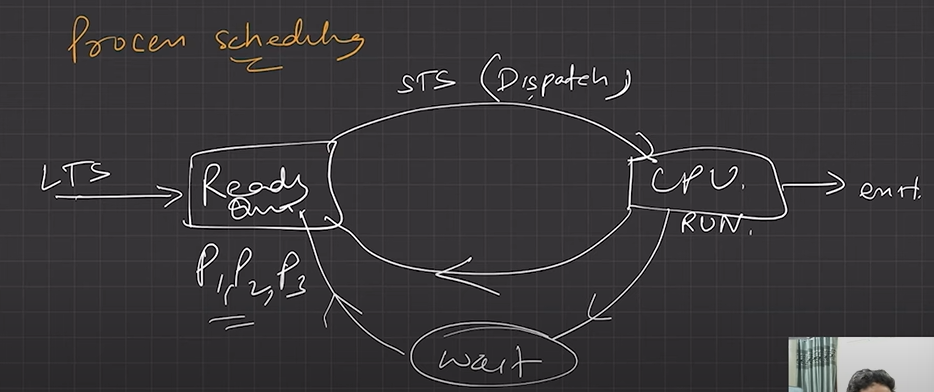
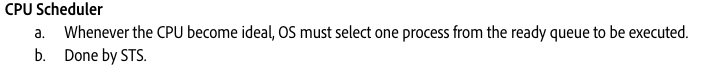

# 4.5.1 4- CPU Scheduling

Process Scheduling = CPU Scheduling

Kisi process pe CPU ko control dena = Dispatcher (Short Term Scheduler) ka kaam hai

  - CPU scheduling is the process of determining which process in the ready queue is allocated to the CPU.

  - Various scheduling algorithms can be used to make this decision, such as First Come-First-Served (FCFS), Shortest Job Next (SJN), Priority and Round Robin (RR).

  - Different algorithm support different class of process and favor different scheduling criterion.

PROCESS SCHEDULING:

  - Basis of Multi-programming OS

  - By switching the CPU among processes, the OS can make the computer more productive.

  - Many processes are kept in memory at a time, when a process must wait or time quantum expires, the OS takes the CPU away from that process & gives the CPU to another process & this pattern continues.

