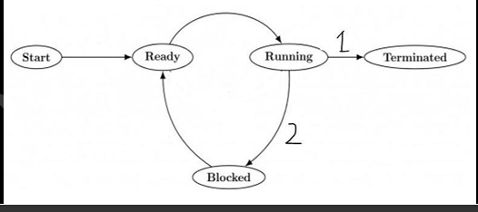
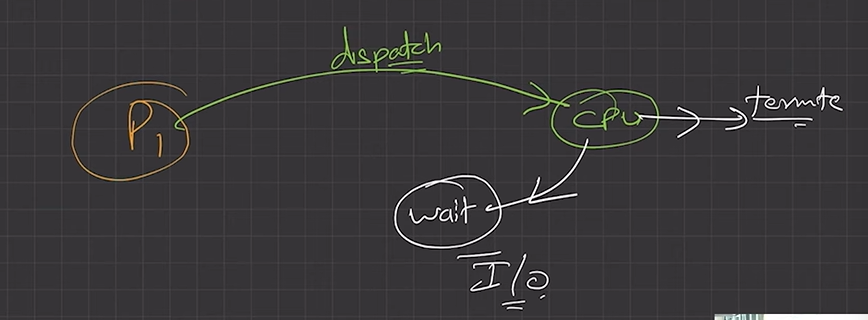
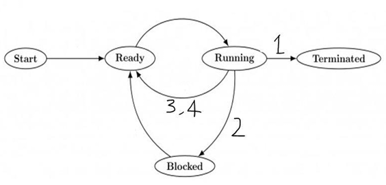
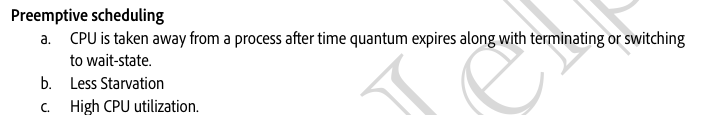
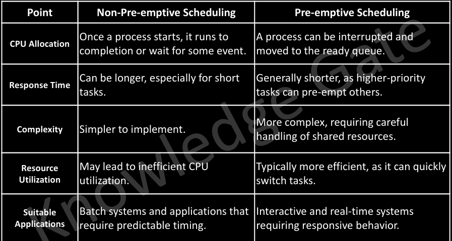

# 4.5.2 Types of Scheduling

**TYPE OF SCHEDULING:**

**Non-Pre-emptive: **

Under Non-Pre-emptive scheduling, once the CPU has been allocated to a process, the process keeps the CPU until it releases the CPU willingly. Voluntarily running state ko chhor ke jaate h, ham kisi ko forcefully bahar nahi nikalte vo khud hi bahar aayegi, either in termination or for I/O state.

  - Starvation, as a process with long burst time may starve less burst time process

  - Once CPU has been allocated to a process, the process keeps the CPU until it releases CPU either by terminating or by switching to wait-state

  - Low CPU utilization.

A process will leave the CPU only

1. When a process completes its execution (Termination state)

2. When a process wants to perform some i/o operations(Blocked/waiting state)

**Pre-emptive scheduling: **

Under Pre-emptive scheduling, once the CPU has been allocated to a process, A process will leave the CPU willingly or it can be forced out (when the time quantum expires). So it will leave the CPU eg: Round Robin, Priority.

1. When a process completes its execution

2. When a process leaves CPU voluntarily to perform some i/o operations

3. If a new process enters in the ready states (new, waiting), in case of high priority

4. When process switches from running to ready state because of time quantum expire.

  - Starvation is more in Non-pre-emptive because time sharing is absent.

  - Pre-emptive has less starvation.  Higher CPU utilization. Overhead is more, more variation in processes.

