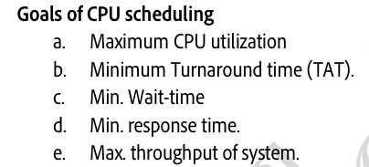

# 4.5.3 Scheduling Criteria:

**Scheduling Criteria:**

Different CPU-scheduling algorithms have different properties, and the choice of a particular algorithm may favour one class of processes over another. So, in order to efficiently select the scheduling algorithms following criteria should be taken into consideration:

  - CPU utilization: Keeping the CPU as busy as possible.

  - Throughput: If the CPU is busy executing processes, then work is being done. One measure of work is the number of processes that are completed per time unit, called throughput.

  - Waiting time: Waiting time is the sum of the periods spent waiting in the ready queue.

  - Response Time: Is the time it takes to start responding (pehli baar response milne ka time), not the time it takes to output the response.  Time duration between process getting into ready queue and process getting CPU for the first time.

Note: The CPU-scheduling algorithm does not affect the amount of time during which a process executes or perform I/0; it affects only the amount of time that a process spends waiting in the ready queue.

**Goals of CPU Scheduling:**

It is desirable to maximize CPU utilization and maximize throughput and to minimize turnaround time, waiting time, and response time.

Arrival Time = Ready queue me aane wala time

Completion Time = Exit karne wala time

Response time = Ready queue me aane se leka first time CPU milne tak ka time

**Terminology:**

  - **Arrival Time (AT):** Time at which process enters a ready state.  Time when process is arrived at the ready queue.

  - **Burst Time (BT):** Amount of CPU time required by the process to finish its execution.

  - **Completion Time (CT):** Time at which process finishes its execution.

  - ** Turn Around Time (TAT):** Completion Time (CT) – Arrival Time (AT)   --> Time taken from first time process enters ready state till it terminates.

  - TAT = Waiting Time + Burst Time (BT)

  - **Waiting Time:** Turn Around Time (TAT) – Burst Time (BT)   ----> Time process spends waiting for CPU

**Starvation:**

When due to execution of one process, other process are not getting executed and are waiting for a long time.
