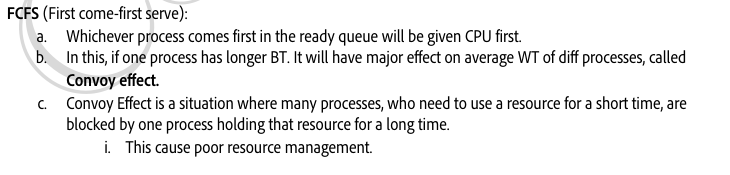
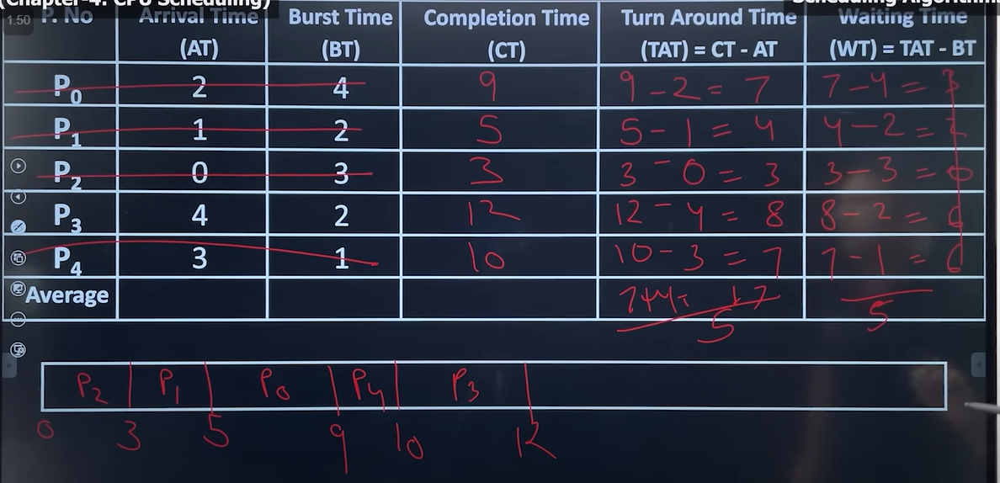
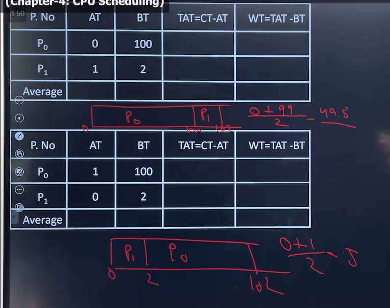
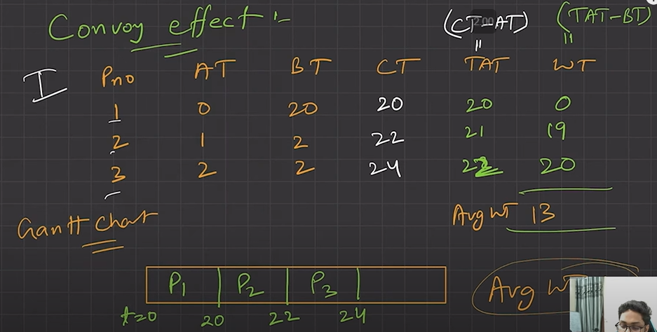
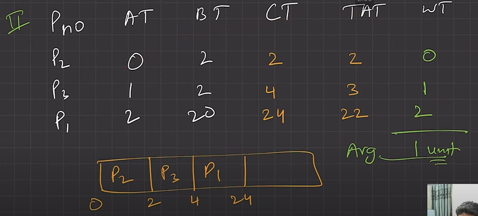

# 4.5.4.1 FCFS

NOTE:

  - The CPU-scheduling algorithm does not affect the amount of time during which a process executes or perform I/0; it affects only the amount of time that a process spends waiting in the ready queue.

  - It is desirable to maximize CPU utilization and throughput and to minimize turnaround time, waiting time, and response time.

FIRST COME FIRST SERVE ALGORITHM:

  - FCFS is the simplest scheduling algorithm, as the name suggest, the process that requests the CPU first is allocated the CPU first.

  - Implementation is managed by FIFO Queue.

  - It is always non pre-emptive in nature.

Gannt Chart:

Advantage

  - Easy to understand, and can easily be implemented using Queue data structure.

  - Can be used for Background processes where execution is not urgent.

Disadvantage:

**Convoy Effect**

  - If the smaller process have to wait more for the CPU because of Larger process then this effect is called Convoy Effect, it result into more average waiting time.

  - Solution, smaller process have to be executed before longer process, to achieve less average waiting time.

  - Jab badi process ki vajah se chhote process ko jyada wait karna pade, FCFS me hoti hai

  - If one process has longer BT. It will have major effect on average WT of diff processes, called Convoy effect.

  1. FCFS suffers from convoy which means smaller process have to wait larger process, which result into large average waiting time.

  1. The FCFS algorithm is thus particularly troublesome for time-sharing systems (due to its non-pre-emptive nature), where it is important that each user get a share of the CPU at regular intervals.

  1. Higher average waiting time and TAT compared to other algorithms.

[Lecture 12: What is Convoy Effect \| FCFS CPU Scheduling Algorithm](<https://www.youtube.com/watch?v=lLmqbQnLM4A&list=PLDzeHZWIZsTr3nwuTegHLa2qlI81QweYG&index=13&pp=iAQB>)
