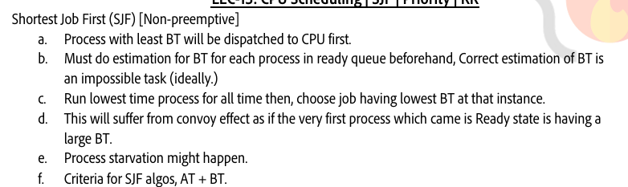
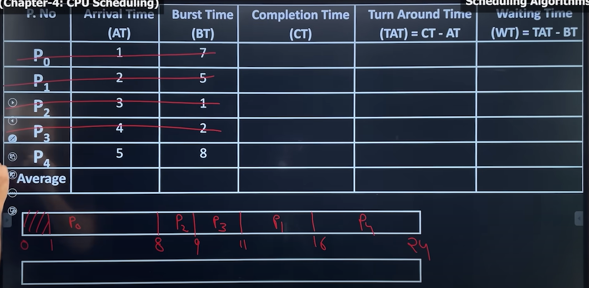
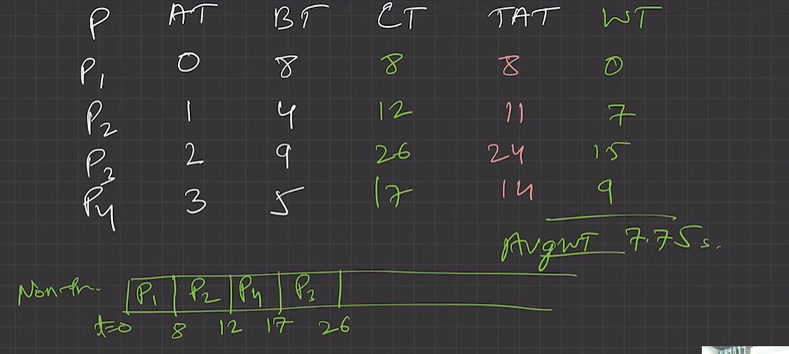
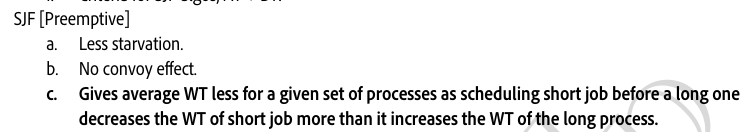
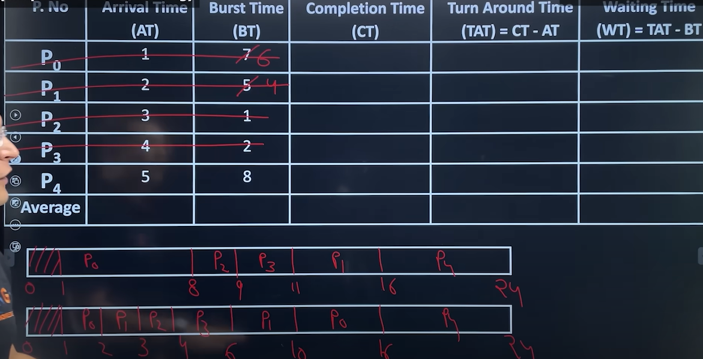
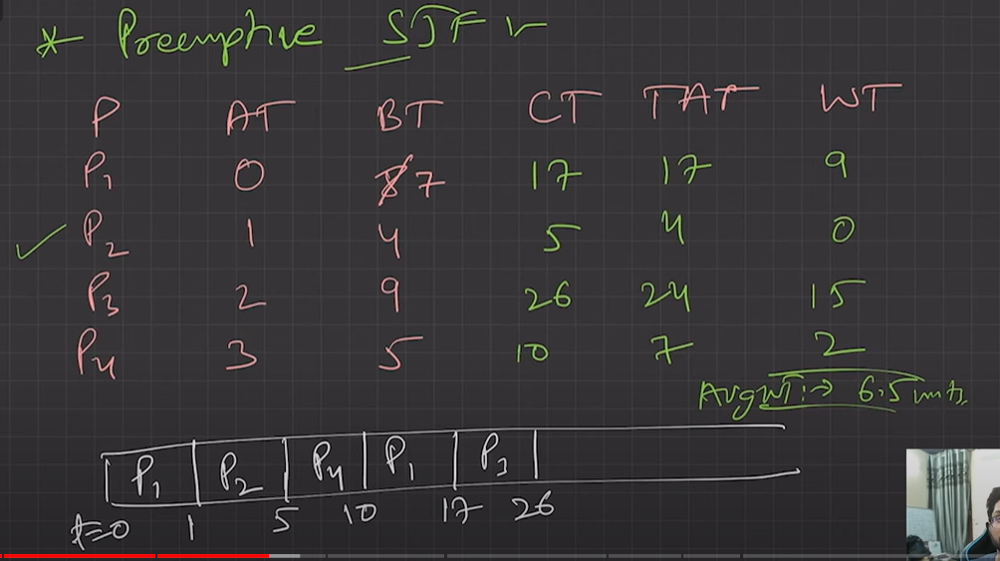

# 4.5.4.2 SJF

**Shortest Job First (SJF)(non-pre-emptive)**

**Shortest Remaining Time First (SRTF)/ (Shortest Next CPU Burst) (Pre-emptive)**

Whenever we make a decision of selecting the next process for CPU execution, out of all available process, CPU is assigned to the process having smallest burst time requirement. When the CPU is available, it is assigned to the process that has the smallest next CPU burst. If there is a tie, FCFS is used to break tie.

It supports both version non-pre-emptive and pre-emptive (purely greedy approach)

**NON PRE-EMPTIVE:**

Ek baar process aa gaya toh complete hoke hi bahar jayega, lekin agar multiple process available hai toh usme se shortest burst time wala pehle execute hoga. First process according to arrival time.

In Shortest Job First (SJF)(non-pre-emptive) once a decision is made and among the available process, the process with the smallest CPU burst is scheduled on the CPU, it cannot be pre-empted even if a new process with the smaller CPU burst requirement then the remaining CPU burst of the running process enter in the system.

CRITERIA: ARRIVAL TIME & BURST TIME

THIS WILL BE VICTIM OF CONVOY EFFECT

Here CPU has to estimate the Burst time using heuristics:

**PRE-EMPTIVE: (greedy) - optimal, minimum time**

Arrival time pey remaining BT aur incoming process ke BT ko compare kiya, chhote wale ko execute kiya.

In Shortest Remaining Time First (SRTF) (Pre-emptive) whenever a process enters in ready state, again we make a scheduling decision weather, this new process with the smaller CPU burst requirement then the remaining CPU burst of the running process and if it is the case then the running process is pre-empted and new process is scheduled on the CPU.

NO CONVOY EFFECT

This version (SRTF) is also called optimal is it guarantee minimal average waiting time.

Advantage

  - Pre-emptive version guarantees minimal average waiting time so some time also referred as optimal algorithm. Provide a standard for other algo in terms of average waiting time.

  - Provide better average response time compare to FCFS.

Disadvantage

  - Here process with the longer CPU burst requirement goes into starvation and have response time.

  - This algo cannot be implemented as there is no way to know the length of the next CPU burst. As SJF is not implementable, we can use the one technique where we try to predict the CPU burst of the next coming process.

[Lecture 13:  Shortest Job First Algorithm \| Priority Scheduling \| Round Robin CPU Scheduling](<https://www.youtube.com/watch?v=AXrF0AmMYlc&list=PLDzeHZWIZsTr3nwuTegHLa2qlI81QweYG&index=14&pp=iAQB>)
