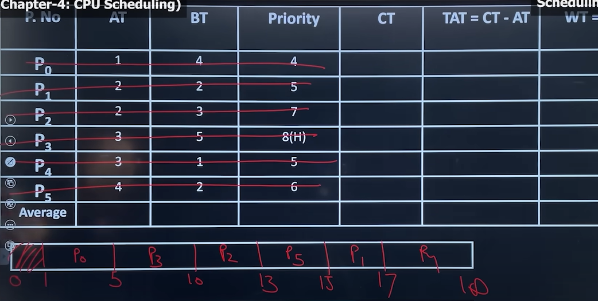
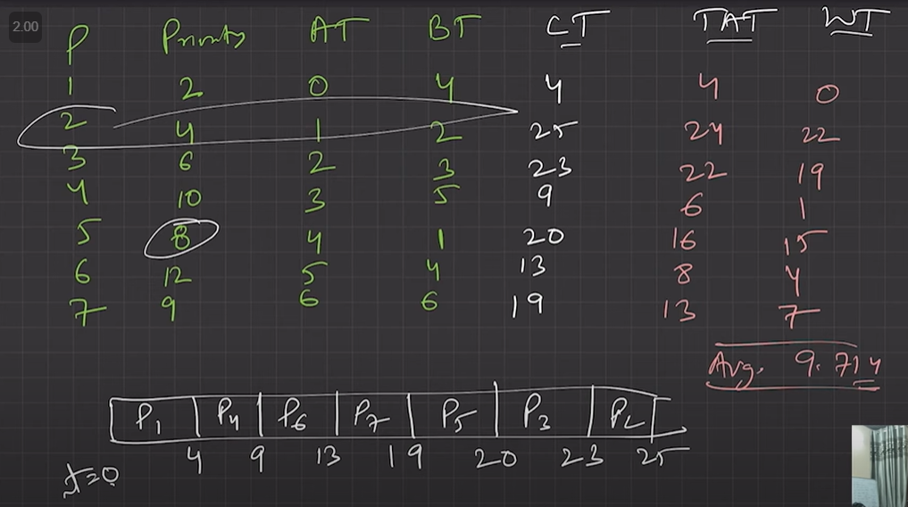
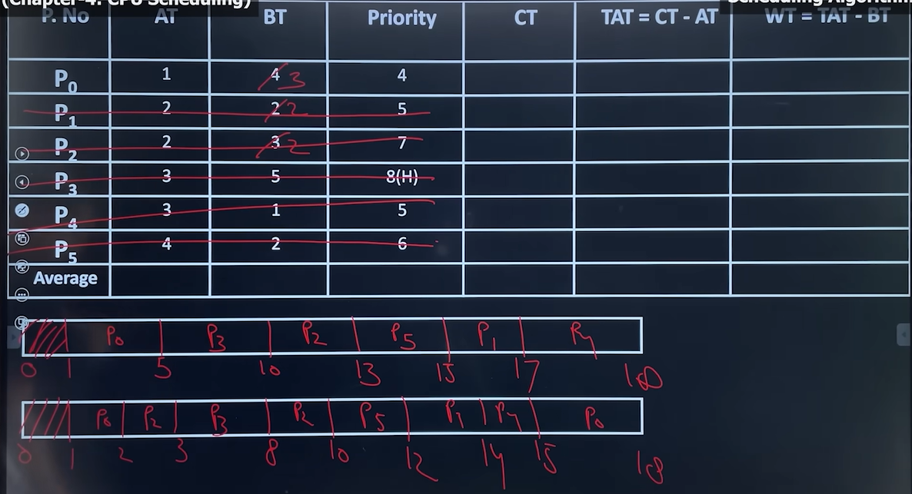
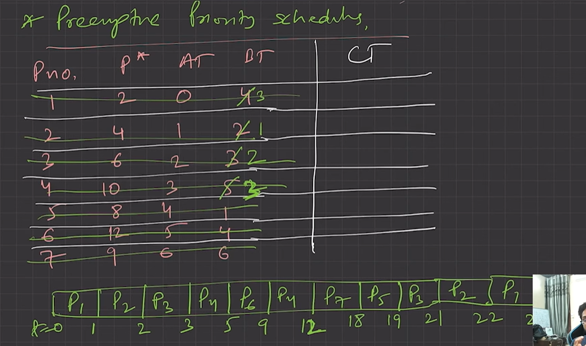
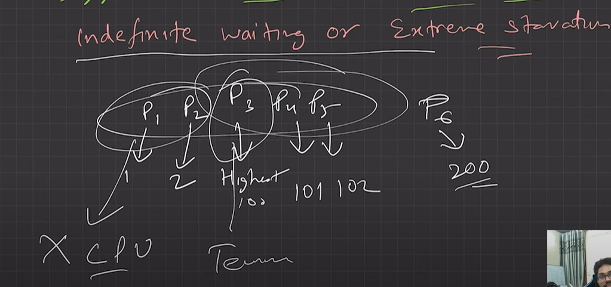

# 4.5.4.3 Priority Scheduling

In FCFS, Arrival time is priority. In SJF, burst time is priority, and here in Priority Scheduling the priority is defined already. Both versions possible. Pre-emptive and non-pre-emptive.

Resolve clash (when priority same) using arrival time and not burst time.

**Non-pre-emptive:**

a. Priority is assigned to a process when it is created.

b. SJF is a special case of general priority scheduling with priority inversely proportional to BT

**Pre-emptive:**

  1. Current RUN state job will be pre-empted if next job has higher priority.

  1. May cause indefinite waiting (Starvation) for lower priority jobs. (Possibility is they won’t get executed ever). (True for both preemptive and non-preemptive version)

    1. Solution: Ageing is the solution.

    1. Gradually increase priority of process that wait so long. E.g., increase priority by 1 every 15 minutes.

Here a priority is associated with each process. At any instance of time out of all available process, CPU is allocated to the process which possess highest priority (may be higher or lower number).

  - Tie is broken using FCFS order. No importance to senior or burst time. It supports both non-pre emptive and pre-emptive versions.

    - In Priority (non-pre-emptive) once a decision is made and among the available process, the process with the highest priority is scheduled on the CPU, it cannot be pre-empted even if a new process with higher priority more than the priority of the running process enter in the system.

    - In Priority (pre-emptive) once a decision is made and among the available process, the process with the highest priority is scheduled on the CPU. if it a new process with priority more than the priority of the running process enter in the system, then we do a context switch and the processor is provided to the new process with higher priority.

  - There is no general agreement on whether 0 is the highest or lowest priority, it can vary from systems to systems.

Advantage

• Gives a facility specially to system process.

• Allow us to run important process even if it is a user process. Disadvantage

• Here process with the smaller priority may starve for the CPU • No idea of response time or waiting time.

• Note: - Specially use to support system process or important user process

• Ageing: - a technique of gradually increasing the priority of processes that wait in the system for long time. E.g. priority will increase after every 10 mins

Disadvantage:

Convoy Effect aa jata hai

Solution to indefinite waiting is AGEING. Every 15 mins low priority jobs : priority++
