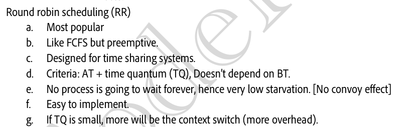
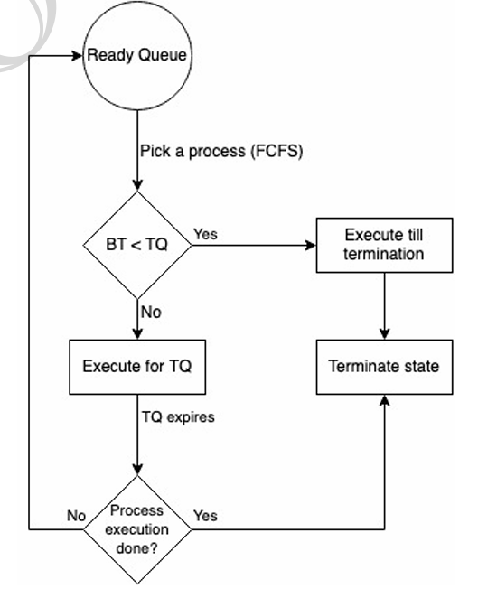
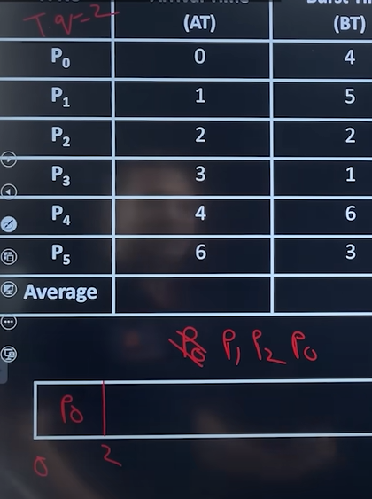
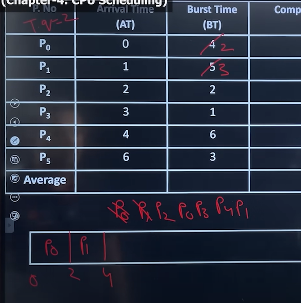
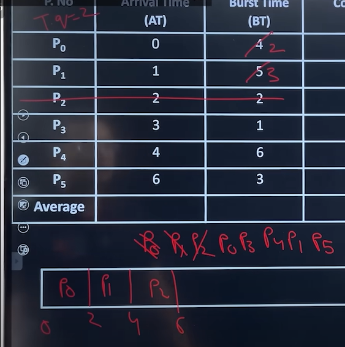
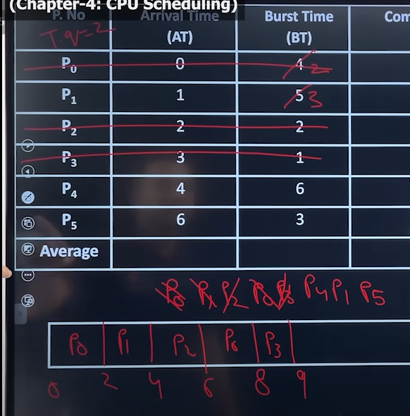
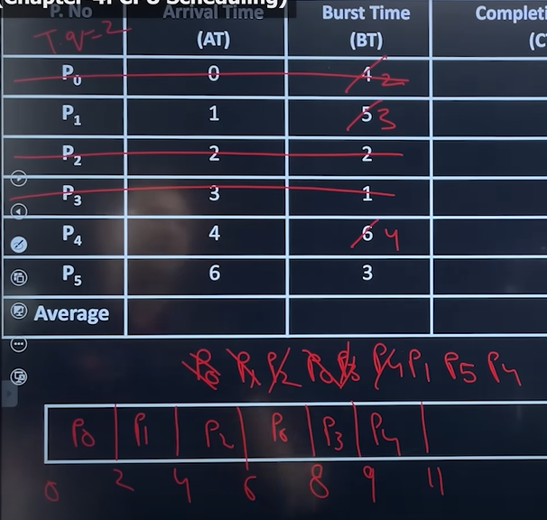
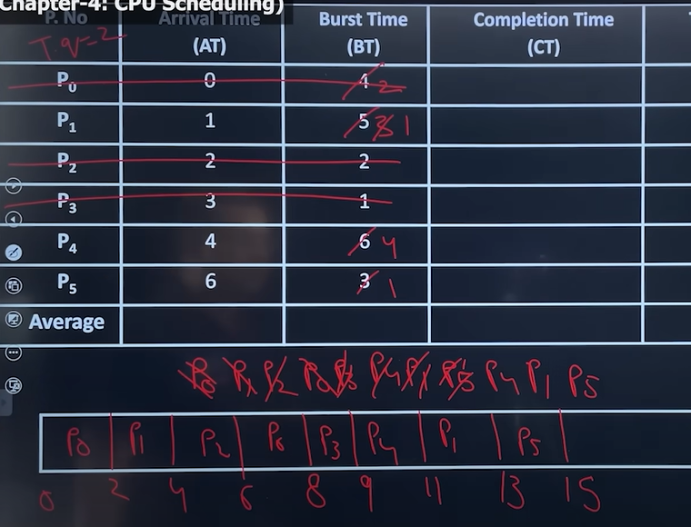
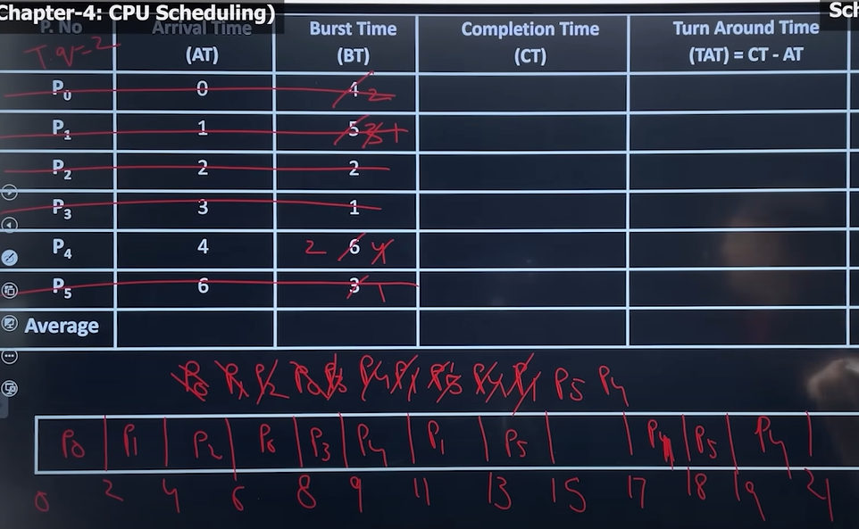

# 4.5.4.4 Round Robin

This algo is designed for time sharing systems, where it is not, the idea to complete one process and then start another, but to be responsive and divide time of CPU among the process in the ready state(circular).

Criteria: AT + TQ

The CPU scheduler goes around the ready queue, allocating the CPU to each process for a maximum of 1 Time quantum say q. Up to which a process can hold the CPU in one go, with in which either a process terminates if process have a CPU burst of less than given time quantum or context switch will be executed and process must release the CPU voluntarily and enter the ready queue and wait for the next chance.

If there are n processes in the ready queue and the time quantum is q, then each process gets 1/n of the CPU time in chunks of at most q time units. Each process must wait no longer than (n - 1) x q time units until its next time quantum.

At time t = 2, jab P0 se context switch karne ki baari aayi tab P1 and P2 aa chuke thhe and P3,P4,P5 nahi aaye thhe toh P0 firse line me lag gya.

t=2 to t= 4 me P1 chala, and P3,P4 line me lag gye, fir P1 line me lag gaya.

t = 4 to 6 me P2 chala and since 2 BT ki hi need this vo execute hoke finish ho gya, and by that time P5 line me lag gya

t = 6 to 8 me P0 chala and 2 ki hi need thi toh khatam ho gya, t=8-9 me P3 chala and since 1 ki need this to khatam hogya

Circular queue implementation.

Starvation removed, Convoy effect removed, but overhead increase. Context Switching increase if time quantum is less.

Advantage

• Perform best in terms of average response time

• Works will in case of time-sharing systems, client server architecture and interactive system

• kind of SJF implementation

Disadvantage

• Longer process may starve

• No idea of priority

• Performance depends heavily on time quantum -

  - If value of the time quantum is very less, then it will give lesser average response time (good but total no of context switches will be more, so CPU utilization will be less),

  - If time quantum is very large then average response time will be more bad, but no of context switches will be less, so CPU utilization will be good.
