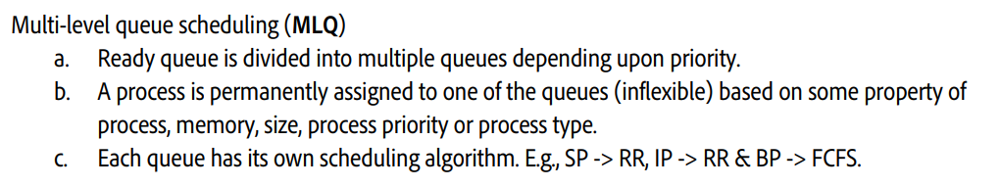
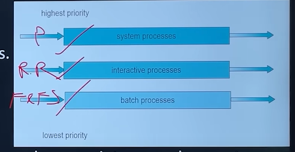
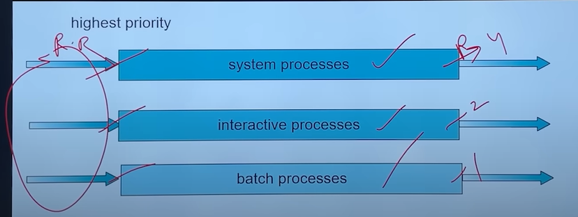

# 4.5.4.5 Multilevel Queue Scheduling

**Multi Level-Queue Scheduling (MLQ)**

• After studying all important approach to CPU scheduling, we must understand anyone of them alone is not good for everxxy process in the system, as different process have different scheduling needs so, we must have a kind of hybrid scheduling idea, supporting all classes of processes.

• Here processes are easily classified into different groups.

• System process - process created by OS (HIGHEST PRIORITY)

• foreground (interactive) processes  - user input required (I/O)

• background (batch) processes - background process, no I/O required, Runs silently

• A multilevel queue scheduling algorithm, partitions the ready queue into several separate queues. The processes are permanently assigned to one queue, generally based on properties and requirement of the process.

Each queue has its own scheduling algorithm. For example

• System process (SP Queue) might need priority algorithm

• Interactive process (IP Queue) might be scheduled by an RR algorithm

• Batch processes (BP queue) is scheduled by an FCFS algorithm

**Scheduling between sub-queues**

In addition, there must be scheduling among the queues, which is commonly implemented as fixed-priority pre-emptive schedulingor round robin with different time quantum.

**fixed-priority pre-emptive scheduling ==>  **

  - SP > IP > BP

  - Scheduling among different sub-queues is implemented as fixed priority preemptive scheduling. E.g., foreground queue has absolute priority over background queue.

  - If an interactive process comes & batch process is currently executing. Then, batch process will be preempted. g.

  - **Problem:** Only after completion of all the processes from the top-level ready queue, the further level ready queues will be scheduled.

  - This came starvation for lower priority process.

  - Convoy effect is present

**round robin with different time quantum.  ==> **

Hybrid round robin between multiple queues, (4,2,1) time sharing

[Lecture 14: Multi Level Queue Scheduling || MLFQ  || Comparison btw CPU Scheduling Algorithms](<https://www.youtube.com/watch?v=ly5Ume_Crsk&list=PLDzeHZWIZsTr3nwuTegHLa2qlI81QweYG&index=15&pp=iAQB>)
