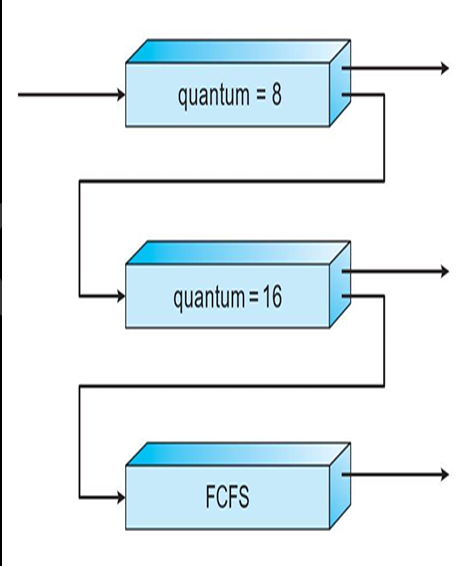
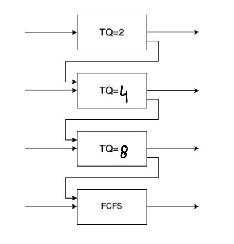
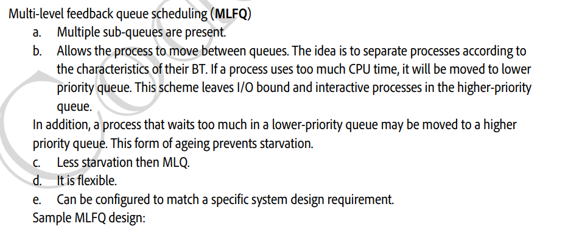

# 4.5.4.6 Multi-level feedback queue scheduling (MLFQ)

**Multi-level Feedback Queue Scheduling **

**(USED CURRENTLY)**

• Problem with multi-level queue scheduling is how to decide number of ready queue, scheduling algorithm inside the queue and between the queue and once a process enters a specific queue we can not change and queue after that.

  - Multiple SubQueues

  - Inter-queue movement is allowed

  - Separate processes based on BT

  - BT increase ---> move the process to lower queues

  - I/O bound and interactive processes ----> higher priority. move to upper queue

  - Ageing method used to prevent starvation. Increase priority of processes in lower queues.

The multilevel feedback queue scheduling algorithm, allows a process to move between queues. The idea is to separate processes according to the characteristics of their CPU bursts. If a process uses too much CPU time, it will be moved to a lower-priority queue. In addition, a process that waits too long in a lower-priority queue may be moved to a higher-priority queue. This form of aging prevents starvation.

A process entering the ready queue is put in queue 0. A process in queue 0 is given a time quantum of 8 milliseconds. If it does not finish within this time, it is moved to the tail of queue 1. If queue 0 is empty, the process at the head of queue 1 is given a quantum of 16 milliseconds. If it does not complete, it is pre-empted and is put into queue 2. Processes in queue 2 are run on an FCFS basis but are run only when queues 0 and 1 are empty.

In general, a multilevel feedback queue scheduler is defined by the following parameters:

• The number of queues

• The scheduling algorithm for each queue

• The method used to determine when to upgrade a process to a higher- priority queue

• The method used to determine when to demote a process to a lower- priority queue.

The definition of a multilevel feedback queue scheduler makes it the most general CPU-scheduling algorithm. It can be configured to match a specific system under design. Unfortunately, it is also the most complex algorithm, since defining the best scheduler requires some means by which to select values for all the parameters.

