# 4.6.1 Critical Section Problem

**Process Synchronization & Race Condition **

As we understand in a multiprogramming environment a good number of processes compete for limited number of resources. Concurrent access to shared data (variable i modified by 2 processes running same code)at some time may result in data inconsistency for e.g.

Process synchronization techniques play a key role in maintaining the consistency of shared data

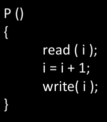

Race condition is a situation in which the output of a process depends on the execution sequence of process. i.e. if we change the order of execution of different process with respect to other process the output may change.

Clash/inconsistency is possible with shared data (CRITICAL SECTION) only. If data is not shared then inconsistency nahi hogi.

**General Structure of a process**

• Initial Section: Where process is accessing private resources.

• Entry Section: Entry Section is that part of code where, each process request for permission to enter its critical section.

• Critical Section: Where process is access shared resources.

• Exit Section: It is the section where a process will exit from its critical section.

• Remainder Section: Remaining Code.

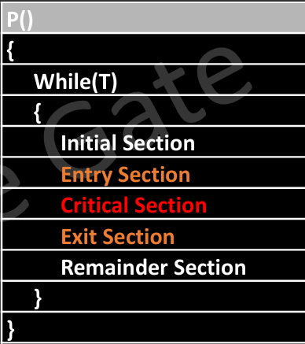

**Critical Section (C.S)**

The critical section refers to the segment of code where processes/threads access shared resources, such as common variables and files, and perform write operations on them. Since processes/threads execute concurrently, any process can be interrupted mid-execution.

**Race Condition **

i. A race condition occurs when two or more threads can access shared data and they try to change it at the same time. Because the thread scheduling algorithm can swap between threads at any time, you don't know the order in which the threads will attempt to access the shared data. Therefore, the result of the change in data is dependent on the thread scheduling algorithm, i.e., both threads are "racing" to access/change the data.

**Solution to Race Condition**

a. Atomic operations: Make Critical code section an atomic operation, i.e., Executed in one CPU cycle.

b. Mutual Exclusion using locks.

c. Semaphores

Criterion to Solve Critical Section Problem

• **Mutual Exclusion****:** No two processes should be present inside the critical section at the same time, i.e. only one process is allowed in the critical section at an instant of time.

• **Progress:** If no process is executing in its critical section and some processes wish to enter their critical sections, then only those processes that are not executing in their remainder sections can participate in deciding which will enter its critical section next(means other process will participate which actually wish to enter). there should be no deadlock.  Agar koi ek thread critical section me nahi hai toh vo dusri thread ko critical section me jaane se naa roke.

• **Bounded Waiting:** There exists a bound or a limit on the number of times a process is allowed to enter its critical section and no process should wait indefinitely to enter the CS.

Limited waiting time, no indefinite waiting

Some Points to Remember

• Mutual Exclusion and Progress are mandatory requirements that needs to be followed in order to write a valid solution for critical section problem.

• Bounded waiting is optional criteria, if not satisfied then it may lead to starvation.

**Solutions to Critical Section Problem**

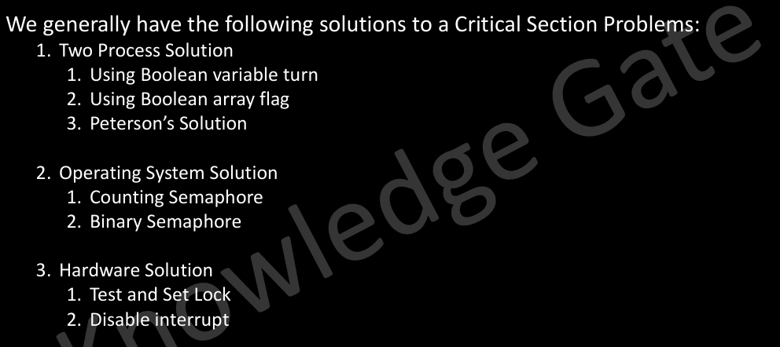

CRITICAL SECTION PROBLEM - EXAMPLE

**COUNT++**

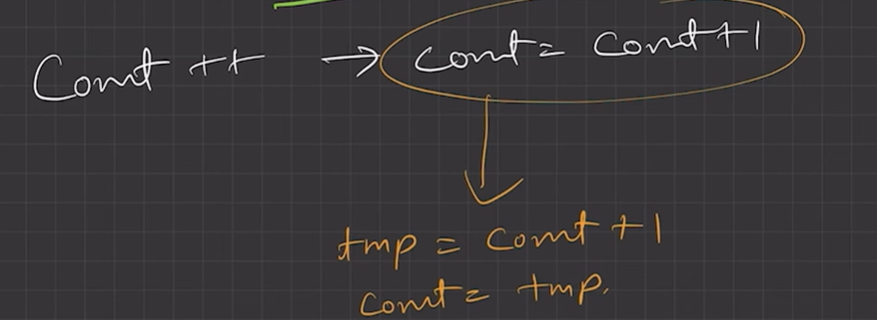

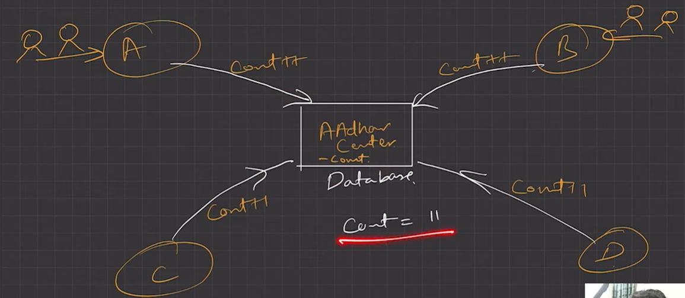

Two updation requests at same time, but not all updates are made--->  RACE CONDITION

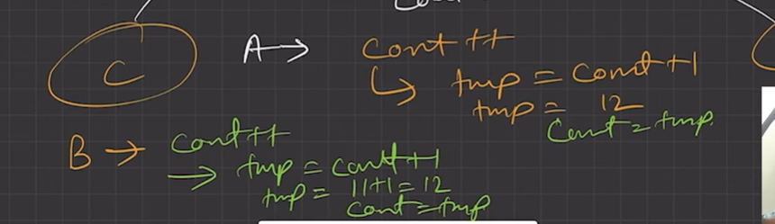

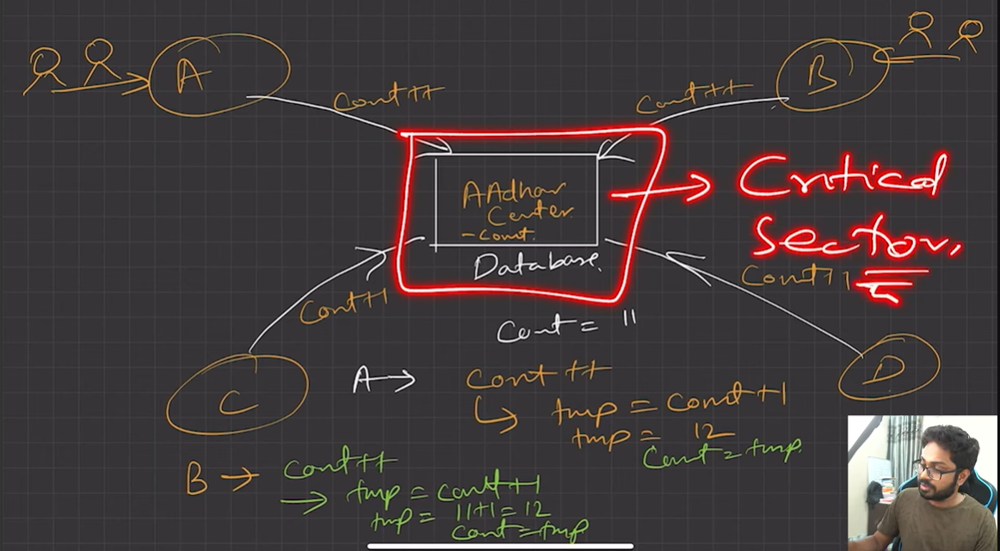

CRITICAL SECTION IS SHARED RESOURCES WHERE MULTIPLE THREADS ARE UPDATING THE SHARED VARIABLE AT THE SAME TIME. AMD WE HAVE TO UPDATE THE VARIABLE CAREFULLY TO AVOID INCONSISTENCY.

EXAMPLE OF HOW RACE CONDITION LEADS TO INCONSISTENCY:

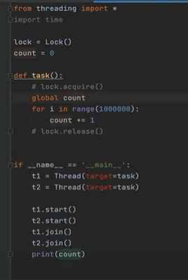

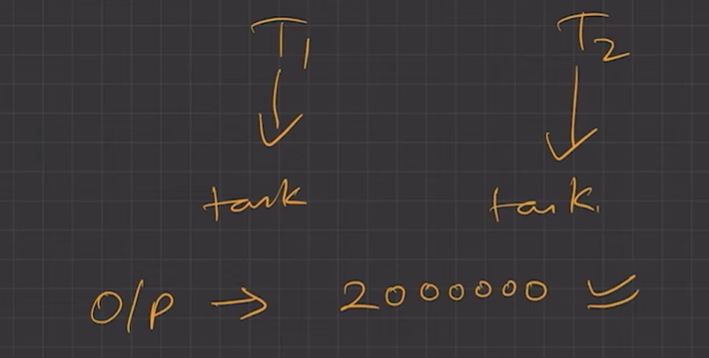

If we run this program again and again, we get an output less than 2000000 and difference each time.... output is inconsistent.

**SOLUTION?**

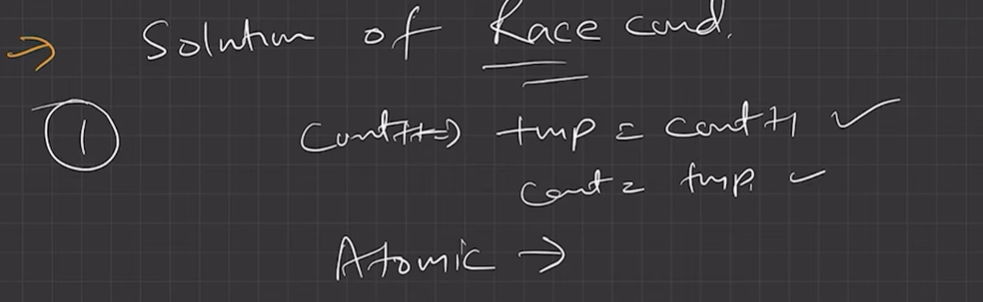

Make count++ operation atomic. In C++, we have atomic<int> variable which is thread safe, and doesn't generate inconsistency

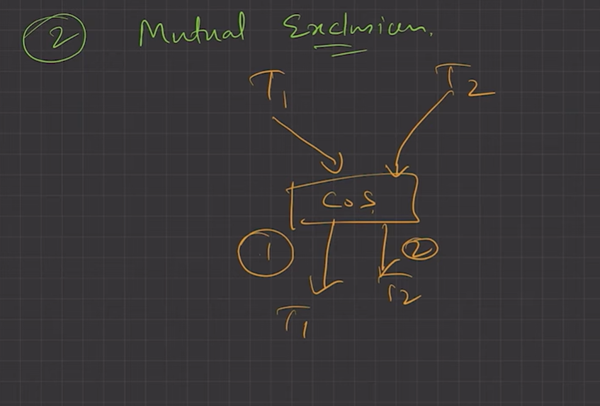

CONVERT TO SEQUENTIAL ---> MUTUTAL EXCLUSION USING LOCKS/MUTEX

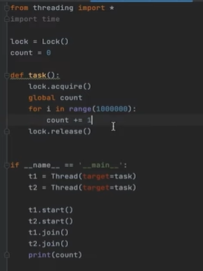

EXECUTE THIS CODE, USE OF LOCKS, OUTPUT ALWAYS 2000000
