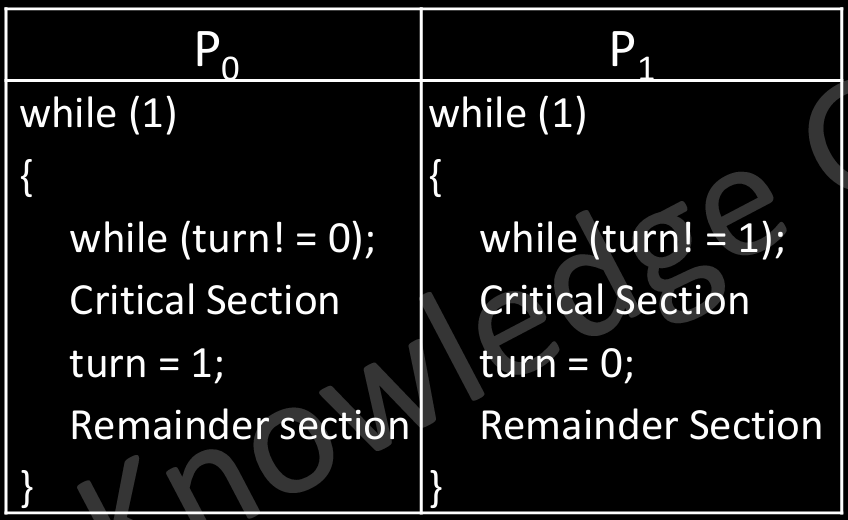
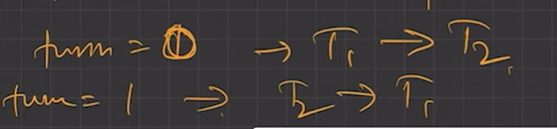
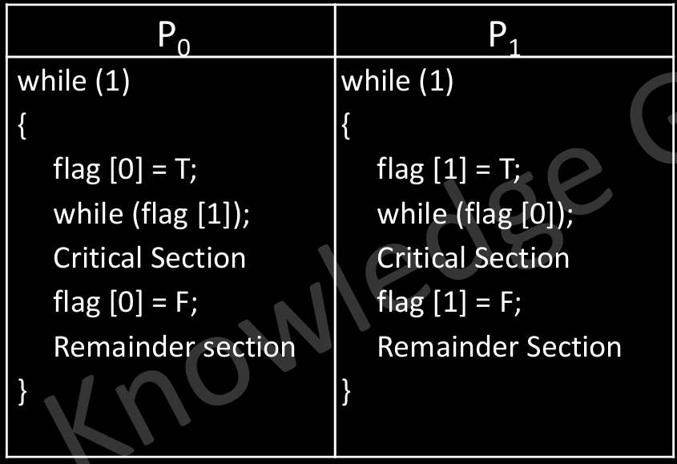
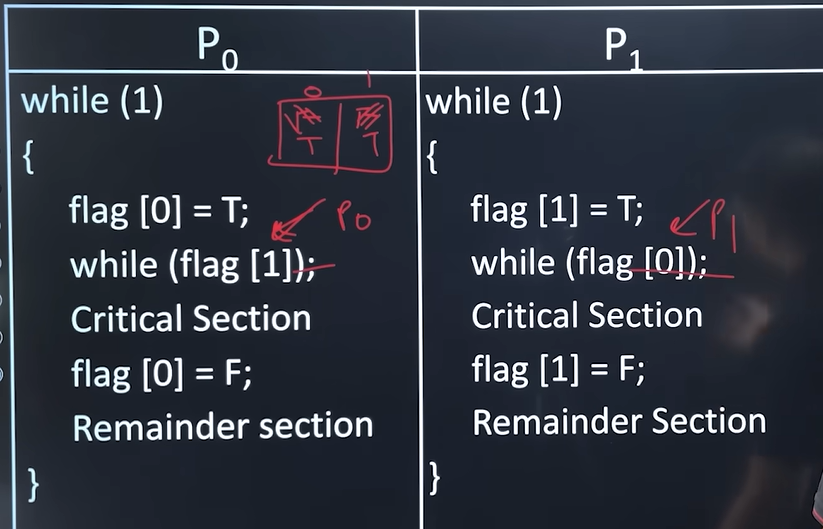
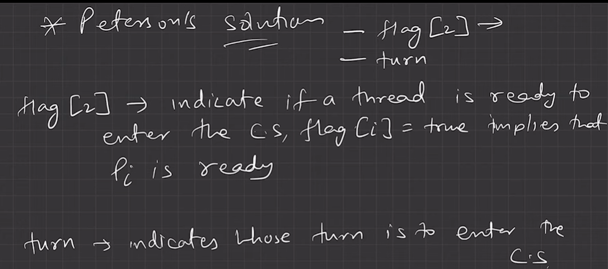
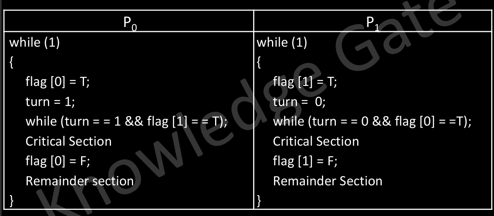
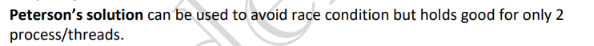
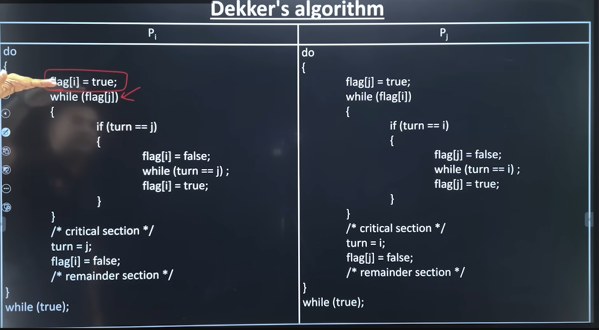

# 4.6.2 Two Process Solution

**Two Process Solution**

In general it will be difficult to write a valid solution in the first go to solve critical section problem among multiple processes, so it will be better to first attempt two process solution and then generalize it to N-Process solution.

• There are 3 Different idea to achieve valid solution, in which some are invalid while some are valid

**1-Using Boolean variable turn (invalid) // Single Flag**

Mutual Exclusion hai, strict alternation hai, not progress (jo jaana chahata hai vo jaaye, idhar strictly alternate karwa rahe)

Here we will use a Boolean variable turn, which is initialize randomly(0/1)

The solution follows Mutual Exclusion as the two processes cannot enter the CS at the same time.

thi

The solution does not follow the Progress, as it is suffering from the strict alternation. Because we never asked the process whether it wants to enter the CS or not?

**2-Using Boolean array flag  (invalid)**

Here we will use a Boolean array flag with two cells, where each cell is initialized to F

• This solution follows the Mutual Exclusion Criteria.

Agar P1 interested nai h i.e. flag(1) is false, then P0 kitni bhi baar execute ho sakta hai, i.e. progress is there somewhat. BUT  agar deadlock aa jaye:

• But in order to achieve the progress the system ended up being in a deadlock state.

**3-Peterson’s Solution**

Peterson's solution is a classic Software-based solution to the critical-section problem for two process.

We will be using both: turn and Boolean flag.

• This solution ensures Mutual Exclusion, Progress and Bounded Wait.

Peterson solution is safe for only two threads.

**4-Decker's Algorithm**

