# 4.6.4 Semaphores

CONDITIONAL VARIABLES

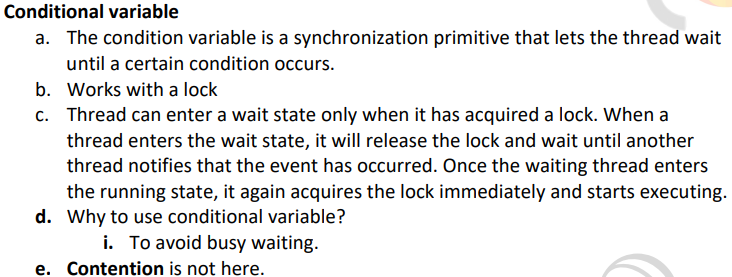

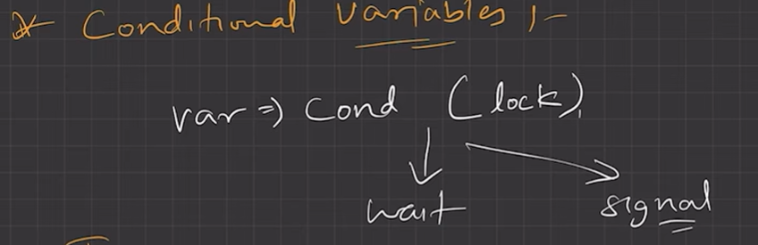

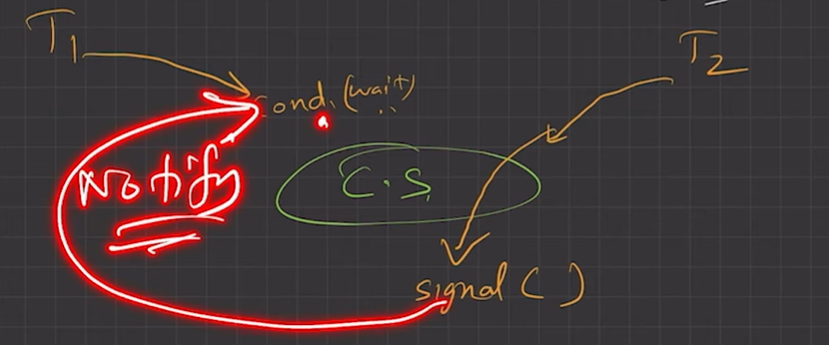

CONDITONAL VARIABLE INTERNALLY USES MUTEX(LOCK)

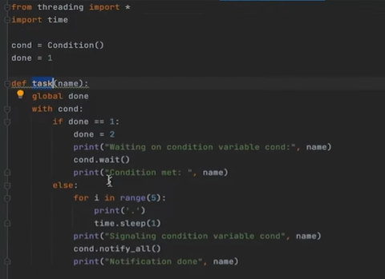

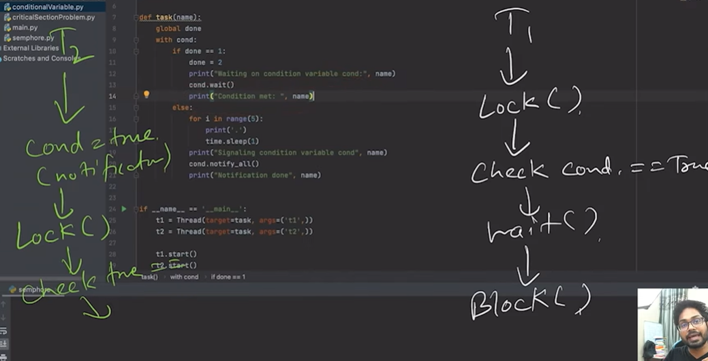

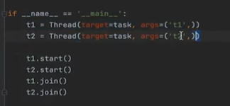

**Operation System Solution (Semaphores)**

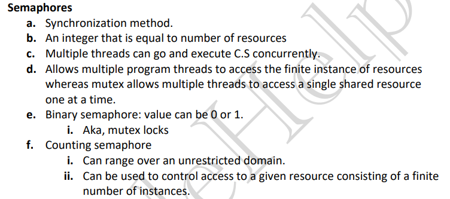

1. Semaphores are synchronization tools using which we will attempt n-process solution.

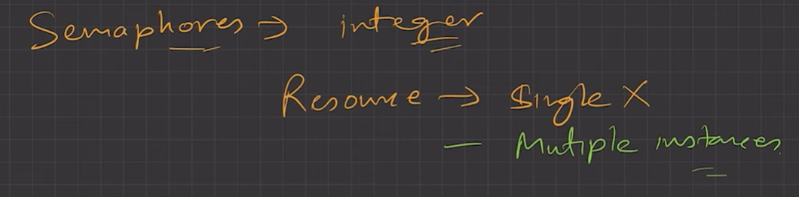

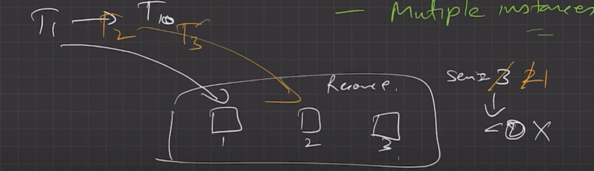

2. A semaphore S is a simple integer variable that, but apart from initialization it can be accessed only through two standard atomicoperations: wait(S) and signal(S).

Atomic means no context switch between Wait(S) and Signal(S) operation.

3. The wait(S) operation was originally termed as P(S) and signal(S) was originally called V(S).

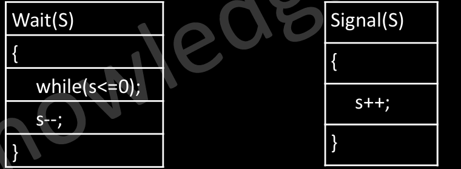

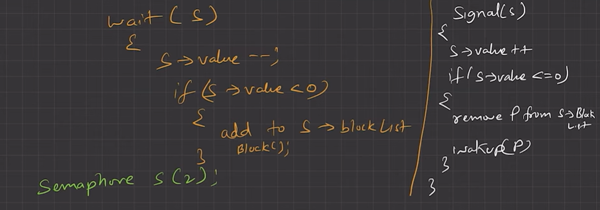

• Peterson’s Solution was confined to just two processes, and since in a general system can have n processes, Semaphores provides n-processes solution.

• While solving Critical Section Problem only we initialize semaphore S = 1.

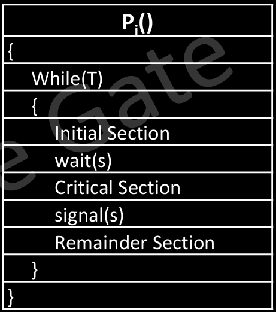

• Semaphores are going to ensure Mutual Exclusion and Progress but does not ensures bounded waiting.

N processes hai, S = 1 se initiate karta hu, jisko bhi andar jaana hai wait karna hai, bahar aake signal karna hai, ek baar me ek hi process jaa paa raha hai

**IMPLEMENTATION**

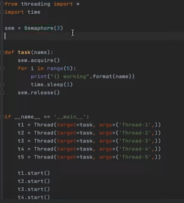

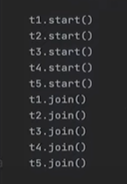

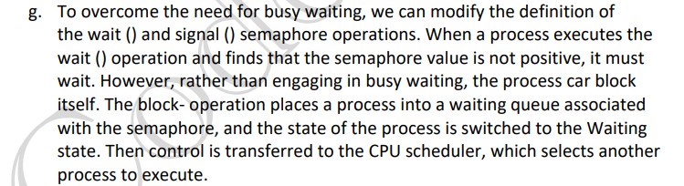

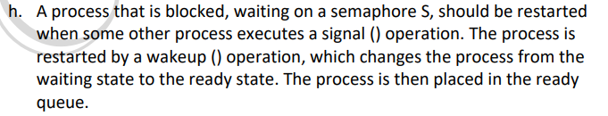

**Classical Problems on Synchronization**

• There are number of actual industrial problem we try to solve in order to improve our understand of Semaphores and their power of solving problems. Here in this section we will discuss a number of problems like

**• Producer consumer problem/ Bounder Buffer Problem **

**• Reader-Writer problem**

**• Dining Philosopher problem (odd)**

**• The Sleeping Barber problem**

**Hardware Type Solutions (Test and Set) **

• Software-based solutions such as Peterson’s are not guaranteed to work on modern computer architectures. In the following discussions, we explore several more solutions to the critical section problem using techniques ranging from hardware to software, all these solutions are based on the premise of locking —that is, protecting critical regions through the use of locks.

• The critical-section problem could be solved simply in a single-processor environment if we could prevent interrupts from occurring while a shared variable was being modified.

TEST AND SET:

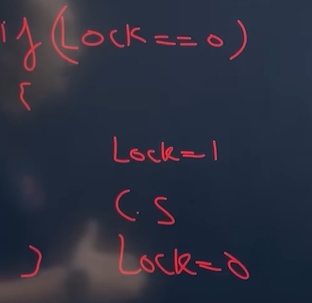

Problem arises if context switched when P1 is at lock ==1

SOLUTION -  SET AND TEST

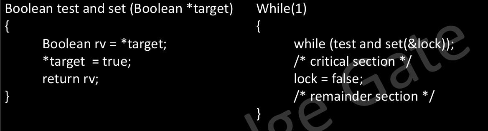

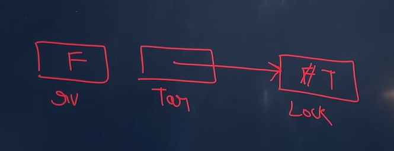

Many modern computer systems therefore provide special hardware instructions that allow us either to test and modify the content of a word atomically —that is, as one uninterruptible unit. We can use these special instructions to solve the critical-section problem in a relatively simple manner.

The important characteristic of this instruction is that it is executed atomically. Thus, if two test and set() instructions are executed simultaneously (each on a different CPU), they will be executed sequentially in some arbitrary order.
