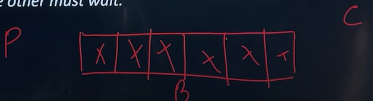
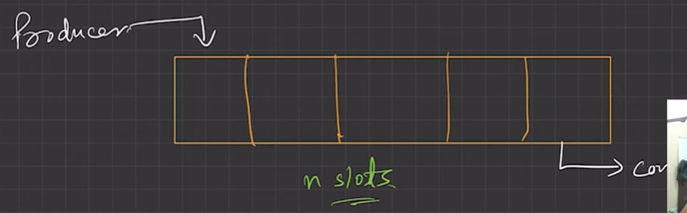
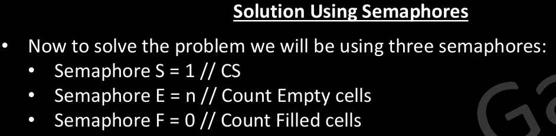
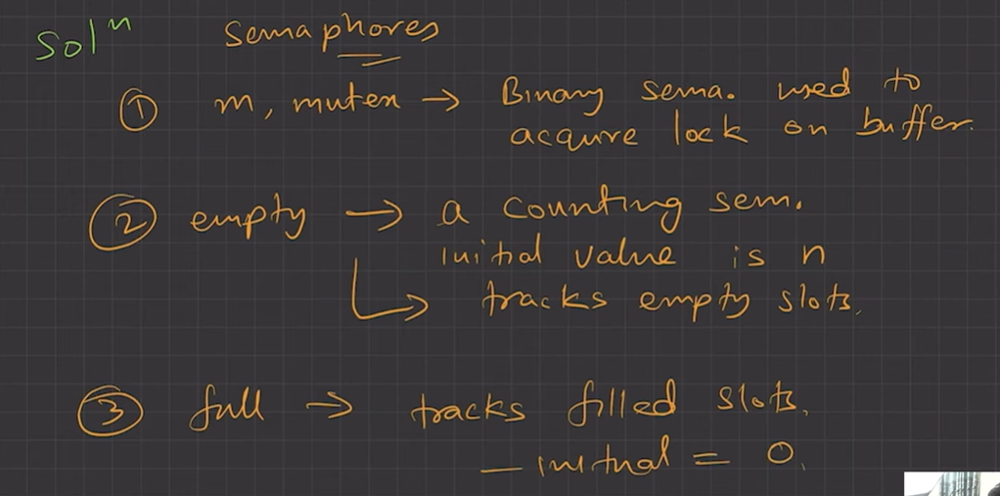
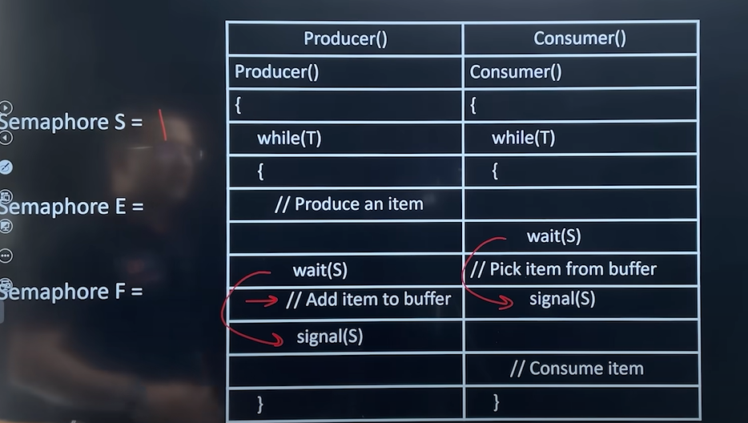
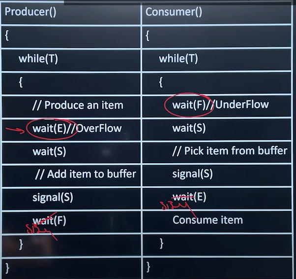
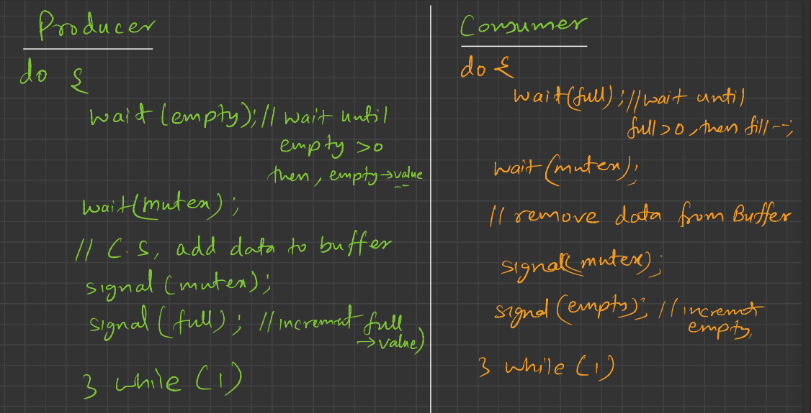

# 4.6.4.1 Producer consumer problem

**• Producer consumer problem/ Bounder Buffer Problem **

Problem Definition– There are two process Producer and Consumers, producer produces information and put it into a buffer which have n cell, that is consumed by a consumer. Both Producer and Consumer can produce and consume only one article at a time.

  1. Producer Thread

  1. Consumer Thread

  - A producer needs to check whether the buffer is overflowed or not after producing an item, before accessing the buffer. Producer must not insert data when the buffer is full.

  - Similarly, a consumer needs to check for an underflow before accessing the buffer and then consume an item.Consumer must not pik/remove the data when the buffer is empty.

  - Also, the producer and consumer must be synchronized, so that once a producer and consumer it accessing the buffer the other must wait.

CRITICAL SECTION = FINITE BUFFER

SYNC BETWEEN PRODUCER THREAD AND CONSUMER THREAD

S=1 --> Critical section coordination

E = n --> empty counting semaphores

F =0 --> filled counting semaphores

Total three resources are used

• semaphore E take count of empty cells and over flow

E = E -1  ----> Wait(E)

• semaphore F take count of filled cells and under flow

F = F +1  ---> signal(F)

• Semaphore S take care of buffer

