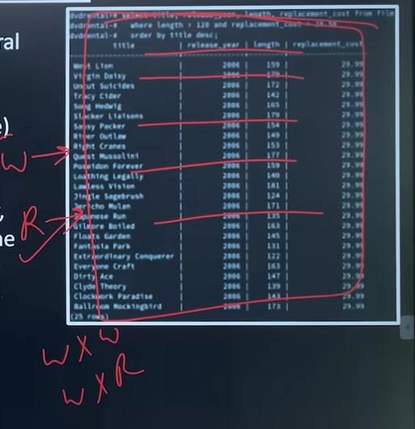
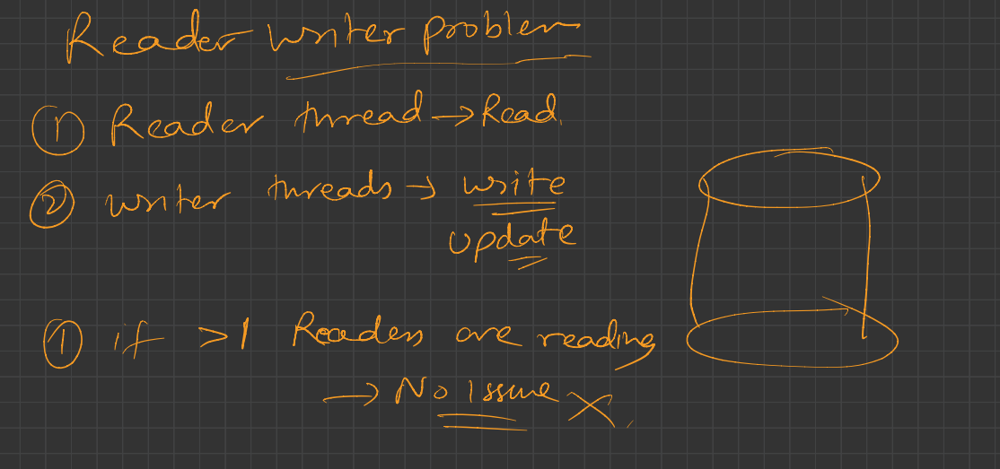
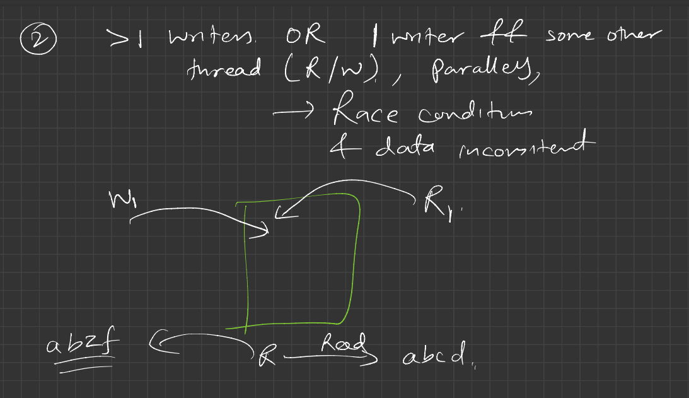
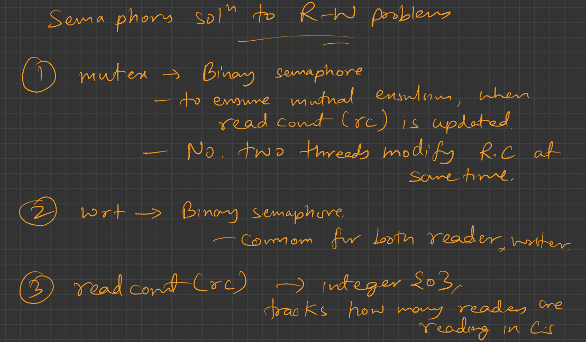
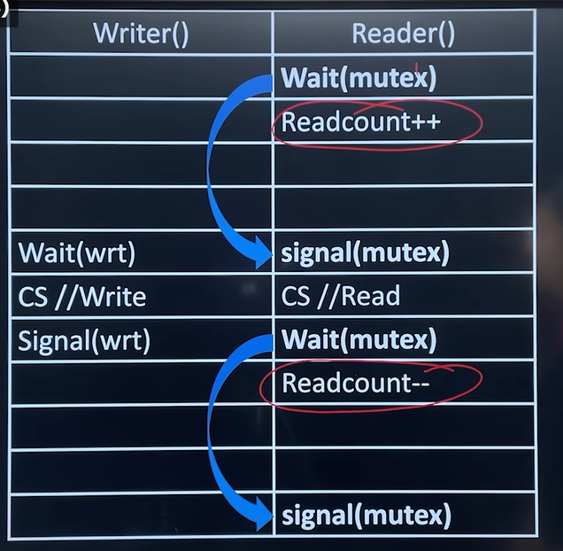
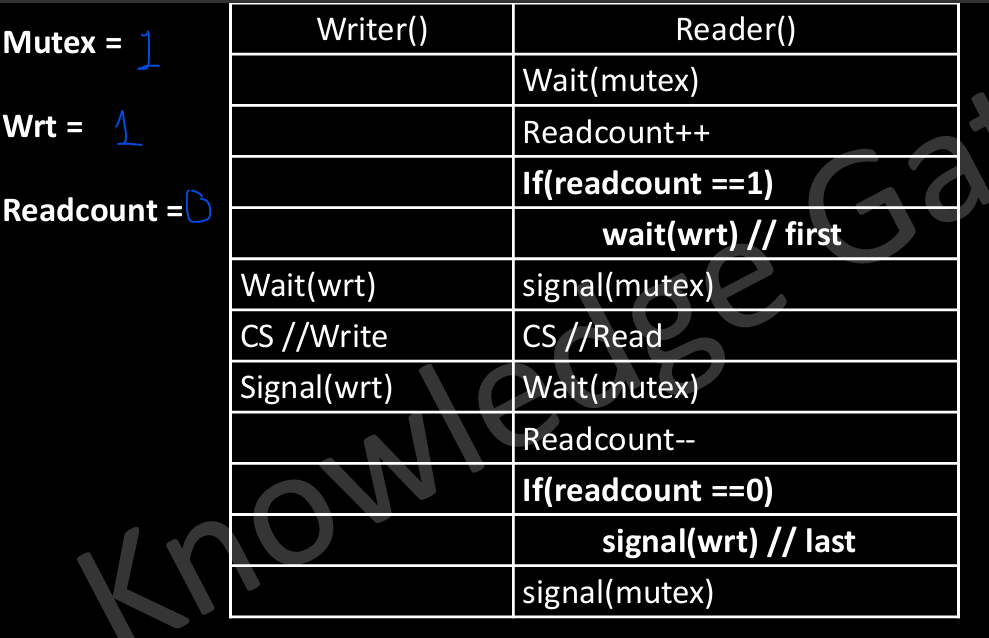
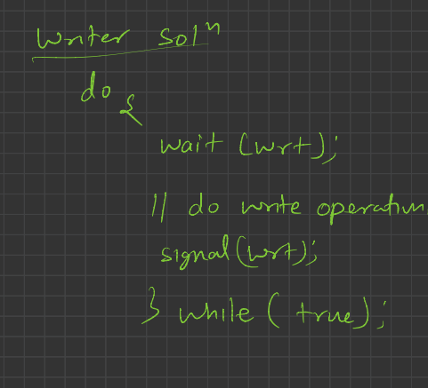
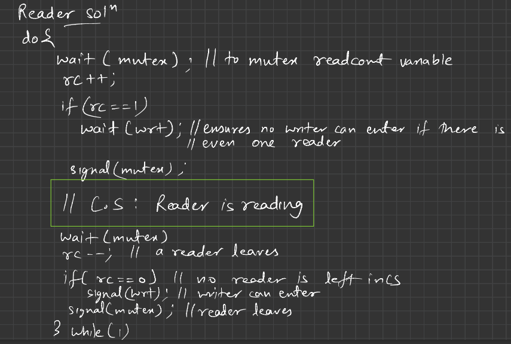

# 4.6.4.2 Reader Writer Problem

Suppose that a database is to be shared among several concurrent processes. Some of these processes may want only to read the database (multiple readers), whereas others may want to update (that is, to read and write) the database( multiple writers).

If two readers access the shared data simultaneously, no adverse effects will result. But, if a writer and some other process (either a reader or a writer) access the database simultaneously, chaos may ensue.

To ensure that these difficulties do not arise, we require that the writers have exclusive access to the shared database while writing to the database.

• Points that needs to be taken care for generating a Solutions:

• The solution may allow more than one reader at a time, but should not allow any writer.

• The solution should strictly not allow any reader or writer, while a writer is performing a write operation.

**Solution using Semaphores **

• The reader processes share the following data structures:

• semaphore mutex = 1, wrt =1; // Two semaphores

• int readcount = 0; // Variable to tell number of reader in critical section

*wrt = whether writer is there*

*mutex = mutual exclusion semaphore*

