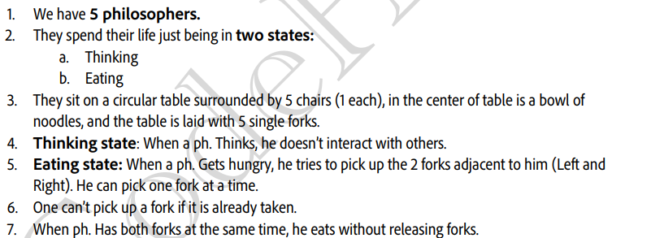
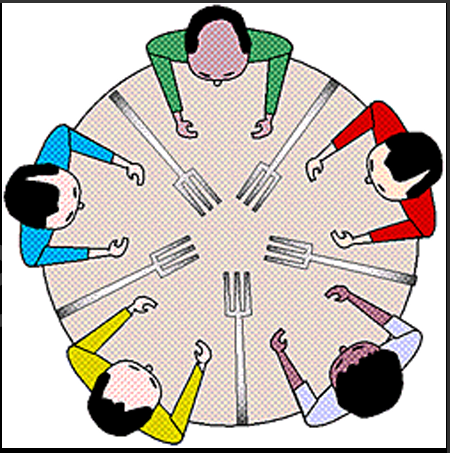
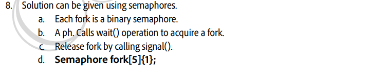
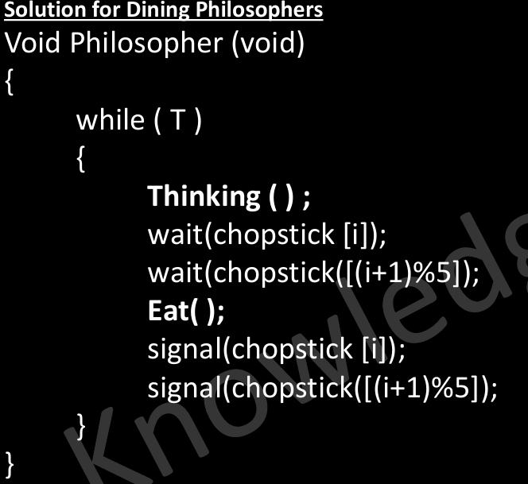
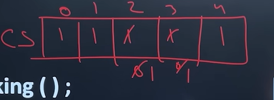
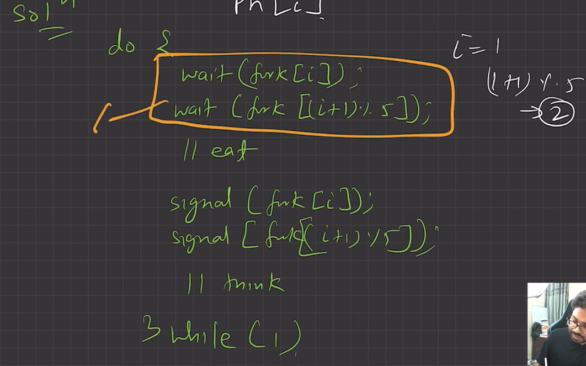
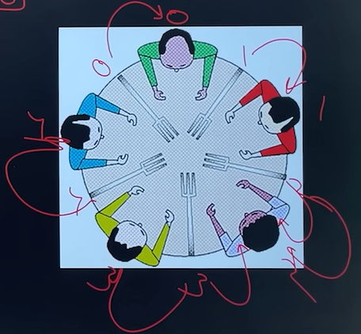
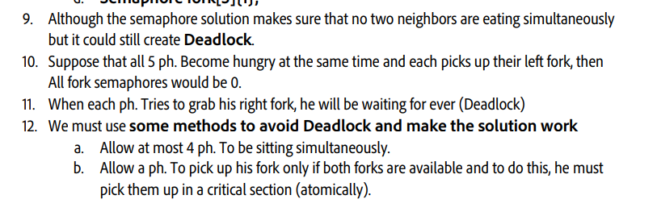
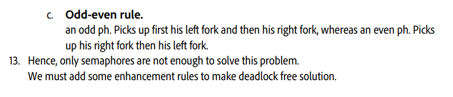

# 4.6.4.3 Dining Philosopher problem (odd)

**• Dining Philosopher problem (odd)**

Consider five philosophers who spend their lives thinking and eating. The philosophers share a circular table surrounded by five chairs, each belonging to one philosopher.

In the center of the table is a bowl of rice, and the table is laid with five single chopsticks.

When a philosopher thinks, she does not interact with her colleagues.

From time to time, a philosopher gets hungry and tries to pick up the two chopsticks that are closest to her (the chopsticks that are between her and her left and right neighbors).

A philosopher may pick up only one chopstick at a time. Obviously, she can’t pick up a chopstick that is already in the hand of a neighbor. When a hungry philosopher has both her chopsticks at the same time, she eats without releasing her chopsticks. When she is finished eating, she puts down both of her chopsticks and starts thinking again.

array of semaphores

example for philosopher number 2 (i=2)

Here we have used an array of semaphores called chopstick\[\]

Solution is not valid because there is a possibility of deadlock. (violates progress)

when each philosopher pick one chopstick = deadlock

  - The **proposed solution for deadlock problem** is

    - Allow at most four philosophers to be sitting simultaneously at the table.

    - Allow six chopstick to be used simultaneously at the table.

    - Allow a philosopher to pick up her chopsticks only if both chopsticks are available (to do this, she must pick them up in a critical section).

  - One philosopher picks up her right chopstick first and then left chop stick, i.e. reverse the sequence of any philosopher.   **n-1 and 1**

  - Odd philosopher picks up first her left chopstick and then her right chopstick, whereas an even philosopher picks up her right chopstick and then her left chopstick. **odd and even**

