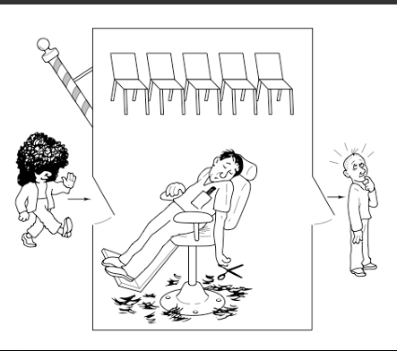
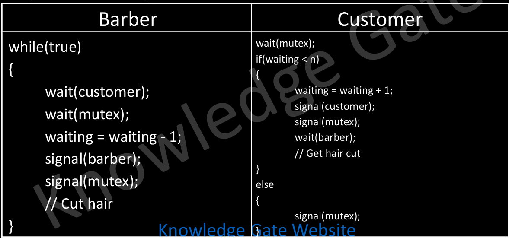

# 4.6.4.4 Sleeping Barber

  - **Barbershop:** A barbershop consists of a waiting room with n chairs and a barber room with one barber chair.

  - **Customers:** Customers arrive at random intervals. If there is an available chair in the waiting room, they sit and wait. If all chairs are taken, they leave.

  - **Barber:** The barber sleeps if there are no customers. If a customer arrives and the barber is asleep, they wake the barber up.

  - **Synchronization:** The challenge is to coordinate the interaction between the barber and the customers using concurrent programming mechanisms.

semaphore barber = 0; // Indicates if the barber is available semaphore customer = 0; // Counts the waiting customers semaphore mutex = 1; // Mutex for critical section

int waiting = 0; // Number of waiting customers

