# 4.7.1 6 - Deadlock

- Threads/processes ko synchronise karte hue jab apne locks lagate hai uss se critical section mututally exclusive way me access hota h

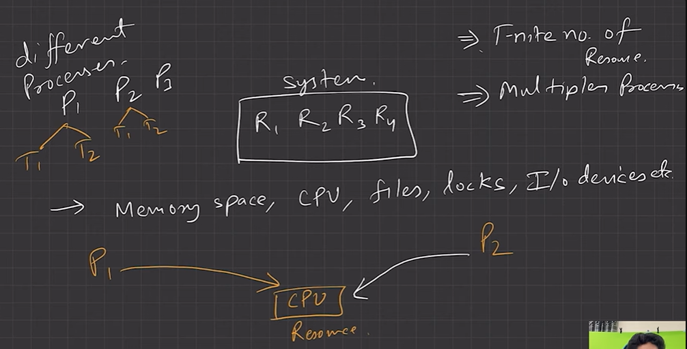

• In a multiprogramming environment, several processes may compete for a finite number of resources.

• A process requests resources; if the resources are not available at that time, the process enters a waiting state. Sometimes, a waiting process is never again able to change state, because the resources it has requested are held by other waiting processes. This situation is called a deadlock.

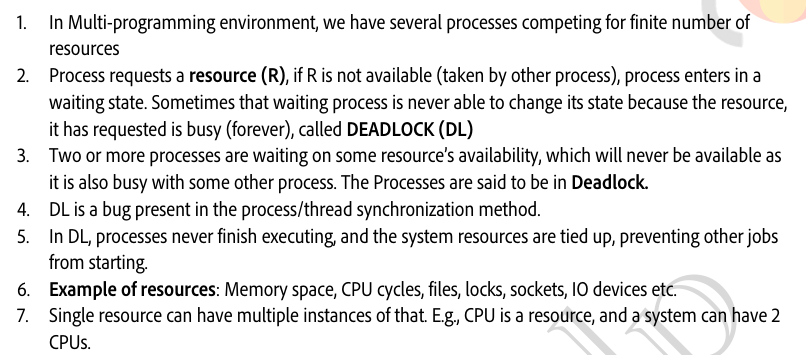

• A set of processes is in a deadlocked state when every process in the set is waiting for an event that can be caused only by another process in the set.

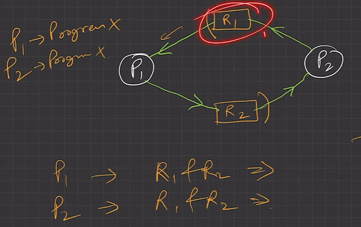

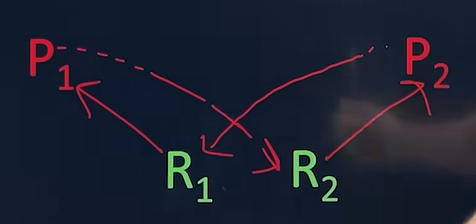

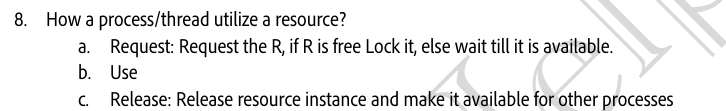

**Necessary conditions for deadlock**

A deadlock can occur if all these 4 conditions occur in the system simultaneously:

• Mutual exclusion

  - At least one resource must be held in a non-sharable mode; that is, only one process at a time can use the resource.

  - If another process requests that resource, the requesting process must be delayed until the resource has been released. And the resource Must be desired by more than one process.

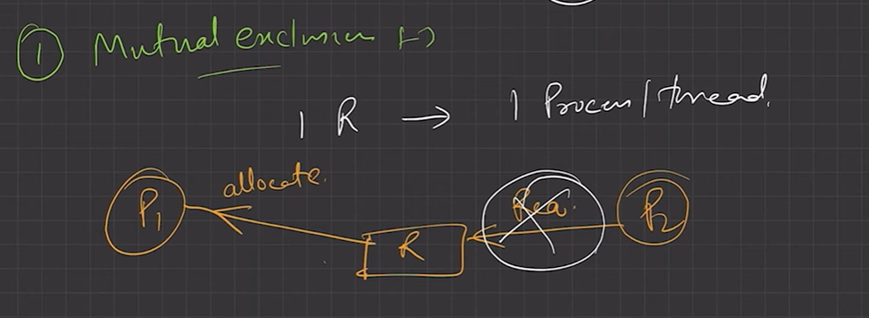

• Hold and wait

  - A process must be holding at least one resource and waiting to acquire additional resources that are currently being held by other processes. E.g. Plate and spoon

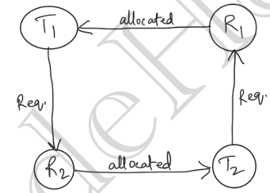

• No pre-emption

  - Resources cannot be pre-empted; that is, a resource can be released only voluntarily by the process holding it, after that process has completed its task.

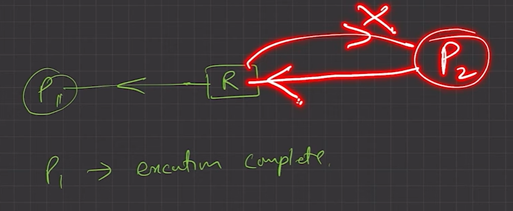

• Circular wait

  - A set P0, P1, ..., Pn of waiting processes must exist such that P0 is waiting for a resource held by P1, P1 is waiting for a resource held by P2, ..., Pn−1 is waiting for a resource held by Pn, and Pn is waiting for a resource held by P0.

  - Wait for graph:

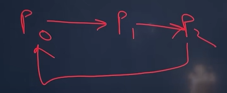

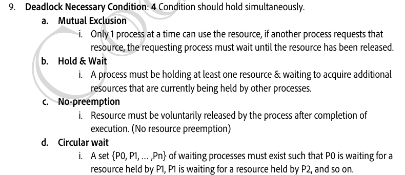

**Deadlock Handling methods **

  - 1. **Prevention: -** Design such protocols that there is no possibility of deadlock.

  - 2. **Avoidance: -** Try to avoid deadlock in run time so ensuring that the system will never enter a deadlocked state.

  - 3.** Detection: -** We can allow the system to enter a deadlocked state, then detect it, and recover.

  - 4.** Ignorance: -** We can ignore the problem altogether and pretend that deadlocks never occur in the system. OSTRICH ALGORITHM

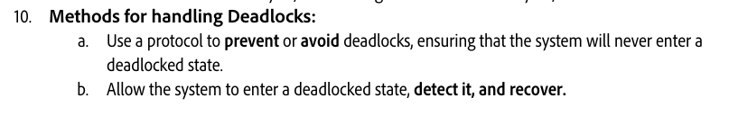

**To ensure that deadlocks never occur, the system can use either a deadlock prevention or deadlock avoidance scheme.**

| [Lecture 21: What is Deadlock \| Necessary Conditions \| Handling Methods \| Part - 1](<https://www.youtube.com/watch?v=pkTekFvauhU&list=PLDzeHZWIZsTr3nwuTegHLa2qlI81QweYG&index=22&pp=iAQB>) | [Lecture 22: Deadlock Avoidance \| Deadlock Detection and Recovery \| Part - 2](<https://www.youtube.com/watch?v=dupdUhx1fns&list=PLDzeHZWIZsTr3nwuTegHLa2qlI81QweYG&index=23&pp=iAQB>) |
| --- | --- |

[L-4.1: DEADLOCK concept \| Example \| Necessary condition \| Operating System](<https://www.youtube.com/watch?v=rWFH6PLOIEI&list=PLxCzCOWd7aiGz9donHRrE9I3Mwn6XdP8p&index=38&pp=iAQB>)

[L-4.2: Resource Allocation Graph in Deadlock \| Single Instance with example \| Operating System](<https://www.youtube.com/watch?v=BW74JYB3QOM&list=PLxCzCOWd7aiGz9donHRrE9I3Mwn6XdP8p&index=39&pp=iAQB>)

[L-4.3: Multi-Instance Resource Allocation Graph with Example \| Operating System](<https://www.youtube.com/watch?v=hJhB2ddOQtg&list=PLxCzCOWd7aiGz9donHRrE9I3Mwn6XdP8p&index=40&pp=iAQB>)

[L-4.3: Multi-Instance Resource Allocation Graph with Example \| Operating System](<https://www.youtube.com/watch?v=hJhB2ddOQtg&list=PLxCzCOWd7aiGz9donHRrE9I3Mwn6XdP8p&index=40&pp=iAQB>)

[L-4.4: Deadlock Handling Methods and Deadlock Prevention \| Operating System](<https://www.youtube.com/watch?v=pPM9Ajqmy_4&list=PLxCzCOWd7aiGz9donHRrE9I3Mwn6XdP8p&index=41&pp=iAQB>)

[L-4.5: Deadlock Avoidance Banker's Algorithm with Example \|With English Subtitles](<https://www.youtube.com/watch?v=7gMLNiEz3nw&list=PLxCzCOWd7aiGz9donHRrE9I3Mwn6XdP8p&index=42&pp=iAQB>)

[L-4.6: GATE 2018 Question on Banker's Algorithm \| Deadlock avoidance \| Operating System](<https://www.youtube.com/watch?v=k8BHyy6gBls&list=PLxCzCOWd7aiGz9donHRrE9I3Mwn6XdP8p&index=43&pp=iAQB>)

[L-4.7: Question Explaination on Deadlock \| Operating System](<https://www.youtube.com/watch?v=mGBjd2WoODs&list=PLxCzCOWd7aiGz9donHRrE9I3Mwn6XdP8p&index=44&pp=iAQB>)

[L-4.8: GATE 2018 Question Explaination on deadlock \| Operating system](<https://www.youtube.com/watch?v=6uEf_F1S-Jo&list=PLxCzCOWd7aiGz9donHRrE9I3Mwn6XdP8p&index=45&pp=iAQB>)
