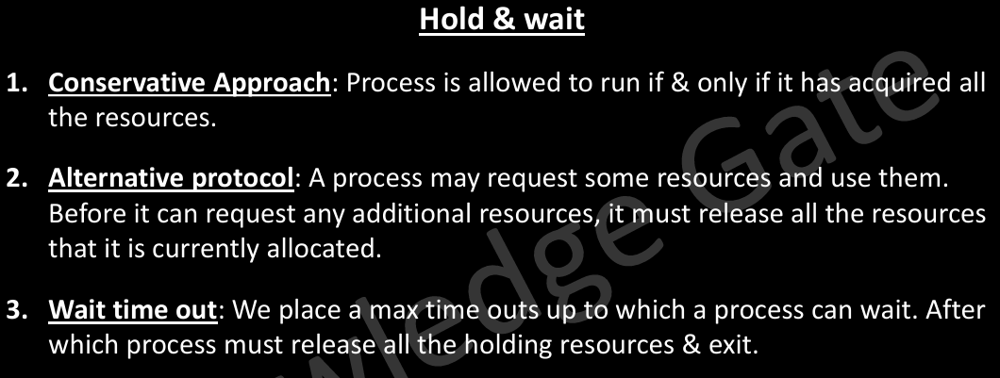
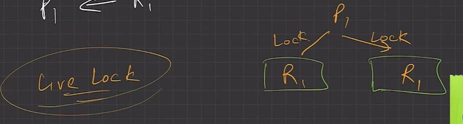
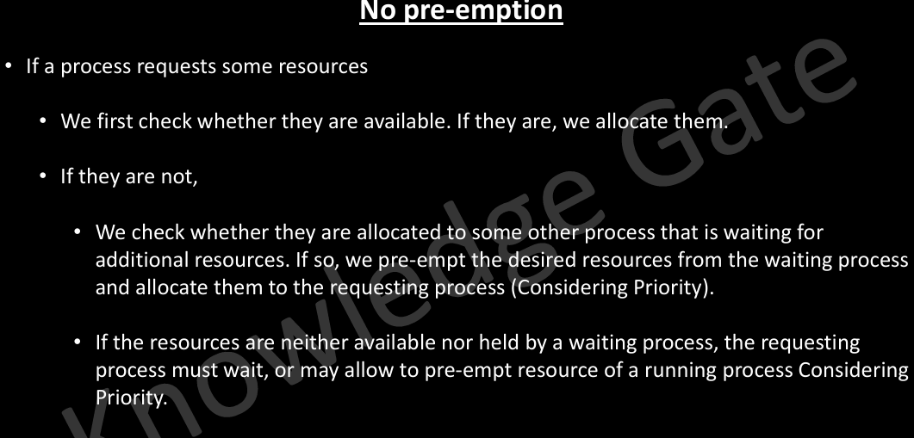
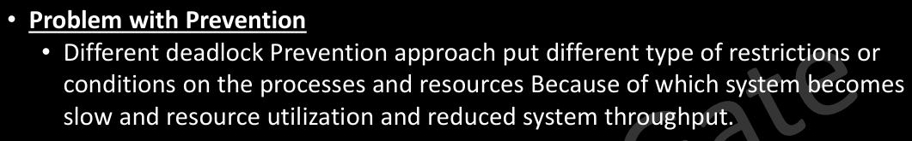

# 4.7.2 Prevention

**Prevention**

It means designing such systems where there is no possibility of existence of deadlock. For that we have to remove one of the four necessary condition of deadlock.

**Mutual exclusion **

  - Use locks (mutual exclusion) only for non-sharable resource.

  - Sharable resources like Read-Only files can be accessed by multiple processes/threads.

  - However, we can’t prevent DLs by denying the mutual-exclusion condition, because some resources are intrinsically non-sharable.

**Hold & Wait **

  - To ensure H&W condition never occurs in the system, we must guarantee that, whenever a process requests a resource, it doesn’t hold any other resource.

  - Protocol (A) can be, each process has to request and be allocated all its resources before its execution.

  - Protocol (B) can be, allow a process to request resources only when it has none. It can request any additional resources after it must have released all the resources that it is currently allocated.

**No preemption **

  - If a process is holding some resources and request another resource that cannot be immediately allocated to it, then all the resources the process is currently holding are preempted. The process will restart only when it can regain its old resources, as well as the new one that it is requesting. (Live Lock may occur).

  - If a process requests some resources, we first check whether they are available. If yes, we allocate them. If not, we check whether they are allocated to some other process that is waiting for additional resources. If so, preempt the desired resource from waiting process and allocate them to the requesting process

High priority process can pre-empt the resource of low priority process.

**Circular wait **

  - To ensure that this condition never holds is to impose a proper ordering of resource allocation.

  - P1 and P2 both require R1 and R1, locking on these resources should be like, both try to lock R1 then R2. By this way which ever process first locks R1 will get R2.

